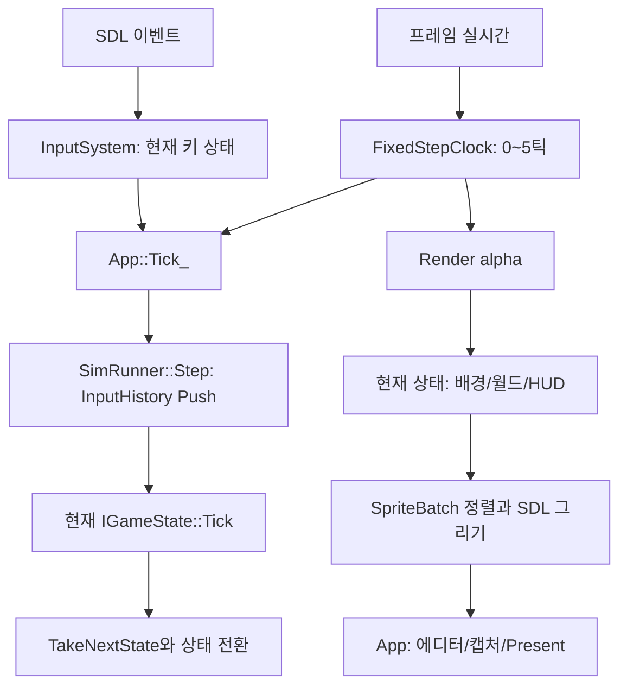

# 01. 실행 루프·입력·렌더링·카메라·월드의 실제 동작

조사일: 2026-10-14. 읽기 시작 시 HEAD는 `0ef7104f1ec6f634ba3ffb42e85119fb313883c2`다. 이 문서는 현재 작업 트리의 구현을 설명한다. 커밋 이력의 작성자와 실제 작성자를 동일시하지 않으며, 과거 문서의 검증 완료 표시를 이번 실행 결과로 사용하지 않는다. 이번 작업에서는 게임 코드 변경, 빌드, 테스트, 캡처를 실행하지 않았다.

기존 `02_Gameplay_Combat_Enemies.md`와 `03_Editor_Data_Audio.md`를 보존하면서 누락되어 있던 실행 기반 설명을 채운다. 플레이어부터 적·보스까지의 구체적인 한 틱은 `02_Gameplay_Combat_Enemies.md`의 §3(틱 순서)·§8(적 14종)에서 이어진다. 표의 수치는 코드 기본값과 현재 파일의 값으로 구분하며, 실행 중 에디터나 튜닝 재로드가 바꾸는 값은 고정 사실로 취급하지 않는다.

## 1. 먼저 잡아야 하는 네 가지 경계

이 프로그램에서 **실시간**, **게임 틱**, **애니메이션 시간**, **화면 픽셀**은 서로 다르다. App은 프레임 사이 실시간을 측정한다. FixedStepClock은 그 시간을 1/60초 단위의 게임 틱으로 나눈다. 게임 상태는 한 틱마다 논리를 진행한다. AnimPlayer는 초를 6,000,000분의 1초 단위 정수로 바꿔 프레임을 고른다. Renderer와 SpriteBatch는 마지막에 월드 좌표를 화면 좌표로 바꾼다. 이 경계를 섞으면 렌더 프레임 수를 공격 쿨다운으로 세거나 스프라이트 크기를 몸 판정으로 오해하게 된다. 근거: [@Source/Core/App.cpp:423], [@Source/Core/FixedStep.h:6], [@Source/Render/Animation.h:7], [@Source/Render/SpriteBatch.cpp:31].

| 값 | 실제 의미 | 대표 쓰기 위치 |
|---|---|---|
| `_deltaTimeSec` | 실제 프레임 사이 초 | App::Run → Update_ |
| `kStepSec` | 게임 논리의 1/60초 | World/Constants.h |
| `m_tickCount` | SimRunner가 Step한 횟수; 상태를 바꿔도 유지 | SimRunner::Step |
| Stage/Sandbox의 틱 | 각 상태가 자신의 Tick에 들어간 횟수 | 상태 Tick |
| `clipTicks` | 적이 선택한 논리 클립의 경과 게임 틱 | EnemyWorld::Tick |
| `m_timeUnits` | AnimPlayer의 경과 정수 애니메이션 시간 | AnimPlayer::Update |
| `position` | 월드의 부동소수 좌표 | 각 게임 객체 |
| Camera::GetPosition | 화면 왼쪽 위의 정수화된 월드 좌표 | Camera::SnapTopLeft_ |
| sprite destination | 월드 원점-카메라-피벗으로 얻은 표시 사각형 | ComputeDestRect |

## 2. 시작과 종료를 직접 따라가기

`main`은 게임 객체를 직접 만들지 않는다. JugX 코어 로그를 게임 stderr 로그에 연결하고, 첫 인자가 `--dump-tuning`이면 기본 튜닝 JSON을 출력하고 끝낸다. 일반 경로에서는 App을 만들어 Run을 호출한다. App::Run은 인자를 문자열 목록으로 보관하고 SDL 비디오를 초기화한 다음 Init_을 호출한다. 메인 루프는 이벤트 처리→Timer::Lap→Update_ 순서이며, 종료 요청을 이벤트 처리 중 받으면 그 프레임의 Update를 생략한다. 근거: [@Source/Main.cpp:10], [@Source/Core/App.cpp:37].

Init_의 읽기 순서가 중요하다. 인자 파싱→기본 상태 선택→에셋 경로/디코드 병렬 폭 계산→애니메이션 정의 로드→Renderer 초기화→에디터 초기화→SpriteBatch 초기화와 atlas 업로드→오디오 초기화→CreateState→SimRunner 생성이다. 애니메이션 정의가 없어도 경고를 내고 진행하지만 Renderer가 실패하면 반환 코드 1로 종료한다. 에디터가 실패하면 에디터만 끄고 게임을 진행한다. 오디오 실패도 무음 실행으로 이어진다. `manifest.json`이 존재하면 기본 상태는 StateFactory가 반환하는 `title`, 없으면 `sandbox`다. 코드의 상태 이름 선택과 실제 Stage 로드 성공 여부는 별개다. 근거: [@Source/Core/App.cpp:261], [@Source/Game/StateFactory.cpp:88].

소유권은 App의 `Scoped<SimRunner>`와 SimRunner의 `Scoped<IGameState>`를 따라간다. SimRunner 생성자는 상태 OnEnter를 호출한다. Step은 현재 입력을 history에 넣고 전체 틱을 증가시킨 뒤 상태 Tick을 호출하고, 상태가 TakeNextState로 넘긴 객체가 있으면 SwitchState를 호출한다. SwitchState의 순서는 이전 OnExit→객체 교체→history.Clear→새 OnEnter다. 같은 Start 입력이 다음 상태의 첫 틱에도 새로 눌린 것으로 남지 않도록 기록이 초기화된다. 객체를 생성했다는 사실만으로 OnEnter가 자동 호출되는 것은 아니다. 근거: [@Source/Game/SimRunner.cpp:5], [@Source/Game/SimRunner.cpp:23], [@Source/Game/SimRunner.cpp:80].

종료는 Runner Reset→Audio Shutdown→SpriteBatch Shutdown→Editor Shutdown→Renderer Shutdown→SDL_Quit 순서다. 상태 OnExit가 아직 살아 있는 렌더/오디오 시스템을 사용할 수 있는 순서다. Renderer와 SpriteBatch의 소멸자도 Shutdown을 호출하고 내부 포인터/목록을 정리한다. **설계 해석:** 상태 생명주기와 외부 장치 생명주기를 구분한 것으로 읽을 수 있다. 이것이 원래 작성 의도였다는 이력 증거는 없다. 근거: [@Source/Core/App.cpp:357], [@Source/Game/SimRunner.cpp:15], [@Source/Render/Renderer.cpp:51].

`IGameState`의 기본 IsFinished는 false, TakeNextState는 null이다. App::Tick_은 IsFinished를 보고 자동으로 끝내지 않는다. 예를 들어 DemoState가 Bomb 입력에 bFinished를 켜도 기본 TakeNextState만 쓰는 한 상태 전환은 생기지 않는다. SimRunner::IsFinished는 그 상태를 조회하는 API다. 근거: [@Source/Game/GameState.cpp:13], [@Source/Core/App.cpp:483], [@Source/Game/DemoState.cpp:29].

## 3. 고정 스텝: 느린 프레임을 처리하는 규칙

FixedStepClock::Advance는 음수 시간을 0, 0.25초를 넘는 시간을 0.25초로 제한하고 accumulator에 더한다. 1/60초 이상 남아 있으면 한 틱을 빼지만 한 프레임에 최대 5틱만 반환한다. 5틱 뒤에도 한 틱 이상 밀려 있으면 나머지 시간을 0으로 버린다. 따라서 장시간 멈췄다가 복귀했을 때 실제로 지난 모든 게임 시간을 복구하는 구현은 아니다. 따라잡기 폭주를 제한하는 계약이다. 근거: [@Source/Core/FixedStep.cpp:3].

계산 예제: 초기 accumulator=0일 때 1/120초 두 번을 넣으면 첫 호출 0틱/alpha≈0.5, 둘째 호출 1틱/alpha≈0이다. 반면 0.25초를 한 번 넣으면 15틱 대신 5틱만 진행하고 밀린 시간을 버린다. 알파는 `남은 초/(1/60초)`이며, 위치의 이전 값과 현재 값 사이를 표시할 때만 사용한다. 부동소수 경계의 정확한 결과는 실제 입력 double의 표현에 달려 있으므로 예제의 ≈ 표시는 의도적이다.

App은 모든 상황에 Advance를 호출하지 않는다. 캡처 틱 목록이 있으면 실시간과 관계없이 렌더 프레임마다 1틱, 디버그 일시정지면 StepOnce가 있을 때만 1틱, 일반 경로면 slow motion에서 시간/4, 에디터에서 배속을 곱한 뒤 Advance한다. 일반적인 속도 변화는 물리 상수를 바꾸는 방식이 아니라 처리할 틱 수를 바꾸는 방식이다. AudioSystem::Update는 먼저 실제 프레임 초로 호출되므로 게임 틱을 멈춰도 오디오의 실시간 페이드는 진행할 수 있다. 근거: [@Source/Core/App.cpp:423].

한 프레임에 3틱을 처리할 때 SDL 이벤트를 세 번 다시 읽지 않는다. PollEvents_에서 바뀐 키 상태를 각 Tick_이 Sample하며 같은 held 프레임이 여러 번 들어갈 수 있다. 첫 틱에서만 false→true가 생기고 다음 틱에는 계속 눌린 상태다. 반대로 두 SDL 샘플 사이에 눌렀다가 뗀 키가 모두 처리되어 최종 키 상태가 false라면 게임 입력 기록에 press가 남지 않을 수 있다. 이벤트 큐를 게임 행동 큐로 저장하는 구현은 아니다. 근거: [@Source/Core/App.cpp:88], [@Source/Core/Input.cpp:62], [@Source/Core/Input.cpp:107].

## 4. 입력을 키 이름에서 게임 행동으로 바꾸는 과정

| 행동 | 키 | 주의점 |
|---|---|---|
| Left/Right/Up/Down | A/D/W/S 또는 방향키 | 같은 행동에 여러 키의 OR |
| Shot | J 또는 Z | 플레이어의 총/칼 판단은 별도 |
| Jump | K 또는 X | 자동 반복 점프가 아님 |
| Bomb | L 또는 C | 폭탄 버퍼는 플레이어가 관리 |
| Start | Enter, 숫자패드 Enter, Space | TitleState의 시작 입력 |
| Pause | Escape | 현재 App은 이 press에 종료함 |

근거: [@Source/Core/Input.cpp:9], [@Source/Core/App.cpp:483].

`eAction::Pause`라는 이름 때문에 Escape가 게임 일시정지라고 설명하면 현재 구현과 다르다. 디버그 pause는 F2가 `g_debug.bPaused`를 뒤집는 기능이고 F3가 한 틱 진행, F4가 slow motion이다. F1은 디버그 그림, F5/F6은 디버그 그림이 켜졌을 때 warp 요청, F7~F10은 무기 요청, 숫자 1~9는 적 생성 요청이다. g_debug는 프레임 경계의 요청/상태를 담고 일부 요청은 상태에서 소비한다. warp와 weapon은 프레임 끝에 미소비 요청도 0으로 버린다. 근거: [@Source/Core/App.cpp:366], [@Source/Core/App.cpp:477], [@Source/Game/GameState.h:8].

InputSystem은 512칸 bool 배열에 scancode의 현재 상태를 기록한다. 이벤트의 키 repeat는 App에서 무시한다. 두 키가 같은 행동을 맡는 경우 J를 놓아도 Z가 눌려 있으면 Shot은 held다. 포커스 상실 시 모든 키를 지우며 에디터가 키보드를 새로 소유할 때도 지운다. 키 up은 에디터 소유 여부와 무관하게 전달된다. 근거: [@Source/Core/Input.h:40], [@Source/Core/App.cpp:88], [@Source/Core/App.cpp:418].

InputHistory는 16개 InputFrame을 순환 저장한다. WasPressedWithin은 현재/이전 held를 비교해 false→true만 찾는다. 검색 길이는 최소 1, 최대 15다. 아직 이전 기록이 없으면 이전을 false로 취급한다. PlayerInputBuffer는 이 history를 그대로 큐처럼 소비하지 않고 별도의 `ticksSincePress`를 가진다. 자세한 입력 소비는 06 문서에서 계산한다. 근거: [@Source/Core/Input.cpp:75], [@Source/Core/Input.cpp:107], [@Source/Game/Player/PlayerInput.cpp:8].

## 5. Base는 어떤 의미를 더하는가

PCH는 Windows.h 뒤에서 GetObject 매크로를 undef하고 JugX 전체 헤더와 `using namespace jug`, 게임 Base/Types를 포함한다. 따라서 Source에서 String, Vector, Scoped, Span, VECTOR2, RngMt19937, Result가 보일 때 먼저 PCH/JugX 타입을 확인한다. Source의 이름만 보고 자체 엔진 컨테이너라고 추정하면 안 된다. Windows 매크로 처리와 라이브러리 API의 이름은 다른 문제다. 근거: [@Source/Base/Pch.h:1].

Base/Types는 `kDefaultZ=INT_MIN` 역할의 미지정 표식과 깊이 이동을 정의한다. ResolveZ는 미지정이면 기본 depth, ZDelta는 미지정이면 0, ZShift는 지정된 z만 다른 기준으로 옮긴다. 예를 들어 플레이어 기본 깊이 20 대신 z=50이면 기본 탄 깊이 30은 60으로 이동한다. z는 세계의 공간 z좌표가 아니라 그림 순서 값이다. 근거: [@Source/Base/Types.h:5], [@Source/Render/SpriteBatch.h:37].

SlugErrorCategory는 JugX Error에 게임 오류 enum을 연결한다. FileOpen, Parse, StageInvalid, EnemyDef 같은 범주와 사람이 읽을 오류 문장을 제공한다. `Result<T>`가 실패한 뒤 정상 값처럼 계속 읽지 않는지 호출부에서 확인해야 한다. ReadAll_은 JugX FileReader로 파일 크기만큼 버퍼를 잡고, 실제 읽은 크기가 정확히 일치하는지 검사한다. WriteFileBytes는 빈 입력도 성공 경로이고 쓰기 실패에 현재 FileRead 코드를 사용한다. 이름에서 자동으로 FileWrite 코드가 있다고 추정하지 않는다. 근거: [@Source/Base/SlugError.h:3], [@Source/Core/AssetPath.cpp:47], [@Source/Core/AssetPath.cpp:113].

FindAssetRoot는 실행 파일 폴더에서 시작해 깊이 0~5의 `Assets`를 찾는다. manifest 또는 Tuning/Tuning.json을 가진 폴더를 유효하다고 본다. 찾지 못하면 설정된 fallback, 그것도 없으면 현재 작업 폴더/Assets다. fallback은 모든 다른 위치보다 우선하는 강제 root가 아니다. 근거: [@Source/Core/AssetPath.cpp:40], [@Source/Core/AssetPath.cpp:71].

JsonFields는 단순 JSON 라이브러리 복제가 아니라 게임 로드 규칙을 더한다. 공통 ReadInt는 double을 llround한다. optional 숫자가 없으면 기존 `_out` 값을 보존한다. Vec2는 정확히 숫자 2개 배열을 받는다. 키 검사에서는 `note`를 늘 허용한다. BOM 허용과 BOM+comments 허용 옵션은 별도이며 로더가 선택한다. Stage/Prop/Enemy의 세부 정수 검증 방식까지 전부 동일한 것은 아니다. 근거: [@Source/Base/JsonFields.cpp:48], [@Source/Base/JsonFields.cpp:84], [@Source/Base/JsonFields.cpp:148], [@Source/Base/JsonFields.cpp:181].

Log는 stderr로 prefix+message를 출력한다. EventLogFormat은 event log가 열렸을 때만 추가 필드를 포맷하고 WriteEventLog는 현재 tick, event 이름, 호출자가 만든 필드를 JSON 한 줄로 기록하고 flush한다. event log는 InputFrame을 저장하고 다시 실행하는 리플레이 기능이 아니다. 현재 SimRunner::Run 역시 이미 주어진 입력 배열을 Step하는 함수이며 파일 리플레이 로더를 뜻하지 않는다. 근거: [@Source/Base/Log.h:23], [@Source/Base/Log.cpp:98], [@Source/Game/SimRunner.cpp:42].

## 6. 애니메이션 정의와 재생기의 책임 차이

AnimationLibrary는 클립 이름→인덱스와 AnimClip 목록을 소유한다. 정의를 로드할 때 atlas 목록과 anim 파일 경로를 manifest에서 읽는다. 이것만으로 SDL_Texture가 생기지 않는다. 텍스처는 SpriteBatch가 별도로 디코드/업로드한다. AddClip은 같은 이름을 교체하면 기존 인덱스를 유지한다. 새 이름은 끝에 추가한다. 포인터나 참조는 Vector 재할당/교체 후 그대로 유효하다고 가정하면 안 된다. 근거: [@Source/Render/Animation.cpp:194], [@Source/Render/Animation.cpp:244].

AnimFrame은 atlas index, atlas 내부 잘라 읽을 x/y/w/h, 표시 원점의 pivotX/Y다. AnimClip은 loop, loopStart, 한 프레임 초, cell 크기, frame 목록이다. 게임 몸 크기와 피격 상자는 여기에 없다. 스프라이트가 큰 적이라도 body/hurtbox가 다른 크기를 가질 수 있다. SpriteLibrary는 애니메이션이 아닌 이름 있는 단일 sprite의 atlas frame 또는 standalone 파일/크기를 저장한다. `file` 키가 있으면 standalone 분기다. 근거: [@Source/Render/Animation.h:12], [@Source/Render/SpriteLibrary.cpp:9].

AnimPlayer는 Play에서 클립이 달라지거나 restart=true일 때 시간/프레임/finished를 0으로 되돌린다. Update는 `_dt*_speed`를 정수 단위로 반올림해 시간에 더하고 Settle_로 프레임을 정한다. 무효 클립이나 finished 클립은 진행하지 않는다. `Update`의 bool은 “현재 프레임 index가 달라졌는가”이며 “클립이 끝났는가”는 IsFinished로 묻는다. 근거: [@Source/Render/Animation.cpp:295], [@Source/Render/Animation.cpp:310].

6,000,000 units/sec에서 1/60초는 약 100,000 units다. frameDuration=0.1초이면 600,000 units, 따라서 정상 고정 틱 6번마다 다음 frame이다. loopStart=2인 5프레임 클립은 첫 바퀴 0,1,2,3,4를 지난 뒤 2,3,4만 반복한다. 시간이 총 길이를 넘으면 `loopStartUnits+(time-loopStartUnits)%loopLenUnits`를 사용한다. 비반복 클립은 마지막 frame에서 finished를 켜고 time을 total로 고정한다. 근거: [@Source/Render/Animation.cpp:327].

SetNormalizedTime은 loop 클립에서 t의 소수 부분만 사용한다. loop의 t=1은 마지막 프레임이 아니라 처음으로 돌아간다. 비loop에서는 t를 0~1로 제한한다. SyncPhase는 다른 재생기의 시간×내 전체 길이/다른 전체 길이를 사용하여 상·하체의 상대 위상을 맞춘다. 동일 프레임 수나 동일 frameDuration을 강제하는 구현이 아니다. 근거: [@Source/Render/Animation.cpp:370], [@Source/Render/Animation.cpp:390].

게임의 적 ClipDef와 표시 AnimClip은 별개의 데이터 경계다. 적 AI의 `ClipReachedFrame`은 논리 clipTicks가 TickOfFrame과 정확히 같은 틱인지 검사한다. 표시 데이터의 프레임 초를 바꿨는데 적 정의의 frameSec/frames를 맞추지 않으면 발사 틱과 그림 타이밍이 달라질 수 있다. 이 문서는 현재 두 자료가 모든 항목에서 일치한다고 주장하지 않는다. 근거: [@Source/Game/Enemies/EnemyCommon.cpp:91], [@Source/Game/Enemies/EnemyDef.cpp:56].

## 7. 이미지를 읽는 일과 SDL에 올리는 일

SpriteBatch::DecodeImages는 path별 결과 칸을 미리 만들고, 단일 모드에서는 순서대로, 병렬 모드에서는 `std::execution::par`로 각 칸을 채운다. 이미지는 ReadFileBytes→stb PNG decode→RGBA 복사→선택적으로 flash RGBA 생성 순서다. 워커 안에서 SDL_Texture를 만들지 않는다. 반환 배열의 위치가 요청 경로 위치이므로 완료 순서가 달라도 atlas index를 바꾸지 않는다. `_numWorkers`가 병렬 알고리즘의 실제 스레드 개수를 직접 지정하는 것은 아니며 로드 상위 함수에서 한 번에 처리할 이미지 묶음 폭을 정한다. 근거: [@Source/Render/SpriteBatch.cpp:101], [@Source/Render/SpriteBatch.cpp:258], [@Source/Render/SpriteBatch.cpp:432].

LoadAtlasPagesParallel은 묶음 디코드가 끝난 뒤 호출 스레드에서 요청 순서로 AddAtlasPage를 한다. 페이지 하나라도 실패하면 false로 멈추고 이미 추가한 페이지를 한꺼번에 rollback하지 않는다. App은 이 반환값을 void로 버리는 현재 호출을 가지고 있다. Standalone 목록 로드는 실패한 위치의 handle=-1을 남기고 나머지를 진행한다. “병렬 로드 전체가 비동기로 게임 뒤에서 계속된다”는 구조는 현재 소스가 보여 주지 않는다. 근거: [@Source/Render/SpriteBatch.cpp:432], [@Source/Render/SpriteBatch.cpp:463], [@Source/Core/App.cpp:319].

atlas 페이지는 정상/flash SDL texture 쌍이다. flashAmount≥0.5이고 flash texture가 있으면 flash texture를 고른다. 피격 밝기 float에 비례해 두 이미지를 연속 혼합하는 구현은 아니다. ApplyHitFlashRamp는 원본 RGBA를 주황 계열로 매핑하고 alpha를 보존하며, 만들어진 texture에 tint/alpha modulation을 적용한다. 근거: [@Source/Render/SpriteBatch.cpp:220], [@Source/Render/SpriteBatch.cpp:281], [@Source/Render/SpriteBatch.cpp:290].

큰 standalone 이미지는 가로 strip으로 나누어 업로드한다. 그릴 때 화면에 필요한 source 구간이 걸친 strip마다 source/destination를 잘라 제출한다. atlas의 부분 sprite와 standalone의 전체 이미지 경로가 같은 저장소는 아니다. 테스트의 wide texture 예제가 이 strip 경계를 다룬다. 근거: [@Source/Render/SpriteBatch.cpp:489], [@Source/Render/SpriteBatch.cpp:539], [@Test/SpriteBatchTest.cpp:372].

## 8. 피벗·반전·깊이 정렬을 숫자로 계산하기

ComputeDestRect는 먼저 `floor(worldOrigin-camera)`를 구한다. width/height는 frame 값을 그대로 둔다. 보통 left=originX-pivotX, 좌우 반전이면 left=originX+pivotX-width다. 반전은 왼쪽 위를 고정하는 게 아니라 같은 원점 주위에 sprite를 뒤집는다. y도 flipY에서 같은 규칙이다. 근거: [@Source/Render/SpriteBatch.cpp:31].

예를 들어 frame w=40/h=60, pivot=(10,50), world=(100.75,200.25), camera=(20,100)이면 origin=(80,100), 정상 dst=(70,50,40,60), flipX dst=(50,50,40,60)다. 두 경우 모두 피벗이 놓이는 화면 원점은 (80,100)이다. 음수 -0.2는 0이 아니라 floor로 -1이 된다. 실수 원점 때문에 매 프레임 sprite 폭을 ceil/floor로 다시 계산하여 39/40px로 흔드는 구현은 아니다.

scale을 적용할 때는 반전 후 피벗 위치 cx/cy를 사용해 dst에 `pivot*(1-scale)`를 더하고 w/h에 scale을 곱한다. 회전은 같은 피벗을 SDL rotation center로 전달한다. Scale/rotation은 표시 변화이며 몸/hitbox 크기를 자동으로 수정하지 않는다. standalone command의 표시 경로는 중심 기준이고 tint만 사용하며 atlas DrawFrame의 flip/rotation 옵션과 완전히 같은 처리라고 설명할 수 없다. 근거: [@Source/Render/SpriteBatch.cpp:663], [@Source/Render/SpriteBatch.cpp:806].

Submit은 그 자리에서 그리지 않고 depth, sortKey, 증가하는 seq, frame, origin, options를 command에 복사한다. Flush는 depth 오름차순→sortKey 오름차순→seq 오름차순으로 그린다. 뒤에 그린 불투명 픽셀이 앞을 덮으므로 큰 depth가 앞이다. 같은 depth에서 발 y를 sortKey로 주면 아래쪽 발을 가진 캐릭터가 나중에 그려진다. sortKey의 뜻은 호출자가 정하므로 건물의 x 기반 순서나 부위별 offset도 가능하다. 근거: [@Source/Render/SpriteBatch.cpp:49], [@Source/Render/SpriteBatch.cpp:745], [@Source/Game/Props/PropWorld.cpp:674].

StageState 렌더의 실제 순서는 BeginFrame→보간 카메라→배경→Enemy Submit→terrainDepth보다 낮은 command만 Flush→지형 standalone 직접 그리기→플레이어/탄/폭탄/Props/Effects Submit→남은 command Flush→debug→HUD/결과/전면 그림/페이드/배너다. Props는 terrain 전에 Submit하지 않기 때문에 Props의 depth를 낮게 준 것만으로 앞선 terrain flush에 들어갈 수 없다. 직접 DrawFrame/FillRect와 command Submit의 순서를 함께 읽어야 그림 전체 순서를 설명할 수 있다. 근거: [@Source/Game/Stage/StageState.cpp:862], [@Source/Game/Stage/StageState.cpp:942], [@Source/Game/Ui/UiSystem.cpp:283].

App은 상태 Render 뒤 에디터를 그리고 캡처가 필요하면 present 전 스크린샷을 저장한 뒤 EndFrame을 호출한다. Renderer는 SDL 창/렌더러의 소유자이며 논리 크기는 640×448, 정수 배율 logical presentation과 VSync를 설정한다. 실제 창 배율과 논리 좌표를 구별해야 한다. 근거: [@Source/Core/App.cpp:494], [@Source/Render/Renderer.cpp:21], [@Source/Render/Renderer.h:12].

## 9. 카메라는 단일 Lerp가 아니다

Camera는 화면 중심 `m_center`를 내부 실수로 관리하고 GetPosition에서 왼쪽 위를 정수화한다. SnapTopLeft_의 반올림은 floor(x+0.5)다. 그 뒤 bounds의 ceil(min)~floor(max-viewSize) 안에 놓는다. bounds가 view보다 작으면 가운데에 배치한다. Body.position 같은 발 좌표와 카메라 center를 같은 의미로 쓰면 추적 높이가 어긋난다. StageRunner는 목표를 player feet.y-60+offset으로 만든다. 근거: [@Source/Render/Camera.cpp:289], [@Source/Render/Camera.cpp:317], [@Source/Game/Stage/StageRunner.cpp:182].

추적의 출발은 deadzone이다. focus가 center±half 안에 있으면 desired=center라 움직이지 않는다. 밖에 있으면 desired=focus-half 또는 focus+half다. forwardOnly는 desired.x를 기존 center 이상으로 제한하고, forwardOnlyY도 같은 규칙으로 아래 방향만 허용한다. 자동 scrollFloor가 있으면 x의 최소 목표를 더한다. 마지막에 bounds로 제한한다. 근거: [@Source/Render/Camera.cpp:80], [@Source/Render/Camera.cpp:495].

가로 StepX_는 보통 px/tick 값을 사용한다. 96px 이상 벌어지면 glide에 들어가, 한 틱 속도 변화≤1, 최대 걸음 12, BrakeSpeed에 의한 감속으로 따라간다. 평소 추적에서는 focus가 같은 방향으로 이동한 양을 받아 pushSpeed를 1부터 시작하고 틱마다 0.19씩 증가시키며, 플레이어가 멈추면 ×0.8로 감쇠한다. 새 걸음은 gap, pushSpeed, 직전 걸음×1.5 또는 최소1, BrakeSpeed 중 최솟값이다. 따라서 추적 속도가 player runSpeed처럼 px/sec로만 표현되어 있지 않다. 근거: [@Source/Render/Camera.cpp:389].

세로는 임계감쇠 스프링 근사 SmoothDamp_를 사용한다. omega=2/smoothTime와 dt로 지수감쇠의 근사식을 만들고 overshoot를 제한한다. 그 결과 걸음을 다시 직전 세로 걸음±1과 BrakeSpeed 범위로 제한한다. Camera::Update가 dt를 받더라도 가로 acceleration/걸음 제약과 explicit move 경과는 틱 기반이다. 가변 dt를 임의로 주면 모든 축이 완전한 시간 독립성을 갖는다고 주장할 수 없다. 근거: [@Source/Render/Camera.cpp:48], [@Source/Render/Camera.cpp:529].

SetBounds는 목표 bounds를 바꾸지만 m_effBounds는 바로 모두 교체하지 않는다. ApproachEdge_는 영역이 줄어드는 쪽 가장자리를 틱마다 다가가게 하고, 영역이 풀리는 방향은 바로 목표로 맞춘다. Lock은 lockRect를 effective로 설정하고 카메라가 멀거나 움직이고 있으면 0.5초 기본 correction move를 시작한다. Unlock은 locked/pendingLock만 해제한다. 게임의 여러 lock stack을 관리하는 곳은 Camera가 아니라 StageRunner다. 근거: [@Source/Render/Camera.cpp:111], [@Source/Render/Camera.cpp:123], [@Source/Render/Camera.cpp:245], [@Source/Game/Stage/StageRunner.cpp:597].

BeginMove는 seconds를 틱으로 반올림하되 거리와 현재 속도로 MinMoveTicks_를 계산해 더 긴 쪽을 쓴다. 시작 속도를 가진 cubic Hermite 보간(h00/h10/h01)으로 이동하고 끝 속도는 0이다. 원래 속도가 0이면 smoothstep 형태가 된다. 요청한 seconds보다 실제 이동이 길어질 수 있다. LockWithGlide는 pending lock을 두고 이동 도착 시 Lock을 적용한다. 이동 중 bounds가 바뀌면 목표도 틱당2까지 접근한다. 근거: [@Source/Render/Camera.cpp:157], [@Source/Render/Camera.cpp:193], [@Source/Render/Camera.cpp:454].

AddScrollFloor는 처음 center.x를 기준으로 누적 최소 x를 만든다. ShiftLock은 pending lock과 이동 목적지, 실제 lock/effective bounds를 옮긴다. 보스가 카메라 전진을 요청하면 StageRunner는 lock이 있을 때 stack의 마지막 rect와 Camera의 lock을 같이 옮기고, 없을 때 scroll floor에 더한다. 실제 카메라와 JSON 스크립트의 잠금 상태를 둘 다 유지하는 이유가 여기 있다. 근거: [@Source/Render/Camera.cpp:336], [@Source/Render/Camera.cpp:347], [@Source/Game/Stage/StageRunner.cpp:238].

## 10. World: 좌표와 충돌을 최소 예제로 이해하기

월드 좌표는 오른쪽 +x, 아래 +y다. Body.position은 발의 가운데이고 Body.GetBox는 bottom-center로 상자를 만든다. size=(20,58), feet=(100,200)이면 min=(90,142), max=(110,200)이다. 점프 속도 y는 음수이고 중력은 양수다. sprite origin과 발 좌표의 차이는 PlayerRig의 baseline에서 처리한다. 근거: [@Source/World/Physics.cpp:552], [@Source/World/Geometry.cpp:30], [@Source/Game/Player/PlayerRig.cpp:340].

Aabb::Overlaps는 `<`와 `>`이므로 면만 닿으면 겹치지 않는다. 점 Contains는 min 포함/max 제외이고, 다른 Aabb Contains는 바깥 상자의 max까지 허용한다. Empty는 max≤min인 축이 있을 때다. 면 접촉을 착지로 판단하는 Physics와 면 접촉을 공격 적중으로 판단하지 않는 HitResolver의 계약이 같지 않다. 근거: [@Source/World/Geometry.h:29], [@Source/World/Geometry.cpp:60].

GroundMap은 1px당1bit, row stride=(width+7)/8이다. SetSolid의 byte offset은 y×stride+(x>>3), mask=1<<(x&7)이다. 기본 bounds policy는 아래 밖만 고체다. 음수 x/y를 unsigned로 바꾸어 범위 검사하므로 음수도 정상적으로 바깥 정책으로 처리한다. IsSolidAt은 실수 좌표를 floor한다. FindGroundY는 fromY에서 fromY+maxDist까지 포함하여 아래로 첫 solid를 찾는다. 근거: [@Source/World/GroundMap.cpp:10], [@Source/World/GroundMap.cpp:96], [@Source/World/GroundMap.cpp:144], [@Source/World/GroundMap.cpp:214].

IsRectSolid는 뒤집힌 입력 범위를 정렬하고, 첫/끝 byte에 mask를 씌워 구간의 **고체가 하나라도 있는지** 검사한다. 이름을 “사각형 전체가 고체인지”로 읽으면 잘못이다. periodic tail은 IsSolid에서 x≥from을 tailX+(x-from)%tailW로 치환하며 MaterializeTail은 반복 구간을 실제 더 넓은 bitmap으로 복사한다. IsRectSolid 자체는 현재 원래 width로 clip하는 경로이므로 IsSolid의 tail 치환을 모든 사각형 쿼리에 자동 적용한다고 설명하지 않는다. 근거: [@Source/World/GroundMap.cpp:157], [@Source/World/GroundMap.cpp:287], [@Source/World/GroundMap.cpp:66].

Physics::Step의 순서는 이전 grounded 기록→상승속도면 grounded 해제→dropThroughSteps 소비→가로 이동→접지 재확인→공중이면 중력/종단속도/세로 이동→MoveResult 작성이다. 가로와 세로는 각각 ceil(abs(이동량))개의 최대1px substep으로 나뉜다. 전체 이동 선분을 한 번에 정확한 연속 충돌 수식으로 해결하는 엔진은 아니다. 근거: [@Source/World/Physics.cpp:345], [@Source/World/Physics.cpp:387], [@Source/World/Physics.cpp:469].

FindSupport_는 발 센서 `max(footHalfWidth,0.5)`에 걸리는 bitmap 열, platform 윗면, wall 윗면 중 가능한 범위의 가장 작은 y를 선택한다. grounded 이동에는 maxStepUp 위/ maxSnapDown 아래 범위로 support를 다시 찾고, 올라갈 때 머리 공간이 막히면 가로 이동을 취소한다. 공중에는 step-up zone=0이라 낮은 턱을 순간이동해 오르지 않는다. 상·하좌우 충돌은 body 전체 폭과 발 센서 폭을 각각 다르게 사용한다. 근거: [@Source/World/Physics.cpp:44], [@Source/World/Physics.cpp:314], [@Source/World/Physics.cpp:359].

one-way platform은 아래에서 올라갈 때 천장/측면으로 막지 않고, 내려오는 발이 위쪽 면을 통과할 때만 받친다. RequestDropThrough는 남은 틱 수를 기록할 뿐 position을 직접 아래로 밀지 않는다. 지원 검색에서 one-way를 빼면 grounded가 풀리고 이후 중력으로 내려간다. 지형 bitmap이나 solid wall을 통과하게 만드는 옵션이 아니다. 근거: [@Source/World/Physics.cpp:94], [@Source/World/Physics.cpp:407], [@Source/World/Physics.cpp:484], [@Source/World/Physics.cpp:557].

초기 공중 velocity=(250,-600), dt=1/60, gravity=1400이면 가로 약4.1667px 뒤 vy≈-576.6667, 세로 약-9.6111px다. 중력을 더한 속도로 이동하는 semi-implicit Euler 순서이므로 연속식 `y=y0+v0*t+0.5*g*t²`와 첫 틱 값이 정확히 같지 않다. ground normal은 좌우4px의 높이를 ±8px 범위에서 찾아 slope=(rightY-leftY)/8, normal=(slope,-1)/sqrt(slope²+1)이다. 이는 측정 결과이며 body를 normal 방향으로 회전시키는 코드가 아니다. 근거: [@Source/World/Physics.cpp:499], [@Source/World/Physics.cpp:522], [@Source/World/GroundMap.cpp:235].

## 11. World/Combat은 피해량을 적용하지 않는다

HitResolver는 Hitbox와 Hurtbox를 순서대로 중첩 순회한다. 팀 행렬, invulnerable, accepts mask, 같은 owner, Aabb 겹침을 통과하면 HitEvent를 만든다. Player→Enemy/Neutral, Enemy→Player, Neutral→Player/Enemy다. 실제 HP 차감은 적/소품/연습 표적의 OnHitEvents가 맡고 플레이어는 피해량과 별개로 Kill을 호출한다. 근거: [@Source/World/Combat.cpp:17], [@Source/World/Combat.cpp:161], [@Source/Game/Player/PlayerController.cpp:98].

tracked hit id마다 맞힌 target owner를 저장한다. 여러 hurtbox가 같은 owner면 관통 공격도 한 번만 적중한다. owner가 없으면 hurtbox index 기반 임시 key를 사용하므로 등록 순서 변경이 key 의미를 바꿀 수 있다. 비관통 공격은 첫 유효 hurtbox 뒤 consumed=true, 관통은 같은 owner 재적중만 막는다. `kNoHitId`인 untracked 공격은 매 Resolve마다 다시 맞을 수 있다. Release(id)를 호출해야 그 id의 기록이 사라지며, CombatSystem::BeginTick은 판정 목록만 지우고 resolver 기록은 유지한다. 근거: [@Source/World/Combat.cpp:9], [@Source/World/Combat.cpp:62], [@Source/Game/Combat/CombatSystem.cpp:5].

이 방식은 공간 분할이 없는 O(hitbox수×hurtbox수) 기본 검사다. 첫 적중은 기하학적으로 가장 가까운 대상이 아니라 등록 index의 앞선 대상이다. 특정 수의 적에서 성능이 충분한지는 이번 정적 조사로 측정하지 않았다. Health::ApplyDamage는 양수 피해만, 현재 HP까지 차감하고 실제 적용량을 반환한다. Boss turret와 같이 자체 HP 배열을 가진 override는 공통 Health와 세부 동작이 다를 수 있다. 근거: [@Source/World/Combat.cpp:23], [@Source/World/Combat.cpp:190], [@Source/Game/Enemies/BigShiee.cpp:426].

## 12. UI도 데이터와 시간과 그리기를 나눈다

HUD의 MakeHudModel은 플레이어 lives/score/ammo/bombs를 읽는다. BuildHudItems는 layout의 좌표와 모델을 Text/Sprite/Rect/TimeDigits 목록으로 바꾼다. UiSystem::DrawHud가 이를 즉시 그린다. HUD 모델의 infinite는 현재 무기가 Pistol인지에 따른 유한 탄 여부다. 에디터의 매 틱 탄 보충 옵션과 같은 뜻이 아니다. 표시 숫자는 score≤9,999,999, ammo≤999, bombs≤99, timer≤99로 잘라 보여 주며 실제 저장값 자체를 이 범위로 고치는 것은 아니다. 근거: [@Source/Game/Ui/Hud.cpp:45], [@Source/Game/Ui/Hud.cpp:69], [@Source/Game/Ui/UiSystem.cpp:97].

BitmapFont는 font strip에서 glyph를 잘라 그린다. A~Z와1~9가 slot을 갖고0은 O glyph로 매핑한다. 소문자는 대문자로 바뀐다. 줄마다 left/center/right를 계산하고 glyph 크기·letterSpacing·lineGap으로 quad를 만든다. atlas font가 없을 때 SDL debug font를 사용하지만 일반적인 Unicode 한글 조판 시스템은 아니다. timer는 별도32px 숫자 strip을 사용한다. 근거: [@Source/Game/Ui/BitmapFont.cpp:39], [@Source/Game/Ui/BitmapFont.cpp:129], [@Source/Game/Ui/BitmapFont.cpp:168], [@Source/Game/Ui/BitmapFont.cpp:242].

BannerSystem은 Show마다 현재 배너를 교체하고 경과 틱0으로 시작한다. 큐가 아니다. 일반 alpha는 fade-in/hold/fade-out으로 계산하며 mission 글자 pose는 index%4 방향에서170px를 이동한다. 진입은 `1-(1-t)^3`, 퇴장은 `t³`, 글자마다 제한된 지연이 있다. UI_Mission 이름으로 만든 큰 글자와 일반 font의 표시 경로를 구분해야 한다. 근거: [@Source/Game/Ui/Banner.cpp:32], [@Source/Game/Ui/Banner.cpp:54], [@Source/Game/Ui/Banner.cpp:151].

FadeController는 현재alpha→targetalpha를 요청 틱 수로 나눈 step을 저장하고 매 틱 감소시킨다. 마지막 틱에는 target으로 정확히 놓고 phase를 Clear/Black으로 바꾼다. ticks≤0 또는 이미 목적지면 즉시 끝난다. UI Tick이 호출되지 않는 구간에서는 페이드도 진행하지 않는다. 근거: [@Source/Game/Ui/FadeController.cpp:26], [@Source/Game/Ui/FadeController.cpp:61].

ScreenFlow는 하나의 누적 elapsed를 Delay→Results→Banner/Art→FadeOut→Hold→Done의 경계와 비교한다. 각 단계별 타이머를 따로 다시 시작하는 방식이 아니다. Start는 BGM을 fade/stop하고 elapsed0에서도 Advance하여 길이0인 단계를 넘긴다. 조건들이 독립 if라 한 호출에서 여러 단계가 넘어갈 수 있다. 게임오버 기본 flow는 helmet art fade-in30+hold180, black fade40, hold20이며 총270틱이다. mission은 delay60+results(12+6×rescued+18+150)+banner210+fade90+hold30이다. 근거: [@Source/Game/Ui/ScreenFlow.cpp:11], [@Source/Game/Ui/ScreenFlow.cpp:62], [@Source/Game/Ui/ScreenFlow.cpp:98], [@Source/Game/Ui/ScreenFlow.cpp:220].

mission bonus는 구출1명당10,000, 8명 이상100,000 rank 추가,15명 이상220,000 rank 추가다. 결과 view는 그 점수가 집계되는 모습을 만들며 실제 player score에 더하는 호출은 상태가 책임진다. StageState는 end flow 도중 UI/flow만 Tick하고 월드를 멈춘다. 타이틀은 시작 press가 inputDelay를 넘겼을 때 fade-out을 시작하고 페이드가 끝나면 다음 상태 객체를 만든다. 근거: [@Source/Game/Ui/ScreenFlow.cpp:27], [@Source/Game/Ui/ScreenFlow.cpp:55], [@Source/Game/Stage/StageState.cpp:319], [@Source/Game/TitleState.cpp:79].

## 13. 학습용 읽기 순서와 스스로 답할 질문

아래 질문은 실행을 요구하지 않는 소스 읽기 연습이다. 값이나 분기 순서를 한 줄씩 적어서 답하고, 마지막에 해당 소스로 돌아가 확인한다.

| 순서 | 읽을 함수 | 스스로 설명할 과제 |
|---|---|---|
| 1 | main→App::Run→Init_ | 애니메이션 JSON 성공/Renderer 실패/오디오 실패는 각각 어떻게 처리되는가? |
| 2 | FixedStepClock::Advance→App::Update_ | 0.25초 정지 뒤 게임이15틱 진행하지 않는 이유를 계산하라. |
| 3 | InputSystem::Sample→InputHistory::Push | J와Z를 같이 누르고 J만 놓았을 때 press/held를 구분하라. |
| 4 | SimRunner::SwitchState | 입력 기록은 언제 없어지고 전체 tickCount는 언제 유지되는가? |
| 5 | AnimPlayer::Settle_ | 5프레임/loopStart2/0.1초 클립의 첫10프레임 선택을 적어라. |
| 6 | ComputeDestRect→DrawFrame | 음수 원점, 반전, 배율2에서 피벗을 고정하는 좌표를 계산하라. |
| 7 | Submit→FlushBelowDepth→Flush | terrain과 같은 depth인 적 command가 어느 flush에 남는가? |
| 8 | Camera::StepX_→BeginMove | px/tick과 px/sec 필드를 구분하고0.1초 요청이 더 길어지는 경우를 설명하라. |
| 9 | GroundMap::IsSolid→Physics::Step | 같은 bitmap을 body와 bullet이 다른 간격으로 조사하는 이유를 설명하라. |
| 10 | CombatSystem::BeginTick→HitResolver::Resolve | 같은 owner에 hurtbox2개를 둬도 관통이 두 번 HP를 깎지 않는 과정을 적어라. |

### 소스에 있는 검증 계약 — 이번에는 실행하지 않음

| 파일·위치 | 실제로 묻는 계약 | 그 검사만으로 알 수 없는 것 |
|---|---|---|
| [@Test/CoreTest.cpp:21] | 서로 다른 렌더 프레임 간격에서 고정틱 수 일치 | 모든 입력 이벤트가 빠짐없이 기록되는지 |
| [@Test/CoreTest.cpp:37] | 긴 stall의 step cap | 지연 후 플레이 체감 |
| [@Test/CoreTest.cpp:88] | 여러 키→한 행동 | 운영체제별 모든 키 이벤트 |
| [@Test/AnimationTest.cpp:204] | 한 시간 고정 틱의 frame drift 방지 | 모든 애니메이션과 AI 정의의 시각 동기 |
| [@Test/AnimationTest.cpp:235] | loopStart 구간 반복 | 전체 atlas의 그림 품질 |
| [@Test/SpriteBatchTest.cpp:107] | depth/sort/seq 순서 | 모든 직접 Draw 호출과의 조합 |
| [@Test/SpriteBatchTest.cpp:547] | 순차·병렬 디코드의 요청 위치별 결과 일치 | 실제 모든 장치에서의 성능 향상 |
| [@Test/CameraTest.cpp:635] | 플레이어 이동 없이 scroll floor로 전진 | 원작 보스 카메라와 화면 일치 |
| [@Test/PhysicsTest.cpp:105] | 얇은 ground를 빠른 낙하로 뚫지 않음 | 임의 dt/임의 초고속 모든 충돌 |
| [@Test/CombatTest.cpp:262] | owner를 공유하는 여러 hurtbox의 중복 억제 | 보스 모든 부위/모든 폭발의 체감 |

## 14. 범위와 남은 확인 경계

조사 시 Source C++/헤더는 총194파일이며 Main1, Base9, Core10, Render10, World9, Audio8, Editor28, Game119다. 이 문서는 Main/Base/Core/Render/World와 Game의 실행상태/UI 진입점을 다루며, 06은 Game 도메인 구현을 이어 설명한다. 각 파일의 전역 색인은 기존05, 데이터·에디터·오디오는 기존03과 추가 심층 문서를 함께 읽는다.

현재 소스에서 보이는 구현의 수치와 호출 순서는 설명했지만 SDL/miniaudio/JugX의 외부 구현 전체, GPU/드라이버 동작, 모든 에셋 픽셀, 실제 실행 화면, 전체 과거 시행착오를 분석 완료했다고 주장하지 않는다. 특히 hash 일치는 누락된 내부 상태와 RNG까지 보증하지 않는다. 이 문서를 근거로 “현재 빌드 성공”, “테스트 모두 통과”, “원작과 동일”, “특정 부분을 누가 만들었다”라는 결론을 내릴 수 없다.
