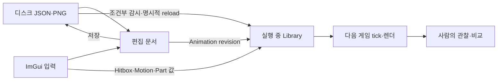

# 편집기·데이터·오디오 심층 읽기

2026-10-14 현재 작업 트리, HEAD `0ef7104f1ec6f634ba3ffb42e85119fb313883c2`를 읽은 자료다. 게임 코드 수정, 빌드, 테스트 실행, 게임 실행은 하지 않았다. 기존 [03_Editor_Data_Audio.md](<C:/Users/Ahnjiwoo/Desktop/Projects/windowAPIProject(24.02.05)/MyMetalSlug2/Docs/CodeStudy/03_Editor_Data_Audio.md>)의 개요 다음에 읽는다. 이 문서는 버튼 하나가 어떤 상태를 바꾸고, 언제 게임에 적용되며, 실패하면 무엇이 남는지를 설명한다.

**코드 사실**은 현재 분기·필드·호출 순서로 확인한 내용이다. **설계 해석**은 그 구조를 이해하기 위한 설명이고, **실습/QA 제안**은 사람이 나중에 수행할 확인 방법이다. 테스트 소스를 읽은 것과 테스트를 실행한 것은 구별한다. 사용자가 확인한 맥락은 AI의 도움으로 도구 환경을 구축했고 사람이 최종 QA를 수행했다는 것이다. 아래의 구조에서 특정 기능을 누가 직접 작성했는지, 과거에 어떤 시행착오를 겪었는지를 역으로 추정하지 않는다. Assets의 `note`도 그 파일에 기록된 설명이지 독립적으로 확인한 개발 이력은 아니다.

## 1. 도구는 게임 위에 놓인 별도의 상태다

### 1.1 한 화면 안에 네 종류의 시간이 있다

| 시간/호출 기준 | 진행시키는 곳 | 편집 중 의미 |
|---|---|---|
| 실제 프레임의 `_deltaTimeSec` | `App::Update_`의 AudioSystem::Update | Lab을 일시정지해도 이미 재생한 SFX와 BGM fade는 계속 진행할 수 있다 |
| 게임 고정 tick | `m_clock.Advance` → `Tick_` → SimRunner::Step | 적 상태, 공격 시점, 물리, 판정의 시간 |
| ImGui 프레임의 `io.DeltaTime` | Animation 창의 preview | 게임 tick 정지와 별개인 클립 미리보기 |
| 편집기 render frame 수 | AnimEditor::Poll, EnemyLab::DrawOverlay | 파일 감시의 60프레임 간격. TuningWatcher의 60 Poll/tick과 다르다 |

`App::Update_`는 오디오를 먼저 갱신하고, Lab 배속으로 게임에 들어갈 delta를 조절한 뒤 고정 tick 수를 정한다. Lab Pause는 이미 계산한 자연 tick 수를 `TakeSteps`로 대체한다. `g_debug.bPaused`와 capture tick 경로는 이 Lab 경로보다 먼저 분기하므로 서로 같은 Pause라고 설명하면 안 된다. 렌더는 게임 → Lab overlay → ImGui UI 순서다. 같은 render에서 숫자를 바꿨다면 게임 그림은 그 변경 전 이미 제출되었을 수 있고, 애니메이션 library 동기화는 UI를 그린 뒤 실행된다. 다음 렌더 또는 tick에서 새 값이 보인다는 설명이 정확하다. 근거: [App.cpp:423][A-update], [App.cpp:494][A-render], [Editor.cpp:124][E-frame], [EnemyLab.cpp:268][L-steps].



화살표가 모든 데이터에 모두 존재하는 것은 아니다. Map 저장에는 실행 중 StageRunner를 교체하는 화살표가 없고, Collision 저장에는 실행 중 GroundMap에 픽셀을 복사하는 화살표가 없다.

### 1.2 선언에서 소유권부터 읽는다

`Editor`는 AnimEditor, StageEditor, GroundEditor, EnemyLab, HitboxEditor, MotionEditor, DepthEditor를 **값 멤버로 소유**한다. 각 문서는 해당 편집기 안에 있다. SDL renderer, AnimationLibrary, SimRunner 연결은 외부 객체를 가리키는 포인터다. 따라서 편집기의 수명과 게임의 현재 state 수명이 같다고 가정하지 않는다. Lab에서 state를 전환해도 Hitbox/Motion/Depth의 문서 캐시는 자동으로 새로 읽는 구조가 아니다. [Editor.h:43][E-owner], [EnemyLab.cpp:295][L-enter], [MotionEditor.h:35][M-owner].

네 탭은 Animation / Map / Collision / AI다. AI 탭을 그릴 때 Lab, Hitbox, Motions, Depth 창이 함께 생성된다. `DrawLabOverlay`는 AI 탭의 선택 여부로 막히지 않는다. Editor가 켜져 있으면 App이 호출하며, 내부에서는 현재 state가 SandboxState인지 확인한다. ‘현재 AI 탭을 열었을 때만 Defs를 감시한다’는 설명은 맞지 않는다. [Editor.cpp:196][E-tabs], [Editor.cpp:108][E-overlay], [EnemyLab.cpp:580][L-overlay].

### 1.3 ImGui와 게임 입력의 경계

1. SDL event는 Editor의 `ProcessEvent`로 ImGui backend에도 전달된다.
2. 이전 Editor frame에서 계산한 `OwnsKeyboard`가 true로 바뀌면 App은 게임 입력의 held 상태를 `ClearAll`한다.
3. 그 event poll에서는 key-down을 게임으로 보내지 않고 key-up은 계속 보낸다. 숫자 입력을 시작한 뒤 이동키가 눌린 채 남는 상황을 줄이려는 구조다.
4. Editor는 `WantCaptureKeyboard || WantTextInput || bFocus`를 사용한다. `bFocus`는 dock host가 아닌 ImGui navigation window의 focus다. 단순히 텍스트 입력 중인지 하나만 확인하지 않는다.
5. 월드 배치/선택은 ImGui의 `WantCaptureMouse`와 Lab의 별도 `m_bMouseCaptured`를 확인한다. Motion/Extra hitbox marker는 후자를 설정한다.

실제 순서는 Lab overlay의 `HandleMouse_` → Motion overlay → Hitbox overlay다. marker hover/capture가 같은 호출 안에서 Lab의 클릭 처리보다 먼저 계산되는 것은 아니다. 첫 클릭까지 언제나 완전히 차단된다고 확대하지 말고, capture가 어디에서 쓰이고 갱신되는지 따라 읽는다. [App.cpp:88][A-input], [Editor.cpp:153][E-keyboard], [EnemyLab.cpp:517][L-mouse], [MotionEditor.cpp:615][M-overlay], [HitboxEditor.cpp:425][H-extra-overlay].

### 1.4 분리 창을 그리는 작은 renderer 보완 계층

Init는 ImGui context와 SDL3 backend를 만들고 Docking/Viewports를 켠다. `IniFilename=nullptr`이므로 기본 ImGui ini 파일에 창 배치를 저장하지 않는다. 기본 폰트에 `malgun.ttf`의 한국어 glyph를 병합한다. Editor frame 중에는 SDL logical presentation을 잠깐 끄고 실제 창 좌표로 ImGui를 그린 다음 원래 설정을 복구한다. [Editor.cpp:13][E-init], [Editor.cpp:133][E-frame].

`ImGuiSdlRendererViewports`는 보조 viewport별 `ViewportTarget`을 `RendererUserData`에 소유시킨다. 창 크기가 바뀌면 target texture를 다시 만들고, desktop 좌표의 정점/clip rect에서 `DisplayPos`를 빼 창 원점 좌표로 바꾼다. 메인 SDL renderer의 target에 렌더한 결과를 `SDL_RenderReadPixels`로 읽어 보조 창 surface에 복사한다. 별도의 renderer를 창마다 만들어 공유 atlas를 다시 올리는 방식은 아니다. 이 구조의 비용은 보조 창의 렌더 결과를 픽셀로 읽고 복사한다는 점이다. Shutdown은 플랫폼 창 → backend → context 순으로 정리한다. [ImGuiSdlRendererViewports.cpp:16][V-origin], [ImGuiSdlRendererViewports.cpp:57][V-render], [Editor.cpp:41][E-shutdown].

## 2. Document를 세 가지 저장 전략으로 구분한다

| 모델 | 편집 상태 | 저장 | 되돌리기 | 실패/보존 경계 |
|---|---|---|---|---|
| AnimDocument | 파싱된 클립·프레임 값 | 전체 JSON 재직렬화 | 이전 클립 snapshot, 최대 200개, Undo만 | 모르는 필드가 저장 때 사라지는 일을 막으려 로드에서 필드 수 검사 |
| StageDocument | 원문 + entity/section/rect token span | 수정 원문 그대로 | 전체 원문 snapshot, 최대 100개, Undo만 | patch 후 재색인 실패 시 원문·색인을 복원 |
| HitboxDocument | 원문 + 수치 token span + saved 원문 | 수정 원문 그대로 | 마지막 저장 원문으로 Revert | SetValue/ApplyExtraBoxes는 Stage의 전체 rollback 계약과 다르다 |
| MotionDocument | 원문 + saved 원문 | 필요 필드 patch 후 그대로 | 문서 자체 Undo/Revert 없음 | LoadFromText는 정식 JSON 검증 없이 문자열을 받음; 편집 시 scanner 사용 |
| DepthEditor | 파일별 원문과 dirty flag | 수정 원문 그대로 | 전용 Undo 없음 | 저장 결과를 현재 코드에서 확인하지 않고 dirty를 끔 |
| GroundMaskDocument | 0/1 픽셀 + stroke의 before/after | palette PNG 재인코딩 | stroke별 Undo/Redo | 저장한 이력 위치와 현재 위치를 비교; redo 분기를 잃으면 savedLost 표시 |

이 표의 ‘원문 보존’은 **문서 전체를 예쁘게 다시 출력하지 않는다**는 의미다. 추가한 `effects`/`hitboxes` 배열, part override 같은 국소 블록은 새 형식으로 쓰므로 그 블록 내부까지 기존 whitespace를 보존하는 것은 아니다. 저장은 공통 `WriteFileBytes`가 JugX FileWriter로 직접 수행한다. 임시 파일에 쓴 뒤 원자적으로 교체하는 방식은 구현되어 있지 않다. [AnimDocument.cpp:34][AD-parse], [StageDocument.cpp:647][SD-patch], [HitboxDocument.cpp:127][HD-value], [MotionDocument.cpp:322][MD-load], [DepthEditor.cpp:289][D-save], [GroundEditor.cpp:212][G-stroke], [AssetPath.cpp:113][Asset-write].

### 2.1 JsonScanner는 게임 스키마 검증기가 아니다

`JsonNode`는 원문 `[begin,end)` byte 위치, 종류 `o/a/s/n/l`, 객체 key와 child index를 담는다. 문자열은 escape를 두 byte씩 건너뛰며 원문 내용으로 보관한다. 정식 JSON 문자열의 escape를 해제해 의미 문자열로 만드는 범용 serializer가 아니다. BOM을 건너뛰고 공백을 처리하며 재귀 깊이는 64를 넘기면 실패한다. primitive는 delimiter까지 읽어 첫 문자로 숫자/기타 literal을 구분하므로 정식 JSON 문법 및 게임 필드 규칙은 별도 로더 책임이다. [JsonScan.h:5][J-node], [JsonScan.cpp:5][J-parse], [JsonScan.cpp:34][J-string].

예를 들어 `100`을 `1200`으로 바꾸면 뒤 token의 byte 위치는 1만큼 바뀐다. Stage는 여러 replacement를 `begin` 내림차순으로 적용하고 **전체를 다시 스캔**하여 다음 편집에 사용할 색인을 만든다. Motion은 각 필드 patch마다 다시 스캔하므로 이전 숫자의 길이가 변해도 다음 필드를 새 위치에서 찾는다. `FormatJsonNumber`는 절댓값이 1e9 미만인 정수값을 정수 표기로, 그 외를 `to_chars`로 쓴다. [StageDocument.cpp:219][SD-replace], [MotionDocument.cpp:84][MD-number], [JsonScan.cpp:149][J-number].

## 3. Animation: 그림의 기준점과 시간부터 분리한다

### 3.1 문서가 알고 있는 필드

| 위치 | 필드 | 의미 |
|---|---|---|
| root | `version`, `animations` | version 수치는 보관·재출력; 이 문서 로더는 root 필드 개수를 2로 검사 |
| clip | `loop`, `loopStart`, `frameDuration`, `cellW`, `cellH`, `frames` | 반복 여부·반복 시작 frame·frame당 초·셀 크기·그림 목록 |
| clip 선택 필드 | `cancelFrame` | 원문에 있으면 보관·저장. 편집 UI의 runtime ApplyClipTo가 새 AnimClip에 복사하는 필드는 아님 |
| frame | `atlas`, `x`, `y`, `w`, `h`, `pivotX`, `pivotY` | atlas 사각형과 anchor 기준점. frame object 필드 개수는 정확히 7 |

`LoadFromText`는 새 vector에 모든 clip을 먼저 파싱하고 성공 후에만 기존 문서와 교체한다. 실패한 외부 anim.json이 기존 파싱 상태를 중간까지 덮는 구조가 아니다. 성공 시 Undo를 비우고 dirty=false, lastChanged=-1, revision 증가다. `Save` 자체는 const이고 dirty를 지우지 않는다. UI가 파일 쓰기 성공을 확인한 뒤 `ClearDirty`한다. [AnimDocument.cpp:126][AD-load], [AnimDocument.cpp:177][AD-save], [AnimEditor.cpp:201][AE-save].

### 3.2 피벗을 올리면 왜 그림이 올라가는가

정방향, scale 1의 runtime 그리기는 다음 식이다.

```text
originScreen = floor(worldAnchor - camera)
spriteLeft   = originScreen.x - pivotX
spriteTop    = originScreen.y - pivotY
```

따라서 `pivotX+1`은 논리 anchor를 옮기지 않고 그림을 왼쪽으로 1px 옮긴다. Animation UI의 Left/Up 방향키가 pivot을 +1하는 이유다. preview도 같은 개념으로 화면 원점에서 `pivot*zoom`을 뺀다. 반전 시 runtime의 left는 `originX + pivotX - w`다. 피벗이 단순한 중심점이 아니므로 flip을 위치 변화와 독립적으로 검사해야 한다. [SpriteBatch.cpp:31][R-dest], [AnimEditor.cpp:426][AE-canvas], [AnimEditor.cpp:496][AE-keys].

`cellW/H`가 같더라도 trim된 frame의 `w/h`와 pivot은 다를 수 있다. 포탑 Shot에서 반동 때문에 `w/h`가 달라지는 것은 자연스러울 수 있고, 그때 anchor가 고정되도록 각 pivot이 조절되어야 한다. 모든 frame에 같은 pivot을 적용하는 버튼은 편리하지만, trim이 서로 다른 부품 클립에 무조건 사용하면 정렬을 망칠 수 있다. 이는 도구의 자동 판정이 아닌 사람이 확인할 부분이다.

### 3.3 화면 기능과 실제 호출

| 조작 | 상태 변화 |
|---|---|
| 이름 filter/clip 선택 | 선택 frame 0, 재생 정지, playTimer 0 |
| frame table 또는 `<`/`>` | frame 선택, 재생 정지; 화살표 버튼은 frame 목록에서 순환 |
| loop/loopStart/frameDuration | 문서 setter → clip snapshot → dirty/revision |
| pivot 숫자·방향키 | 선택 frame pivot 변경; 방향키는 focus, text input, Ctrl 조건을 확인 |
| Apply to all frames | 하나의 clip snapshot 후 모든 frame에 같은 pivot |
| Play/Pause | preview만 재생; `io.DeltaTime` 누적, 끝이면 loopStart로 이동하거나 정지 |
| onion | 이전 frame을 알파 90으로 그리고 현재 frame을 그림 |
| wheel | canvas에서 정수 zoom 1~8 |
| Ctrl+S / Save | 파일에 전체 anim JSON 저장 |
| Ctrl+Z / Undo | 마지막 clip snapshot 복원, dirty=true와 revision 증가 |
| Reload | 미저장 편집을 버리고 파일 다시 읽기; 현재 선택 이름 복구 시도 |

ApplyPivotToAll/SetLoop 등의 setter는 SetPivot과 달리 같은 값 여부를 모두 검사하는 것은 아니다. UI의 반복 호출과 Undo 개수를 연결해 읽는다. `SyncLibrary_`는 revision 변화에서 lastChanged가 있으면 그 clip 하나, -1이면 모든 clip을 `AddClip`한다. 이름이 같은 clip의 슬롯은 교체하고 새 이름은 추가한다. 삭제된 이름을 제거하는 단계는 없으므로 전체 Apply를 ‘library를 문서와 완전히 동일한 집합으로 재생성’이라고 설명하지 않는다. [AnimDocument.cpp:231][AD-undo], [AnimEditor.cpp:57][AE-sync], [AnimEditor.cpp:574][AE-apply], [Animation.cpp:244][R-addclip].

### 3.4 외부 파일 변화와 texture cache

60 Editor frame마다 anim.json의 mtime을 검사한다. dirty이면 새 timestamp를 기록하고 ‘미저장 편집을 보존했다’는 상태 문구를 남긴다. 이후 clean이 되었다고 그 같은 timestamp를 다시 자동 로드하는 것은 아니다. clean 상태에서 변화가 발견되면 Reload한다. Reload는 mtime을 **로드 시도 전에** 기억하므로 같은 실패 파일을 매 frame 재시도하지 않는다. 실패 시 기존 문서 값은 남는다. [AnimEditor.cpp:79][AE-poll], [AnimEditor.cpp:109][AE-reload].

atlas 이미지는 `Atlas/atlas_{:03}.png`에서 지연 로드하며 SDL texture를 캐시한다. anim.json Reload가 이 texture cache를 제거하지 않는다. JSON 사각형/피벗 변경과 실제 atlas PNG 픽셀 교체의 반영 경로를 구별해야 한다. 같은 PNG를 수정한 뒤 JSON만 Reload했다고 그림 픽셀이 새로 올라간다고 보장하지 않는다. [AnimEditor.cpp:159][AE-pages].

## 4. Map: 실행 장면 전체와 편집 가능한 인덱스는 다르다

### 4.1 StageDocument가 추출하는 것

`world.size/background`, `ground.initial/maps`, `player`, `sections.id/triggerX/actions`를 읽는다. action 안에서는 `spawn`, `spawnWave.entries`, 중첩 `gate.actions`에서 entity를 추출하고, `lockCamera/setBounds`의 `rect`와 선택적 `glide`를 추출한다. 그 외 action 원문은 보존하지만 전용 UI 모델로 펼치지 않는다. `repeat`로 파생된 모든 spawn을 복제하여 보여주는 코드도 없다. [StageDocument.cpp:87][SD-entity], [StageDocument.cpp:148][SD-action], [StageDocument.cpp:288][SD-index].

entity는 def/kind/id/section/where, x/y/fromY, z, groundSnap, facing과 원문 span을 갖는다. `IsPlaceable = bHasX && (bHasY || bGroundSnap)`다. camera 상대 spawn처럼 명시 x가 없는 항목은 목록에는 남을 수 있어도 지도 marker로 배치하지 않는다. player는 copy/delete 불가다. 문서를 열 때 정식 JSON 문법을 먼저 검사하지만 StageParser의 참조·범위·액션 의미 검사까지 실행하는 것은 아니다. [StageDocument.h:7][SD-types], [StageDocument.cpp:233][SD-place], [StageDocument.cpp:384][SD-load].

### 4.2 편집 동작의 실제 범위

| 동작 | 원문 변경과 의미 |
|---|---|
| x/y 이동 | 이미 존재하는 숫자 token만 교체. y가 없는 groundSnap 항목은 수평 이동만 가능 |
| Y 잠금 해제 | `groundSnap=false`로 바꾸고, y가 없으면 현재 marker Y를 삽입. 이미 y가 있으면 그 값을 별도로 바꾸지는 않음 |
| Add | 선택 section의 **최상위 actions 끝**에 단순 spawn `{type,kind,def,x,y}` 삽입 |
| Duplicate | entity object 원문을 복사, 존재하는 x/y만 이동. id가 있으면 `_2`부터 중복 아닌 이름 탐색 |
| Delete | object와 필요한 comma/공백을 제거. gate/command의 id 참조를 자동 수정하지 않음 |
| Z | override 수치 변경/추가. default로 돌리고 기존 z가 앞 comma와 함께 찾히면 국소 제거 |
| trigger 이동 | 해당 trigger만 또는 section의 rect/spawn까지 선택적으로 x 이동 |
| rect/glide | 기존 L/T/R/B 숫자와 기존 glide token 변경. 새 camera action 생성 기능은 아님 |

UI가 ‘gates/commands may still reference it’라는 경고를 남기는 Delete 경로는 button 처리에서 확인된다. 단순 복제는 object 내부의 다른 참조나 파생 의미를 새로 설계하지 않는다. 예를 들어 gate 안의 spawn을 복제하면 여전히 같은 gate actions 안에 들어가며, wave entry를 복제하면 그 entries 안에 들어간다. [StageDocument.cpp:489][SD-add], [StageDocument.cpp:534][SD-duplicate], [StageDocument.cpp:592][SD-delete], [StageDocument.cpp:674][SD-z], [StageDocument.cpp:733][SD-unlock], [StageEditor.cpp:978][SE-delete].

### 4.3 지도 좌표와 섹션 drag

지도 캔버스는 `screen = origin + (world - scroll) * zoom`을 쓴다. originY에는 ruler 높이 20px가 추가된다. 마우스의 world 좌표는 그 역변환이다. Entity 배치/drag는 기본 1px, Shift일 때 8px snap이다. section/rect drag는 Ctrl일 때 8px snap이다. 같은 Shift 키라도 section에서는 움직일 범위를 바꾸므로 의미를 혼동하면 안 된다. [StageEditor.cpp:1075][SE-view], [StageEditor.cpp:1304][SE-drag].

trigger/label을 drag할 때 모드는 클릭 시작 시 결정된다.

| 클릭 modifier | trigger | rect의 좌·우 | spawn의 x |
|---|---|---|---|
| 기본 | 이동 | 이동 | 이동 |
| Shift | 이동 | 이동 | 유지 |
| Alt | 유지 | 유지 | 이동 |

rect의 변/모서리는 5 screen px 안에서 잡고, 선택한 변의 숫자만 바꾼다. 여러 frame 동안 drag해도 첫 실제 변경에서만 Undo 원문을 저장한다. 후속 변경은 `_bUndo=false`여서 Ctrl+Z 한 번으로 drag 시작 전으로 돌아간다. [StageEditor.cpp:547][SE-pick], [StageDocument.cpp:761][SD-section], [StageEditor.cpp:1366][SE-sectiondrag].

### 4.4 preview가 알려 주는 것과 빠지는 것

Map은 Defs를 **재귀적으로** 탐색하고 abstract/projectile을 후보에서 제외한다. enemy의 idle/stand clip을 우선하며 `extends`는 같은 파일의 defs에서 최대 8단계 찾는다. prop은 idle/damaged/destroyed 또는 첫 variant를 확인한다. items/groups는 대표 첫 항목의 그림을 사용한다. runtime의 모든 상속·랜덤 선택·상태를 재현하는 로더는 아니다. [StageEditor.cpp:166][SE-idle], [StageEditor.cpp:277][SE-defs].

anim.json에서는 첫 frame만 가져오며 sprites.json도 함께 읽는다. `{side}`의 방향 그림이 없으면 반대 방향을 mirror한다. marker pick은 그려진 sprite 전체의 alpha 윤곽을 검사하지 않고 anchor 근처 11 screen px 거리로 고른다. 표시 순서는 effective z → MarkerY를 stable_sort한다. runtime SpriteBatch의 sortKey/submit seq와 지도 preview가 모든 부품까지 동일하지는 않다. BigShiee처럼 별도 부품을 조립하는 적의 완성된 그림을 이 preview가 그대로 재현한다고 설명하지 않는다. [StageEditor.cpp:394][SE-frames], [StageEditor.cpp:483][SE-sprite], [StageEditor.cpp:1252][SE-order].

groundSnap marker는 현재 선택한 mask에서 x와 fromY 아래의 첫 solid를 찾는다. mask 목록 변경은 preview mask를 바꾸며 StageDocument의 `ground.initial`을 수정하지 않는다. Map의 mask 판정은 RGB `<64,<64,>192`이고 alpha 조건이 없다. Collision 문서/게임 로더의 `<80,<80,>=200,alpha>=128`과 다르다. 순수 파랑으로 저장한 마스크에는 같은 결과를 기대할 수 있지만 임의 PNG의 반투명 파랑까지 동치라고 주장하지 않는다. [StageEditor.cpp:603][SE-strips], [StageEditor.cpp:729][SE-groundY], [GroundEditor.cpp:99][G-load], [StageMapping.cpp:103][Ground-runtime].

Map Reload는 stage JSON/배경 strip/mask를 다시 읽는다. Init에서 읽은 defs/frame 목록과 sprite page cache까지 모두 새로 만드는 코드는 아니다. Map Save는 파일 쓰기까지이고 현재 StageState의 StageData/StageRunner를 재생성하지 않는다. [StageEditor.cpp:684][SE-load], [StageEditor.cpp:723][SE-save].

## 5. Collision: PNG는 그림이면서 충돌 데이터다

### 5.1 픽셀 모델과 PNG 인코딩

GroundMaskDocument는 RGBA PNG를 읽고 정해진 파랑/alpha 조건에 맞는 픽셀을 1, 나머지를 0으로 만든다. 저장은 각 row 앞에 filter 0을 붙여 zlib로 압축한 뒤 PNG signature, IHDR, PLTE, IDAT, IEND를 직접 구성한다. palette index 0은 흰색, 1은 파랑이다. 원래 PNG의 임의 색·alpha·metadata를 보존하는 이미지 편집기가 아니다. 이 이진 충돌 데이터는 게임의 LoadGroundMask와 같은 색 조건으로 읽힌다. [GroundEditor.cpp:57][G-png], [GroundEditor.cpp:99][G-load], [StageMapping.cpp:103][Ground-runtime].

### 5.2 도구 알고리즘과 Undo

| 도구 | 알고리즘/입력 |
|---|---|
| Pencil / Eraser | 크기 1~16의 정사각 brush를 stamp. drag 사이 점은 정수 Bresenham 계열 line으로 연결 |
| Line | 시작/끝과 brush로 DrawLine. release에서 확정 |
| Rect | 두 모서리를 정규화하고 문서 영역에 clip, 양 끝 pixel 포함하여 FillRect |
| Fill | 시작값과 다른 값으로 4방향 flood fill. pending stack은 좌표 쌍이며 문서 밖/이미 바뀐 값은 건너뜀 |
| 좌/우 클릭 | 좌클릭은 그리기, 우클릭은 지우기; Eraser는 좌클릭도 지우기 |
| Shift+click | 이전 점이 있으면 그 점부터 line |

BeginStroke/EndStroke는 연속 pixel 변경을 하나의 Undo 단위로 묶는다. 변경 기록은 `index,before,after`다. 새 stroke를 Undo 위치에서 확정하면 redo 이력 뒤를 잘라낸다. 잘린 분기에 저장 지점이 있었다면 `m_bSavedLost=true`이므로 history 위치가 우연히 같은 수치가 되어도 saved로 표시하지 않는다. Save 성공 후에만 savedApplied를 현재 위치로 맞춘다. 이 방식은 전체 PNG 복사보다 변경점이 적은 stroke에 유리하다는 설계 해석을 할 수 있다. 현재 history 수 상한이나 byte 상한은 구현되어 있지 않다. [GroundEditor.cpp:206][G-stroke], [GroundEditor.cpp:256][G-line], [GroundEditor.cpp:326][G-fill], [GroundEditor.cpp:375][G-undo], [GroundEditor.cpp:418][G-pixel].

### 5.3 화면 갱신과 적용 경계

긴 마스크와 배경은 폭 2048의 SDL texture strip으로 나눈다. 바뀐 pixel의 최소/최대 x를 누적하고 그 구간과 겹치는 strip만 다시 올린다. ‘바뀐 몇 pixel만 GPU에 쓰기’가 아니라 해당 strip 전체 RGBA를 다시 만든다. 화면 mask는 빨강 계열/반투명으로 합성하여 배경과 구별한다. zoom 0.125~16, 8 이상이면 pixel grid, wheel은 마우스 밑 world 위치를 유지하며 zoom, Shift+wheel과 middle drag는 scroll이다. B/E/R/L/G와 Ctrl+S/Z/Y를 지원한다. dirty이면 다른 mask 선택이 막힌다. [GroundEditor.cpp:487][G-textures], [GroundEditor.cpp:588][G-upload], [GroundEditor.cpp:661][G-keys], [GroundEditor.cpp:766][G-view].

배경은 mask 이름의 첫 `_` 앞 부분을 Stage 파일명으로 삼고, `world.background` → sprites.json의 `file`을 찾는다. 모든 atlas 배경/모든 스테이지 이름 규칙을 자동 지원하는 것은 아니다. 저장은 PNG 파일까지다. 실행 중 sandbox/stage ground를 교체하는 호출은 없으므로 ‘빨강 mask preview가 바뀌었다’와 ‘캐릭터 충돌이 바뀌었다’를 별도로 확인해야 한다. [GroundEditor.cpp:527][G-bg], [GroundEditor.cpp:620][G-save].

## 6. EnemyLab: 같은 적을 다시 만드는 재현 장치

### 6.1 실행 state와 spawn set

Lab은 SimRunner에서 `dynamic_cast<SandboxState*>`로 현재 sandbox를 가져온다. 없으면 Enter lab 버튼으로 `CreateState("enemylab")`을 만들고 runner에 SwitchState한다. Back은 기록한 return state 이름으로 **새 state**를 만든다. 이전 플레이 state 객체를 보관했다가 그 진행 위치로 복귀하는 구조는 아니다. [EnemyLab.cpp:286][L-sandbox], [EnemyLab.cpp:295][L-enter].

Spawn은 facing을 ±1로 정규화하고 z, activated=true로 적을 만든다. 성공한 spawn만 `name,feet,facing,z`의 set에 기록한다. Spawn at player는 player feet + offsetX다. Click to place는 mouse world 위치에 만든다. set은 살아 있는 적의 자동 추적 명단이 아니라 마지막에 재현할 **spawn 요청 기록**이다. 적이 이동해도 기록 feet는 시작점이며 체력·state·난수 진행·투사체를 snapshot한 것은 아니다. [EnemyLab.cpp:72][L-spawn].

Clear는 EnemyWorld를 seed 1로 Reset하고 projectile을 비우고 선택을 지운다. set 자체는 Clear에서 지우지 않는다. RespawnLast는 set을 복사 → Clear → set 비움 → 요청들을 다시 Spawn 순서다. Forget set은 요청 기록만 지운다. 따라서 Clear와 Forget set의 목적은 다르다. Kill all은 적 월드의 KillAll(false) 경로를 요청한다. [EnemyLab.cpp:102][L-clear], [EnemyLab.cpp:116][L-respawn], [EnemyWorld.cpp:86][EW-reset].

### 6.2 리로드가 두 종류인 이유

| 경로 | 성공 후 바뀌는 것 | 유지되는 것/조건 |
|---|---|---|
| Reload defs + respawn | 새 EnemyDefLibrary, projectile clear, enemies reset, set 재생성, selection/index 초기화 | spawn 요청 기록을 사용해 다시 배치 |
| Reload defs (keep enemies) | 새 library를 같은 멤버에 move, EnemyWorld의 library 재연결, animation binding cache 무효화 | 기존 enemy 객체/AI 진행 상태와 projectile을 유지 |
| keep의 조건 불충족 | full reload + respawn으로 fallback | 적 정의/투사체 개수, 순서의 name, behavior, clip 개수 조건을 확인 |

keep 조건은 각 적 정의의 **name/behavior/clip count**와 각 projectile name을 index별로 비교한다. clip 이름/순서/내용까지 모두 동치 검사하는 것은 아니다. body/health/보스 파트 HP 등 이미 instance에 복사된 값까지 전부 새 정의로 초기화하지도 않는다. 새 정의를 다음 Tick에서 읽는 값과 OnInit/Spawn 시 복사한 값을 구분해야 한다. 파싱 실패 시 임시 library를 기존 것과 교체하지 않는다. Lab은 keep가 false이면 full reload를 다시 시도하므로, parse 오류와 set 변경 모두 결과적으로 fallback 후보가 된다. [SandboxState.cpp:284][S-reload], [EnemyLab.cpp:133][L-reload], [EnemyWorld.cpp:76][EW-lib], [BigShiee.cpp:238][B-init].

### 6.3 감시와 진단 화면

Defs 감시는 `Defs` **최상위 `.json`의 최대 mtime** 하나를 60 overlay frame마다 비교한다. 재귀 감시가 아니므로 `Defs/Props/Props.json`은 대상 밖이다. 파일별 mtime 목록/파일 내용 hash도 아니다. 가장 최신 파일보다 오래된 timestamp로 다른 파일이 바뀌거나 최신 stamp를 바꾸지 않는 변화는 이 방식만으로 항상 발견된다고 보장할 수 없다. 처음에는 stamp를 기억하고, Motion 변경이 있으면 stamp 갱신/자동 reload를 막는다. 변화 발견 시 stamp를 먼저 기억하므로 실패한 같은 파일은 다음 stamp 변화 또는 수동 버튼까지 그대로다. [EnemyLab.cpp:176][L-poll], [MotionEditor.cpp:534][M-draw].

Inspector는 life, 활성화/접지, hp, position/velocity, facing/variant, state/stateTicks/counter, climb/death phase, delay/shots/melee/flash, 선택 clip과 clipTicks를 보여준다. instance Z도 바꿀 수 있다. Overlay의 주요 구분은 다음과 같다.

| 표시 | 실제 데이터 |
|---|---|
| 노랑 body | enemy instance의 실제 Body box |
| 초록/파랑 hurt | Combat에 등록된 enemy hurtbox, invulnerable 여부에 따른 색 |
| 빨강 attack | Combat에 등록된 enemy hitbox |
| 흰 선택 mark | 선택 enemy body의 바깥 상자 |
| 자홍 solid | 정의의 solid를 body.position/facing에 붙인 상자 |
| 주황 Bus stairs | stairsBase/Top의 preview 영역 |
| ground probe | feet부터 아래로 최대 64px solid 탐색 |
| AI state/target/camera | 상태 문자열, player body center 선, camera bounds |

Pause에서 Combat overlay는 마지막 simulation tick에 등록된 목록일 수 있다. 숫자 변경 직후 문서 overlay가 새 값을 그려도 실제 Combat 목록은 다음 tick에서 갱신될 수 있다. Step 1/10으로 그 경계를 확인하는 것이 유용하다. 배속은 0.25/0.5/1/1.5/2, Pause는 pending step을 비우고 Step 버튼은 Pause를 켠 뒤 pending을 늘린다. [EnemyLab.cpp:325][L-ui], [EnemyLab.cpp:483][L-inspector], [EnemyLab.cpp:580][L-overlay].

## 7. Hitbox: 추출된 수치, 직접 적용된 수치, 실제 판정을 구별한다

### 7.1 추출 규칙과 편집 대상

Hitbox 창은 `Tuning.json`, `Enemies.json`, `BigShiee.json`, `Bus.json`, `Helicopter.json`, `Vehicles.json`의 여섯 문서를 처음 한 번 읽는다. Props는 이 목록에 없다. `w/h` 숫자를 함께 가진 object를 찾고 선택적 `cx/cy`를 붙인다. 길이 2의 numeric array에서 key가 `Size`를 포함하거나 `hurt`로 시작하면 size 후보로 잡는다. 끝이 Size인 key는 같은 object의 대응 Offset을 같이 찾는다. `hitboxes` 배열은 일반 숫자 수집에서 건너뛰고 별도 UI로 편집한다. [HitboxEditor.cpp:21][H-files], [HitboxDocument.cpp:261][HD-collect].

**화면에 노출된 숫자 모두가 즉시 runtime에 적용되는 것은 아니다.** 직접 ApplyLive는 다음 정확한 경로만 처리한다.

| 문서 값 | live 대상 | 추가 처리 |
|---|---|---|
| `body.standSize` | sandbox tuning의 standSize | 현재 player controller가 언제 이 tuning을 읽는지는 다음 동작/tick과 연결해서 확인 |
| `body.crouchSize` | crouchSize | 동일 |
| `body.hurtStand` / `body.hurtCrouch` | player hurt size | 동일 |
| `defs.<owner>.body` | EnemyDef::body | 해당 def의 기존 bodies에 RefreshBodies |
| `defs.<owner>.hurtbox` | EnemyDef::hurtbox | 다음 Combat 등록에서 사용 |
| `defs.<owner>.params.cannonBoxSize` + Offset | BigShiee cannonBoxSize/Offset | 다음 주포 hurtbox 등록에서 사용 |

다른 blast/hitSize나 arbitrary size 항목은 문서 값과 marker가 바뀔 수 있지만 이 직접 적용 목록에 없다. Tuning 저장 뒤에는 sandbox TuningWatcher가 별도 tick에서 전체 파일을 다시 읽을 수 있다. [HitboxEditor.cpp:117][H-live], [SandboxState.cpp:466][S-watch].

### 7.2 추가 hurt/attack 상자

ExtraBoxDef는 `id`, `kind`(hurt/attack), `w/h`, `offset:[cx,cy]`, 선택적 `frames:[from,to]`, `damage`로 저장한다. 신규 기본값은 30×30, offset(0,-20), id `boxN`다. hurt는 extra hurtbox로, attack은 해당 clip frame 범위에서 melee hitbox로 등록한다. frameTo<0은 항상 활성 조건이다. attack UI는 frame 범위와 damage를 편집하고 생성/삭제도 한다. [HitboxEditor.cpp:351][H-extra], [HitboxDocument.cpp:38][HD-extra], [EnemyWorld.cpp:310][EW-extra].

월드 drag는 선택 owner의 모든 Alive instance에서 상자를 보여 준다. 클릭한 enemy id와 local grab offset을 기억하고,

```text
localX = (mouseWorldX - body.position.x) * facing
localY =  mouseWorldY - body.position.y
```

를 정수 반올림하여 해당 정의의 cx/cy를 바꾼다. 한 instance의 box만 움직이는 것이 아니라 공유 EnemyDef의 box가 바뀌므로 같은 def의 모든 적에 영향을 준다. overlay는 실제 활성 frame 범위 밖의 attack box도 편집용으로 그린다. 화면에 빨강 상자가 있다는 것만으로 그 tick에 Combat에 등록되었다고 판단하지 않는다. [HitboxEditor.cpp:425][H-extra-overlay].

### 7.3 Save/Revert와 preview의 한계

Save 성공 시 savedText를 갱신한다. enemy 파일이면 full ReloadDefs + set respawn을 요청한다. 따라서 같은 적을 공격 중에 Save하면 현재 HP/AI 시점이 유지되지 않을 수 있다. Revert는 savedText로 문서를 되돌리고 enemy 파일이면 disk 기반 full reload를 한다. Tuning 파일의 Revert 분기에는 ApplyLive를 되돌리는 호출이나 watcher 강제 reload가 없다. ‘모든 live 값이 Revert 즉시 돌아온다’는 공통 계약은 없다. [HitboxEditor.cpp:317][H-save], [HitboxDocument.cpp:227][HD-revert].

일반 overlay도 표시 목적이 다르다. player attack 항목의 mark는 feet+(facing×30,-30)의 임시 중심을 사용한다. enemy body mark는 실제 instance body, 그 외 box는 편집 수치의 BoxDef를 body.position에 붙인다. BigShiee의 전체 hurtbox 행 mark와 실제로 등록한 포탑별 hurtbox를 혼동하면 안 된다. 실제 파트 판정은 Lab의 Combat overlay와 RegisterHurtboxes를 함께 읽는다. [HitboxEditor.cpp:508][H-overlay], [BigShiee.cpp:544][B-boxes].

## 8. Motion: 무기 재생과 params 저장은 서로 다른 작업이다

### 8.1 runtime 수정 후 저장하는 경로

Motion 창은 Defs 최상위 JSON을 문서별로 보유한다. 현재 선택 enemy의 def 또는 Spawn combo의 def를 편집한다. 다음 값은 EnemyDef를 먼저 바꾸고 `w|def|weapon`, `c|def|clip`, `p|def|part`의 changed key를 중복 없이 기록한다.

| 기능 | live 수정과 저장 내용 |
|---|---|
| muzzle | weapon의 local muzzle 벡터 |
| muzzleFx.offset | fx 위치는 muzzle에서 더한 상대 offset |
| motionClip | def 안의 NamedClip 이름을 고름 |
| effects 추가/삭제/이동/frame | AnimationLibrary의 clip 이름, body origin 기준 offset, 발동 frame, 기존/default depth |
| 공격 clip sec | 이름에 shot/ready/fire/attack/throw/slash가 있는 clip만 노출; frameSec와 정수 frameUnits를 함께 변경 |
| Bus parts | innerSoldier/wreck/back/stairs/body/cover/window/debris depth,sort |

Save는 changed key마다 실제 owner/weapon/clip/part가 직접 쓰인 문서를 찾아 token을 patch한다. 원문에 없는 상속 weapon/clip 값을 자식 정의에 새로 materialize하는 일반 기능은 아니다. skipped 개수를 표시한 후 changed 목록을 비운다. 따라서 live로 바꾼 상속값이 항상 저장되었다고 생각하면 안 된다. `ApplyWeapon`도 weapon object 존재를 확인한 뒤 muzzle/muzzleFx의 내부 patch 반환값은 모두 성공 여부로 집계하지 않는다. Saved 건수는 실제 모든 세부 필드가 쓰였다는 감사 기록이 아니다. [MotionEditor.cpp:105][M-load], [MotionEditor.cpp:137][M-save], [MotionEditor.cpp:384][M-weapon], [MotionDocument.cpp:342][MD-weapon].

MotionDocument는 수치를 소수 4자리로 round한 뒤 epsilon 0.00005보다 차이가 클 때 교체한다. string/effects는 기존 값과 비교하거나 선택 블록을 삽입/재작성한다. effects depth는 60이면 출력 생략한다. 여러 파일을 저장하다 한 파일이 실패하면 앞 파일은 이미 저장되었을 수 있다. 전체 문서 묶음의 transaction/rollback은 없다. [MotionDocument.cpp:13][MD-round], [MotionDocument.cpp:187][MD-effects], [MotionEditor.cpp:192][M-filesave].

### 8.2 Fire now와 Play motion이 검증하는 것

Fire now는 선택 handle/weapon으로 현재 context의 FireWeapon을 직접 요청한다. projectile/combat/player Alive 등 조건이 없으면 실패할 수 있다. Play motion은 weapon.motionClip을 찾아 EnemyWorld의 `m_play` 하나에 enemy id, weapon, clip, ticks=0, fireTick, endTick을 기록한다. 다음 tick에서 해당 적의 clip/tick을 덮고 fireTick에서 발사하며 길이가 끝나면 m_play를 비운다. UI의 ‘발사 프레임(재생용)’은 이 preview 요청에 쓰며 weapon JSON의 fireFrame을 새로 저장하는 기능이 아니다. [EnemyWorld.cpp:751][EW-fire], [EnemyWorld.cpp:771][EW-motion], [EnemyWorld.cpp:442][EW-playtick].

일반 weapon effect는 `def.FindClip(weapon.motionClip)==enemy.clip`인 동안 `clip.TickOfFrame(effect.frame)==clipTicks`일 때 요청된다. 이 frame은 단순 render frame 횟수가 아니라 ClipDef의 시간 변환에 걸린 index다. frameSec를 바꾸면 실제 effect/fire tick도 달라질 수 있다. [EnemyCommon.cpp:324][EC-effects].

### 8.3 marker의 좌표계

| marker | 월드 위치 | drag 후 저장하는 local 값 |
|---|---|---|
| muzzle | body.position + mirrored muzzle | `(mouse-origin)*facing`의 x와 y |
| muzzleFx | body.position + mirrored `(muzzle+fx.offset)` | 위 local에서 muzzle를 뺀 값 |
| effect | body.position + mirrored `effect.offset` | body origin 기준 local |

pick 반경은 world 기준 8px이며 SDL 창 좌표를 logical 화면으로 바꾸고 floor(camera)를 더한다. marker 종류마다 origin이 다르므로 같은 월드 점에 있어도 JSON 값이 같아야 하는 것은 아니다. BigShiee 포탑 shell은 일반 `weapons.shell.muzzle`에만 놓이지 않고 별도 turret anchor/muzzle 계산 후 extra offset으로 FireWeapon에 전달한다. Motion의 일반 muzzle marker 하나가 7개 포탑 발사 위치를 모두 나타내는 것은 아니다. [MotionEditor.cpp:615][M-overlay], [EnemyCommon.cpp:315][EC-muzzle], [BigShiee.cpp:907][B-shell].

### 8.4 params는 고치는 즉시 파일에 쓴다

ListParams는 해당 def에 **직접 쓰인** params에서 numeric scalar, bool, 숫자 두 개의 array, 최대 depth 3의 중첩 object를 수집한다. 문자열, 긴 array, object 배열은 이 일반 UI에서 제외된다. numeric scalar의 정수 UI 여부는 JSON token에 `.eE`가 있는지로 판단한다. `1`과 `1.0`이 다른 UI 종류로 나타날 수 있으며 데이터의 의미 타입을 별도 schema에서 받는 것이 아니다. [MotionDocument.cpp:131][MD-params], [MotionDocument.cpp:458][MD-listparams].

값을 바꾸면 미저장 weapon/clip/Bus part 변경을 먼저 Save → params token patch → 해당 파일 Save → ReloadDefsKeep 순으로 진행한다. reload 실패 반환값은 이 UI 경로에서 상태 문구와 별도로 처리하지 않는다. 파일 저장 성공과 게임 적용 성공은 구별해야 한다. params 목록 cache는 def 이름, 문서 index, **문서 text 길이**를 기준으로 다시 만든다. 외부 디스크 변화를 문서에 다시 읽어 넣는 역할을 하지 않는다. [MotionEditor.cpp:265][M-params].

## 9. Depth: 뒤/앞과 같은 층의 순서를 구분한다

runtime SpriteBatch는 `depth` 작은 순 → `sortKey` 작은 순 → `seq` 작은 순으로 정렬한다. feet 정렬을 사용하는 호출자가 sortKey에 feet Y와 part offset을 넣기 때문에 UI에서 ‘ties: feet y’라고 설명한다. SpriteBatch 자체가 모든 command의 world Y를 찾아 정렬하는 것은 아니다. 같은 depth에서도 보스 부품이 임의 sortKey를 쓸 수 있다. instance z는 default z와의 차이를 부품 depth에 더하는 경로다. [SpriteBatch.cpp:49][R-sort], [EnemyCommon.cpp:684][EC-part], [DepthEditor.cpp:183][D-parts].

Depth 창은 다음 두 편집 영역과 보기 전용 영역을 갖는다.

| 영역 | 대상 | live/저장 |
|---|---|---|
| Code constants | backdrop/terrain/보스 부품/플레이어/총알/아이템/FX/HUD 기본 depth | 보기 전용; C++ 수정이면 재빌드 |
| 일반 JSON rows | Enemies/BigShiee/Bus/Helicopter/Vehicles/Props에서 재귀로 찾은 depth/fxDepth | 숫자 token을 문서에 patch. 일반 row 자체는 runtime 값에 즉시 복사하지 않음 |
| Parts | GetEnemyPartSlots가 제공하는 부품들 | EnemyDef의 depth/sort를 즉시 바꾸고 nondefault override를 params.parts에 삽입 가능 |

part 슬롯은 Bus 8개, Heli body/rotor/pod/puff, BigShiee hull/antenna/cannon/turretA~G/disc/wreck, 그리고 overlayClip이 있는 정의의 overlay다. 현재 없는 part 이름은 runtime parser가 거부하고 depth/sort 정수만 허용한다. [DepthEditor.cpp:90][D-rows], [EnemyDef.cpp:451][Def-slots], [EnemyDef.cpp:494][Def-parts].

Parts override 생성은 MotionDocument::SetPartDepth를 재사용한다. params가 있어야 하며 parts/part가 없으면 nondefault일 때 블록을 추가한다. 기존 override를 default로 돌리면 기존 필드는 수치 갱신하며, 항상 블록을 삭제하여 최소 JSON로 정규화하는 것은 아니다. Motion 창의 Bus 전용 part Save는 기존 token patch 경로이고, Depth의 일반 part 편집은 override 삽입 경로여서 지원 범위가 다르다. [DepthEditor.cpp:139][D-patchpart], [MotionDocument.cpp:413][MD-part].

Save는 dirty 파일에 WriteFileBytes를 호출하지만 반환 결과를 버리고 dirty=false로 만든 뒤 EnemyLab::ReloadDefs를 요청한다. 따라서 ‘Saved + reloaded defs’는 현재 구현에서 성공을 증명하는 충분한 근거가 아니다. Props 파일이 목록에 있어도 이 reload는 EnemyDefLibrary 경로이며 PropDefLibrary reload를 호출하지 않는다. 또한 Depth/Hitbox/Motion은 같은 파일을 서로 다른 원문 캐시로 보유한다. 한 창의 저장을 다른 창의 오래된 원문으로 덮으면 그 변경이 사라질 가능성이 있으므로, 파일별 담당 창과 외부 변경 시점을 확인하며 읽고 사용한다. 자동으로 모든 문서를 병합·동기화하는 공통 계층은 없다. [DepthEditor.cpp:289][D-save], [SandboxState.cpp:284][S-reload], [HitboxEditor.cpp:102][H-load], [MotionEditor.cpp:105][M-load].

## 10. 정확한 hot reload 표

| 대상 | 감지/버튼 | 적용 위치·시점 | 유지/실패 경계 |
|---|---|---|---|
| anim 문서 내부 편집 | revision, 매 Editor frame Poll | AnimationLibrary clip 교체, 저장 전에도 적용 | 새 clip 추가 가능; 없어진 clip 제거 없음 |
| 외부 anim.json | 60 Editor frame, 해당 file mtime | clean이면 Reload 후 ApplyTo | dirty이면 보존+mtime 기억; 실패 시 이전 clip 유지; atlas texture refresh 없음 |
| Defs 최상위 JSON | 60 Lab overlay frame, 최대 mtime | sandbox ReloadDefsKeep, 조건 실패 시 full reload+set respawn | Motion m_changed만 blocker; Hitbox/Depth dirty를 공통 blocker로 확인하지 않음 |
| Lab 명시 full reload | Reload defs + respawn | EnemyDefLibrary 교체, enemy/projectile clear, set spawn | 현재 적 상태 상실; 실패면 이전 library |
| Lab 명시 keep reload | Reload defs (keep enemies) | 호환 조건 후 library 재연결 | spawn 때 복사된 상태까지 재초기화하지 않음 |
| Hitbox 일반 값 | 숫자/drag | 제한된 ApplyLive 대상만 바로 복사 | 나머지는 문서/overlay 변화; 다음 Combat tick 구별 |
| Hitbox enemy Save/Revert | 버튼/Ctrl+S | disk 저장 또는 savedText 복구, full defs reload | 새 set으로 respawn; Tuning Revert의 live 복원은 별도 없음 |
| Motion weapon/clip/Bus part | 숫자/marker, 이후 Save | EnemyDef live 변경 먼저, 저장은 changed key 처리 | 상속/없는 token skipped; 자동 Defs reload block |
| Motion params | 값 변경 즉시 | 파일 저장 후 ReloadDefsKeep 요청 | saved 문구와 reload 성공을 동일시하지 않음 |
| Depth Parts | drag, 이후 Save | live part 변경 먼저, JSON override cache | Save는 write 실패를 확인하지 않음 |
| Tuning.json | sandbox Tick의 TuningWatcher::Poll, 기본 60회 | 새 Tuning 교체 + camera/rig 갱신 | 초기 Tuning 로드 성공 시 watcher 사용; 실패 시 이전 값, stamp는 기억 |
| Map/Stage JSON | Map Reload/Save | 편집 문서/preview 또는 디스크 | 현재 StageData/Runner 자동 교체 없음 |
| Ground PNG | Collision Load/Save, Map의 mask 선택/Reload | 편집 픽셀·preview 또는 디스크 | 실행 중 GroundMap 자동 교체 없음 |
| sprites/manifest/sounds/atlas/음원 | 각 초기 로더/캐시 | 각 library/device 초기화 때 읽음 | 이 Editor에 공통 자동 감시 경로 없음 |

Tuning의 watcher 초기화는 sandbox 최초 로드 성공 시 하고, Poll은 sandbox Tick에서만 진행한다. 게임을 정지하면 60 render frame을 기다렸다고 Tuning 반영이 일어나는 것은 아니다. StageState의 최초 Tuning 로드와 sandbox watcher를 구별한다. 현재 StageState에 같은 Poll 호출은 없다. [Tuning.cpp:452][T-watch], [SandboxState.cpp:47][S-loadtuning], [SandboxState.cpp:466][S-watch], [StageState.cpp:207][Stage-tuning].

## 11. 보스의 여러 sprite를 맞추는 사람의 QA 루프

### 11.1 정렬을 다섯 층으로 분해한다

| 층 | BigShiee의 실제 값 | 틀렸을 때 구별할 증상 |
|---|---|---|
| 논리 기준점 | body.position, render의 feet | 선체와 모든 부품이 함께 틀어짐 |
| 부품 상대 기준점 | turretAnchor, cannonAnchor, antennaP/Q | 해당 부품의 모든 pose가 같은 방향으로 틀어짐 |
| frame 피벗/trim | anim.json의 각 frame pivotX/Y,w/h | 특정 frame 또는 state 전환에서만 튐 |
| 판정/발사 기준 | turretBox/Muzzle, cannonBoxOffset/Size, weapons missile muzzle | 그림은 맞는데 피격/탄 생성 위치가 다름 |
| depth/sort | params.parts, instance z | 위치는 맞는데 앞뒤 겹침이 틀림 |

보스는 선체, 안테나 P/Q, 7개 포탑, 주포, 탄피, 파괴/잔해를 각각 제출한다. `SubmitParts`가 이 순서를 직접 보이지만 최종 겹침은 SpriteBatch 정렬이 결정한다. BigShiee의 World_는 origin+rel이고 일반 enemy처럼 facing으로 모든 anchor를 좌우 반전하는 함수가 아니다. [BigShiee.cpp:90][B-world], [BigShiee.cpp:578][B-submit], [SpriteBatch.cpp:49][R-sort].

### 11.2 한 포탑의 좌표를 계산해 본다

현재 A 포탑 anchor는 (84,-254), 첫 Idle1 frame의 pivot은 (50,62)다. 선체 origin을 (Bx,By)라고 하면 정방향 그림의 왼쪽 위는 camera/rounding을 제외하여 `(Bx+34, By-316)`이다. 첫 frame w/h는 82×62이고 clip cellW/H는 92×72다. 이 두 크기를 같은 값으로 취급하면 안 된다. [BigShiee.json:53][Asset-bossanchors], [anim.json:8195][Asset-turret].

같은 A의 판정은 turretBox의 첫 네 값 `(76,56,0,-30)`로부터 중심 `(Bx+84,By-284)`, 크기 76×56이다. 이 box는 그림 frame의 사각형과 같을 필요가 없다. 포탑별 owner `MakePartOwner(enemyId,i)`로 등록되며 주포는 part 7이다. 주포 box는 `body.position+cannonBoxOffset`이고 cannonAnchor를 한 번 더 더하는 계산이 아니다. [BigShiee.cpp:544][B-boxes], [BigShiee.json:57][Asset-bossboxes].

`turretAnchor/Muzzle`는 각각 길이 14, `turretBox`는 길이 28, Side/Twin/HP는 각각 길이 7이다. parser는 A~G의 i에 대해 anchor `2i`, box `4i`를 해석한다. Motion의 generic params가 이 긴 배열을 나열하지 않으므로 이 배열 조절은 JSON 또는 별도 전용 기능의 범위다. array 순서를 바꾸면 어느 포탑에 적용하는지까지 바뀐다. [BigShiee.cpp:651][B-parse], [MotionDocument.cpp:131][MD-params].

### 11.3 그림 시간과 공격 tick이 같은 설정은 아니다

포탑 state는 Idle/Prep/Turn/Shot/Dead이고 별도 turretTicks와 조준 position을 가진다. Turn은 `turnFrameTicks`마다 position을 한 칸 바꾸고 render는 Turn clip의 frame을 position으로 **직접 선택**한다. 이 경우 Animation 창의 frameDuration을 바꿔도 턴 속도의 주된 제어 값은 turnFrameTicks다. Shot은 turretTicks로 named part 재생하고, 실제 탄은 `fireTick`, 쌍열 두 번째 탄은 `fireTick+pairGapTicks`에 생성한다. 끝은 shotTicks로 결정한다. [BigShiee.cpp:924][B-tickturret], [BigShiee.cpp:1280][B-renderturret].

`SubmitNamedPart`는 tick을 anim time unit으로 바꾸어 frame index를 계산하고, 호출의 `_bLoop`로 modulo 또는 마지막 frame clamp한다. 이 함수는 일반 AnimPlayer의 loopStart 정책을 그대로 쓰지 않는다. 예를 들어 A Idle1의 JSON loop=false여도 포탑의 Idle 제출은 true로 호출된다. A Shot1은 JSON loop=true여도 보스 Shot 제출은 false로 호출된다. Animation preview의 loop 결과만으로 게임의 보스 재생을 판단하지 않는다. Idle은 `m_ageTicks+i*7`을 넣어 포탑별 위상을 다르게 한다. [EnemyCommon.cpp:684][EC-part], [BigShiee.cpp:1280][B-renderturret], [anim.json:8195][Asset-turret], [anim.json:8306][Asset-shot].

주포 Deploy는 `cannonDeployTicks`에 맞춰 전체 클립 tick 길이로 환산한다. Aim/Ready는 yaw frame을 직접 선택하고 Shot은 row별 Boss_Cannon_ShotN을 cannonTicks로 재생한다. ‘모든 보스 애니메이션은 anim frameDuration 하나로 동기화된다’고 설명할 수 없는 이유다. [BigShiee.cpp:219][B-deploytime], [BigShiee.cpp:1320][B-rendercannon].

### 11.4 권장 관찰 순서 — 실행한 결과가 아닌 QA 절차

1. **기준 장면 고정:** 동일한 spawn set, facing, camera, instance z에서 Pause하고 Step을 사용한다. 실제 reference의 frame/행동 상태를 기록한다. BossLab은 파일에 생성 자료라는 note가 있으므로 해당 정책과 생성 경로를 먼저 확인한다.
2. **선체 기준 고정:** 선체 아래 기준선과 anchor를 먼저 맞춘다. 선체가 틀린 채 turretAnchor를 각각 상쇄하여 고치면 상대 좌표를 설명하기 어려워진다.
3. **포탑 A~G 분리:** Idle1/2/3, Turn 각 frame, Shot 각 frame, Dead를 같은 anchor에서 비교한다. 전체 pose가 같은 만큼 틀리면 anchor, 일부 frame만 튀면 pivot/trim 후보로 분리한다.
4. **겹침 확인:** 선체/안테나/포탑/주포의 앞뒤를 depth와 sort로 확인한다. Z 전체 이동과 특정 part override를 구분한다.
5. **판정 확인:** Lab Combat overlay에서 포탑별 hurtbox가 실제 그림 영역과 의도한 허용 부위에 맞는지 확인한다. 숫자 mark만 보지 않는다. 일부 파트 파괴 후 다른 파트 판정이 남는지도 확인한다.
6. **발사점 확인:** 조준 position별 MuzzleX 변화와 twin muzzleGap을 확인한다. Motion 일반 muzzle와 실제 포탑 계산을 구분한다. 탄이 나오는 순간과 puff/반동 frame을 같은 tick에서 비교한다.
7. **상태 전환 확인:** Prep→Turn→Shot, 7포탑 종료→선체 개방→주포 전개→조준→발사, 파괴→잔해에서 anchor와 frame 시간의 연속성을 본다.
8. **저장·reload 후 재현:** preview만 잘 맞는 값과 실제 파일에 저장된 값을 구분한다. keep reload로 수치가 바뀐 경우 spawn 초기화 값까지 검증하려면 full respawn도 확인한다.
9. **최종 플레이 QA:** 이동·동시 폭발·피격 flash·camera scroll·BGM 전환이 함께 있는 실제 장면을 사람이 본다. parser나 hash만으로 reference의 시각/청각 일치를 승인하지 않는다.

이 절차가 사용자의 QA 역할을 설명한다. 현재 소스만으로 ‘이 절차를 과거에 전부 수행했고 완전히 일치했다’는 이력이나 결과를 주장하지 않는다. 코드 기반 후보와 실제 reference 비교 결과는 별도로 기록해야 한다.

