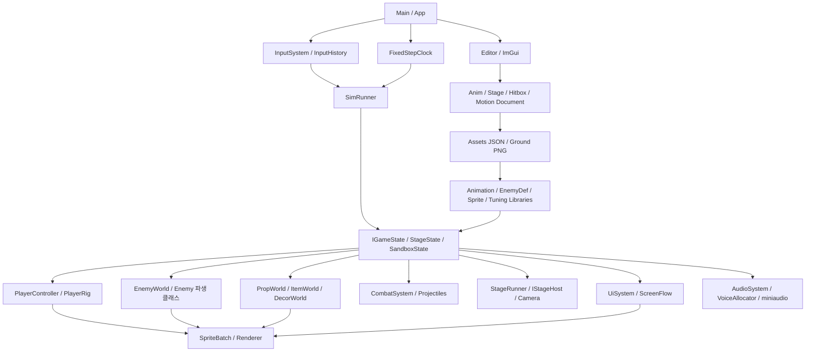

# 게임 코드 학습 안내

## 요청 처리 확인표

- [x] 분석 기준 커밋을 고정하고 게임 소스 변경을 중단했다.
- [x] Source 194개 파일의 타입·API·함수 위치 색인을 만들었다.
- [ ] 시작·입력·시간·렌더·물리·카메라·UI의 상세 설명을 완성하고 검토했다.
- [ ] 플레이어·무기·전투·14종 적·소품·아이템·스테이지의 상세 설명을 완성하고 검토했다.
- [x] 데이터·에디터·오디오의 상세 설명과 저장/실시간 반영 범위의 차이를 기록했다.
- [x] Git 기록으로 확인한 변경과 추론한 설계 이유를 구별했다.
- [x] 설명 연습 질문과 실제 소스 위치를 연결했다.
- [x] 모든 상세 문서의 파일 링크를 점검했다. (2026-10-14 자동 검사: 링크 4,546개 모두 파일 존재·줄 번호 범위 안. 01의 없는 06 문서 참조는 02로 고침)
- [x] 플레이 롱테이크 → 에디터 시연 → 다른 소스의 트레일러 → 마무리 순서의 영상 파일을 완성했다. (프로토타입 `Video/out/MetalSlug2_Prototype.mp4`, 자막은 초안)
- [x] 완성 영상의 자막 배치·장면 전환·출력 길이·영상/음성 스트림을 확인했다. (프레임 QA 시트·ffprobe. 소리는 사람이 들어서 확인해야 함)
- [x] 영상 자막의 코드 근거를 대조했다. ([06](06_Video_Claims.md))

이 표는 이번 분석·영상 제작 요청의 완료 조건이다. 이전 코드 스타일 변경이나 미사용 코드 전체 삭제가 완료됐다는 뜻은 아니다. 게임 빌드·테스트·새 플레이 검증은 사용자의 요청에 따라 수행하지 않는다.

2026-10-14 · 분석 기준: `0ef7104` (`before-deployment-cleanup-20261014`).

이 자료의 목적은 현재 게임과 에디터의 실제 동작을 코드에서 따라가며 설명할 수 있게 하는 것이다. Source 파일은 수정하지 않고, 테스트와 게임 실행도 새로 하지 않았다. 정적 코드 분석과 기존 데이터·Git 기록을 근거로 한다. 녹화 영상은 이전 실행 결과이므로 현재 코드와 모든 세부 동작이 같다는 증거로 취급하지 않는다.

사용자는 기본 게임의 대부분을 직접 구현했고 나머지에 AI 코딩을 활용했다고 설명했다. 개별 함수의 최초 작성 주체나 개인적인 설계 과정은 현재 코드만으로 판정할 수 없다. 기능 설명, 코드에서 추론한 설계 이유, 기록으로 확인한 변경 이력을 분리해서 읽는다.

## 읽는 순서

1. [기반·렌더·물리](<C:/Users/Ahnjiwoo/Desktop/Projects/windowAPIProject(24.02.05)/MyMetalSlug2/Docs/CodeStudy/01_Core_Render_World.md>): 프로그램이 시작해서 한 프레임을 처리하고 화면을 내보내는 과정.
2. [플레이어·전투·적·월드](<C:/Users/Ahnjiwoo/Desktop/Projects/windowAPIProject(24.02.05)/MyMetalSlug2/Docs/CodeStudy/02_Gameplay_Combat_Enemies.md>): 입력이 행동과 피격으로 연결되는 과정, 14종 적의 실제 동작.
3. [데이터·에디터·오디오](<C:/Users/Ahnjiwoo/Desktop/Projects/windowAPIProject(24.02.05)/MyMetalSlug2/Docs/CodeStudy/03_Editor_Data_Audio.md>): JSON이 게임을 구성하는 과정과 편집 값을 저장·반영하는 방식.
4. [변경 이력과 설명 연습](<C:/Users/Ahnjiwoo/Desktop/Projects/windowAPIProject(24.02.05)/MyMetalSlug2/Docs/CodeStudy/04_History_Questions.md>): 확인 가능한 시행착오와 시스템 간 추적 문제.
5. [전체 소스 색인](<C:/Users/Ahnjiwoo/Desktop/Projects/windowAPIProject(24.02.05)/MyMetalSlug2/Docs/CodeStudy/05_Source_Index.md>): Source 194파일/45,405줄의 타입·API·함수 위치. 자동 추출 항목은 3,825개이며 메서드만의 정확한 개수는 아니다.
6. [영상 자막의 코드 근거](<C:/Users/Ahnjiwoo/Desktop/Projects/windowAPIProject(24.02.05)/MyMetalSlug2/Docs/CodeStudy/06_Video_Claims.md>): 프로토타입 영상의 자막 한 줄마다 근거 파일:줄과 설명할 때 주의할 경계.
7. [편집기·데이터·오디오 심층](<C:/Users/Ahnjiwoo/Desktop/Projects/windowAPIProject(24.02.05)/MyMetalSlug2/Docs/CodeStudy/07_Tools_Data_Audio_DeepDive.md>): 에디터 문서 저장 전략, 정확한 hot reload 표, 보스 여러 sprite QA 루프.

본문에서 처음 모르는 이름을 만나면 아래 개념과 해당 파일을 먼저 확인한다. 모든 파일을 이름순으로 읽기보다 실행 경로를 따라가며 범위를 넓힌다.

## 전체 구조

이 그림의 화살표는 제어·참조·데이터 흐름을 함께 표시한다. 직접적인 C++ 소유권 그래프와 동일하지 않다. 소유권은 각 상세 문서에서 값 멤버, Scoped, 빌려 쓰는 포인터/Span을 구분한다.

## 먼저 익힐 용어

| 용어 | 이 프로젝트에서 읽을 의미 |
|---|---|
| Tick | 고정 시간 간격의 게임 논리 갱신. 렌더 프레임과 구별 |
| dt / alpha | dt는 계산 시간 간격, alpha는 이전·현재 위치의 표시 보간 비율 |
| Body / feet | 물리 본체와 발바닥 기준 위치. 대부분 화면 좌표는 오른쪽 +X, 아래 +Y |
| Hurtbox / Hitbox | 맞을 수 있는 영역 / 공격 판정 영역 |
| hit ID / owner ID | 공격 중복 피격 기록의 수명 / 판정 대상 소유자 식별 |
| State / Phase | 게임 전체 장면, 또는 객체 내부 행동 진행. 같은 이름이라도 범위를 확인 |
| Def / Config / Tuning | 로드된 종류별 정의, 그 행동 설정, 공통 게임 수치 |
| Rig / Overlay | 플레이어 표시 조합 / 상체 공격 등 겹쳐 표시하는 행동 |
| Scoped / Span | 객체를 소유하는 핸들 / 외부 저장소를 빌려 보는 연속 구간 |
| Atlas / pivot | 여러 프레임이 모인 텍스처 / 프레임을 세계 위치에 붙이는 기준점 |
| section / wave / gate | 위치 기반 구간 / 반복 스폰 묶음 / 조건을 기다리는 실행 항목 |
| hot reload | 파일 변경을 감지해 현재 실행 데이터에 반영. 편집 종류마다 범위가 다름 |

## 이해 확인 방법

한 기능을 설명할 때 아래 여섯 항목을 자기 말로 연결한다.

- 시작점: 어떤 입력/이벤트/데이터가 들어오는가.
- 상태: 어느 객체의 어느 값이 바뀌는가.
- 순서: 다른 시스템보다 먼저/나중에 처리되는 이유는 무엇인가.
- 결과: 물리·전투·애니메이션·사운드 중 어디로 전달되는가.
- 경계: 같은 틱의 다중 사건, 실패, 재시작, 삭제에서 무엇이 달라지는가.
- 근거: 실제 함수와 조건을 찾아 설명할 수 있는가.

## 주의해서 설명할 사실

- 렌더 순서는 단순한 Y정렬이 아니라 depth → sortKey → 제출 seq다.
- 고정 Tick을 사용하지만 모든 시간/캡처가 완전히 결정적이라는 뜻은 아니다.
- `DisplayTimer`의 표시 숫자 간격은 390틱이다. 화면의 60이 현실의 60초는 아니다.
- Stage와 Sandbox의 Tick 순서·발판 전달·튜닝 감시 범위는 같지 않다.
- 에디터의 Save, 즉시 live 적용, 파일 감시 reload는 서로 다른 경로다.
- 가상 함수가 있다는 사실만으로 모든 종류의 판단이 클래스 내부로 옮겨진 것은 아니다.
- Hash/checkpoint 일치는 누락된 필드와 양자화 한계 때문에 전체 동치의 증명이 아니다.

삭제 요청에 따른 배포 정리는 이 자료와 영상 제작이 끝나기 전까지 소스를 바꾸지 않는 방식으로 분리한다. 이 자료는 삭제 완료를 주장하는 보고서가 아니다.
