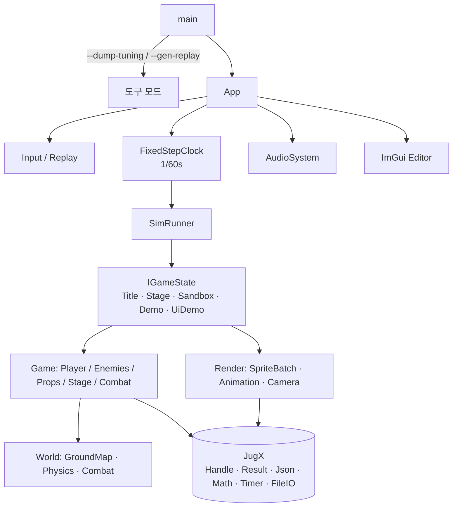

# MetalSlug2 Clone — 아키텍처 포트폴리오 문서

> C++20 + SDL3 로 만든 2D 액션 게임(메탈슬러그 2 Mission 4)의 **결정적 시뮬레이션 구조**와,
> 이를 **동작 변경 0** 으로 자체 유틸 → 자작 라이브러리(JugX) 기반의 평평한 구조로 재정비한 과정을 정리한 문서.

---

## 1. 한눈에 보기

| 항목 | 내용 |
|---|---|
| 장르 / 범위 | 2D 런앤건 액션, 한 스테이지(적 11종·보스·차량·소품·UI·에디터) |
| 기술 | C++20, SDL3(렌더/입력), miniaudio(오디오), yyjson, stb, imgui(에디터), GoogleTest |
| 규모 | 소스 약 4.4만 줄 / 테스트 2.0만 줄, 단위 테스트 902개 |
| 핵심 설계 | **고정 1/60초 결정적 시뮬레이션 + 리플레이 해시 회귀 검증** |
| 데이터 주도 | 애니메이션/스테이지/적 정의/튜닝은 JSON·PNG 를 손으로 고치면 즉시 반영 |
| 도구 | 게임 내 ImGui 에디터(애니메이션·맵·충돌·AI), 핫 리로드 |

---

## 2. 설계 목표

1. **재현 가능성**: 같은 입력이면 항상 같은 결과. 버그 재현과 회귀 검증의 기반.
2. **데이터 주도**: 코드 수정/재빌드 없이 에셋을 고쳐 바로 확인.
3. **단순함**: 프레임워크를 만들지 않고, 직접 호출 가능한 평평한 구조를 유지.
4. **검증 가능한 리팩터링**: 구조를 바꿔도 결과가 1비트도 달라지지 않음을 기계적으로 증명.

---

## 3. 시스템 구성



| 모듈 | 책임 |
|---|---|
| `Core` | 루프(App), 입력/리플레이, 고정 스텝, 자산 경로, 튜닝 |
| `Render` | SDL 렌더러, 스프라이트 배치(+병렬 디코드), 애니메이션, 카메라 |
| `Audio` | miniaudio 래퍼, 사운드 뱅크, 보이스 할당 |
| `World` | 지면 마스크 충돌, 물리, 피격 판정 |
| `Game` | 게임 상태, 플레이어, 적/보스/차량, 소품, 스테이지 러너, UI |
| `Editor` | 에디터 탭(애니/맵/충돌/AI), JSON 원문 제자리 편집 |

---

## 4. 핵심 설계 결정

### 4.1 결정적 시뮬레이션
- 시뮬레이션 상태는 **(틱 번호, 그 틱의 입력 프레임)** 만의 함수. 벽시계·프레임레이트에 의존하지 않음.
- 렌더는 시뮬레이션을 읽기만 하며(텍스처 핸들, 보간 알파는 해시에 들어가지 않음), 결과에 영향을 주지 않음.
- 난수는 시드 고정(`mt19937_64`), 오디오 피치용 RNG 는 별도로 분리해 해시와 무관.

### 4.2 고정 스텝 + 입력 프레임
```text
프레임 dt → FixedStepClock (1/60초, 프레임당 최대 5틱, 초과분은 버림)
         → 틱마다 InputFrame 1개 → SimRunner.Step → GameState.Tick
```
- 키보드 입력도 리플레이와 같은 `InputFrame` 형식으로 샘플링되어 기록/재생이 동일 경로를 탐.

### 4.3 해시 기반 회귀 검증
- 상태마다 `DebugHash`(FNV-1a)를 노출하고, 리플레이를 끝까지 돌려 `ticks / finished / hash` 한 줄로 비교.
- 상태별 합성 리플레이 13개 + 실제 리플레이 2개 = 15개 기준선.

### 4.4 비동기 로딩: "읽기+디코드만 병렬, GPU 생성은 메인"
```text
이전  Submit(Job) → 워커 Execute → Notice → 메인 큐 DrainAll → 순서 재조립 → Complete(GPU)
      (로더 + 큐 + Job 3종 + Notice + 인터페이스 2개 ≈ 600줄)

지금  DecodeImages(경로들, 워커 수)       // std::for_each(par), 결과는 요청 순서 그대로
      for 결과: AddAtlasPage(...)         // 메인 스레드에서 GPU 텍스처 생성
```
- 스레드 경계가 한 줄로 설명됨: 워커는 파일/디코드만, SDL 과 게임 객체는 메인만 접근.
- 비용: Release 첫 프레임 약 +8%(≈100ms). 단순함과 맞바꾼 의도된 트레이드오프.

### 4.5 에디터와 데이터 핫 리로드
- 에디터가 `AnimationLibrary` 객체를 직접 수정하고, 파일 변경은 1초 폴링으로 감지.
- 저장은 JSON **원문 텍스트를 제자리 교체**해 서식과 키 순서를 보존(diff 가 작음).

---

## 5. 리팩터링 프로젝트: 동작 불변으로 구조를 단순화하기

### 5.1 문제
자체 유틸이 늘어나 `AsyncLoader`·`MainThreadQueue`·Job/Notice·단일 구현 인터페이스·`*Context` 묶음 등 **과한 추상화**가 쌓였고, 중복 JSON 필드 리더와 죽은 코드도 많았음.

### 5.2 접근
```text
(1) 검증 장치 먼저  →  (2) 도입/교체  →  (3) 단순화  →  (4) 삭제  →  (5) 재검증
```
- **안전망 우선**: 변경 전에 리플레이 해시 15, 화면 캡처 해시 7, 튜닝 덤프 해시, 텍스처 로드 순서 표, 단위 테스트를 한 번에 돌리는 `Verify.ps1` 을 만들었음.
- **한 번에 하나**: 모듈 단위 커밋 + 매 커밋마다 전체 검증. 하나라도 달라지면 그 단계만 되돌림.
- **증명 가능한 변경만**: 주석/서식 정리는 "주석 제거 후 토큰 스트림 동일"을 스크립트로 증명.

### 5.3 결과
| 영역 | 변화 |
|---|---|
| 비동기 로더 | 약 600줄 3겹 구조 → 병렬 디코드 함수 1개 |
| 인터페이스 | 단일 구현 `IAudioSink`/`IStageHost` 계열 해체, `IGameState`(구현 5개)만 유지 |
| 서비스 접근 | `GameContext` 포인터 묶음 제거 → 싱글턴 + 전역 디버그 스위치 |
| headless 모드 | 별도 경로/분기 16곳 제거, `--replay --hash` 한 줄 경로로 일원화 |
| JSON | 자체 래퍼 + 3벌 필드 리더 → JugX `JsonDeserializer` + 공용 리더 |
| 유틸 | Handle·Result/Error·Random·Assert·Log·Timer·파일 IO·해시·Vec2 등 JugX 로 교체 |
| 코드량 | 죽은 코드/테스트/문서/중복 제거로 대규모 순감, 추적 파일 2,036 → 약 430 |
| 동작 | **해시 15/15, 캡처 7/7, 튜닝, 단위 테스트 902/902 동일** |

### 5.4 의도적으로 바꾸지 않은 것 (판단 근거)
- 부동소수 연산 순서나 메모리 레이아웃이 달라 **결과가 바뀔 수 있는 타입**(예: 스칼라 나눗셈이 역수 곱인 벡터, 필드 순서가 다른 RGBA)은 호출부를 비트 동일하게 풀어 쓸 수 있을 때만 교체.
- 에디터의 원문 텍스트 제자리 편집은 직렬화 라이브러리로 대체할 수 없어 유지.
- 테스트 시임으로 쓰이는 `IStageHost` 는 대체 구조가 더 복잡해져 유지.

---

## 6. 품질 보증

| 장치 | 내용 |
|---|---|
| 단위 테스트 | 902개 (전투·물리·스테이지·에디터·정의 파서·오디오 결정성 등) |
| 리플레이 해시 | 15개 상태/시나리오, 결과 한 줄 비교 |
| 캡처 해시 | 상태 7개 오프스크린 렌더 SHA256 |
| 로드 순서 표 | 텍스처 로드 순서/내용 해시(async·sync 동일) |
| 스타일 검증 | `.clang-format` 일치율, 이름 규칙, 주석 밀도 지표로 코드 스타일 수렴을 수치로 확인 |

---

## 7. 배운 점

1. **리팩터링은 검증 장치를 먼저 만든 만큼만 안전하다.** 해시/캡처 기준선을 먼저 만든 덕에 대규모 삭제와 교체를 두려움 없이 진행.
2. **추상화는 "교체될 것" 이 아니라 "실제로 갈리는 것" 에만.** 구현이 하나뿐인 인터페이스는 가짜(Fake)를 위한 구조가 되기 쉬움.
3. **단순함에는 비용이 있고 그 비용을 숫자로 인정해야 한다.** 병렬 디코드 단순화의 비용(+8% 첫 프레임)을 측정해 기록.
4. **서드파티 코드도 사용하면서 검증된다.** 도입 중 라이브러리 버그 2건(난수 오버로드 추론, 스마트 포인터 변환 제약)을 찾아 원인과 수정까지 반영.

---

## 8. 저장소 구성

```text
Source/   게임 코드        Test/     단위 테스트 + 리플레이
Assets/   JSON/PNG/오디오   Scripts/  빌드·검증·로드 추적
Docs/     포맷/스타일/아키텍처 문서      Vendor/JugX  자작 유틸 라이브러리(서브모듈)
```
관련 문서: `Docs/Architecture.md`(상세·자가평가), `Docs/CodingStyle.md`, `Docs/Wayfinder/Progress.md`(진행 기록).
