<div align="center">

# MetalSlug2-Clone

**C++20과 SDL3로 만든 메탈슬러그 2 Mission 4 모작**


[](https://youtu.be/OR9MWsp2wJE)

<p align="center">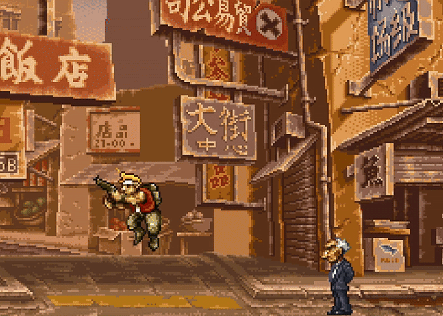</p>

</div>

## Contents

- [프로젝트 소개](#프로젝트-소개)
- [게임 루프와 틱 순서](#게임-루프와-틱-순서)
- [플레이어](#플레이어)
- [적과 보스](#적과-보스)
- [데이터 기반 설계](#데이터-기반-설계)
- [지형 충돌](#지형-충돌)
- [렌더링](#렌더링)
- [오디오](#오디오)
- [이미지 로딩](#이미지-로딩)
- [GUI 에디터](#gui-에디터)
- [빌드 및 실행](#빌드-및-실행)

<br>

## 프로젝트 소개

메탈슬러그 2의 Mission 4를 학습 목적으로 모작한 횡스크롤 액션 게임입니다. 게임 엔진 없이 SDL3 위에 게임 루프, 물리와 충돌, 스프라이트 렌더링, 애니메이션, 사운드를 직접 만들었고, 애니메이션·맵·지형 충돌·적 AI를 고치는 ImGui 편집기를 같은 실행 파일에 넣었습니다.

게임은 `MISSION 4` 배너로 시작합니다. 시가지에서 병사와 부서지는 건물을 지나면 병사를 쏟아내는 버스와 싸우는 구간이 나오고, 차량과 헬기가 등장하는 구간을 거쳐 Big Shiee 보스전으로 이어집니다. 보스를 파괴하면 결과 화면이 나옵니다. 스테이지는 하나이며 원작 전체를 구현하지는 않았습니다.

<p align="center">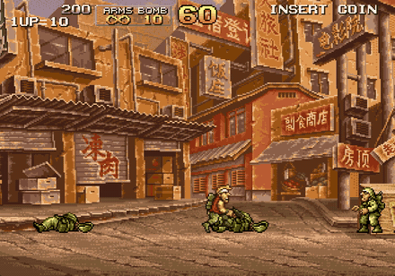</p>

처음에는 2024년 2월 5일부터 두 달 동안 혼자 개발해 게임을 완성했습니다. 그 뒤 2026년 10월 9일부터 일주일 동안 AI 활용 경험을 쌓기 위해 Claude Code와 함께 당시 코드를 리팩터링했고, 아래에서 설명하는 구조는 리팩터링을 마친 현재 코드 기준입니다. 처음부터 보스전까지의 플레이는 [유튜브 영상](https://youtu.be/OR9MWsp2wJE)에서 볼 수 있습니다.

<br>

## 게임 루프와 틱 순서

게임은 60Hz 고정 스텝으로 진행합니다. [`FixedStepClock`](Source/Core/FixedStep.h)이 실제 경과 시간을 누적해 이번 프레임에 몇 틱을 돌릴지 정하고, 남은 시간 비율을 렌더에 넘깁니다. 판정과 이동은 항상 1/60초 단위로 계산되므로 모니터 주사율이 달라도 점프 높이나 탄 속도가 바뀌지 않습니다. 창을 끌어 잠시 멈췄다가 돌아오면 밀린 틱을 한꺼번에 돌리려 하기 때문에, 한 프레임의 시간을 0.25초, 틱 수를 5로 제한했습니다.

### 렌더 보간

틱은 1초에 60번이지만 화면은 모니터 주사율에 맞춰 그 사이에도 그려집니다. 현재 위치를 그대로 그리면 같은 위치가 두 번 그려지거나 한 틱씩 건너뛰어 움직임이 고르지 않게 보입니다. 그래서 플레이어, 탄, 수류탄, 카메라는 이전 틱 위치를 따로 기억하고, 렌더는 `FixedStepClock`이 넘긴 남은 시간 비율 `_alpha`로 두 위치 사이를 그립니다.

```cpp
const VECTOR2 feet = Lerp(m_player.GetPrevFeet(), m_player.GetFeet(), _alpha);   // 플레이어
const VECTOR2 pos  = Lerp(bullet.renderPrev, bullet.position, _alpha);           // 탄
```

보간한 값은 그리기에만 씁니다. 판정과 이동은 계속 틱 단위 위치로 계산하므로, 프레임 수가 달라도 게임 결과는 같습니다. 카메라 위치는 보간한 뒤 정수 픽셀로 내려서, 배경이 픽셀 사이에 걸쳐 흐려지거나 떨리지 않게 했습니다.

### 상태 전환

타이틀·스테이지·샌드박스는 모두 `IGameState`를 구현합니다. 상태는 다음 상태를 직접 실행하지 않고 `TakeNextState()`로 넘기기만 하고, 실제 교체는 틱이 끝난 뒤 [`SimRunner`](Source/Game/SimRunner.cpp)가 합니다. 실행 중인 `Tick()` 안에서 자기 자신이 지워지는 일을 막기 위해서입니다.

### 판정 일괄 처리

스테이지 한 틱에서 가장 중요하게 정한 것은 순서입니다. 플레이어, 적, 프롭(부서지는 건물·오브젝트), 발사체가 서로를 직접 때리게 하면 누가 먼저 갱신되느냐에 따라 결과가 달라지고, 공격하는 쪽이 맞는 쪽의 체력 규칙까지 알아야 합니다. 그래서 [`StageState::Tick()`](Source/Game/Stage/StageState.cpp)은 판정 상자를 먼저 모두 등록하고, 판정은 한 곳에서 한 번에 내린 뒤, 결과를 각자 가져가게 했습니다.

```cpp
m_combat.BeginTick();                    // 지난 틱의 판정 상자를 비웁니다.
m_props.Tick(propCtx);
m_enemies.RegisterHurtboxes(m_combat);   // 맞을 수 있는 범위를 먼저 등록
m_props.RegisterHurtboxes(m_combat);

m_player.Tick(playerCtx, _input);        // 이동하고, 공격 범위(Hitbox)를 등록
m_enemies.Tick(enemyCtx);
m_projectiles.Step(ground, m_combat, kStepSec, m_enemyPlatforms);

const Vector<HitEvent>& events = m_combat.Resolve();   // 겹침 판정은 여기서 한 번만
m_props.OnHitEvents(events);             // 각 시스템이 자기 몫의 결과를 처리
m_enemies.OnHitEvents(events);
m_player.OnHitEvents(events);
m_projectiles.OnHitEvents(events, m_combat);

m_runner->Tick();                        // 마지막으로 스테이지 진행을 확인
```

[`CombatSystem`](Source/Game/Combat/CombatSystem.h)은 공격 범위 `Hitbox`와 피격 범위 `Hurtbox`의 겹침, 팀, 무적 여부만 보고 `HitEvent`를 만듭니다. 체력을 깎을지, 방패로 막을지, 보스의 어느 부위가 맞았는지는 이벤트를 받은 쪽이 정합니다. 덕분에 새 무기를 만들 때 적 코드를 고치지 않아도 되고, 반대로 방패병처럼 맞는 방식이 특이한 적도 판정기를 건드리지 않고 만들 수 있었습니다. 대가로 이번 틱에 등록된 상자는 다음 틱 갱신이 끝날 때까지 바뀌지 않으므로, 판정은 항상 이번 틱 이동이 끝난 위치 기준이 됩니다.

여러 틱 동안 남는 칼이나 화염은 공격마다 ID를 받아 명중 이력을 남깁니다. 칼 판정 상자가 몇 틱 동안 겹쳐도 같은 대상에게는 한 번만 피해를 주고, 화염처럼 일정 간격마다 다시 피해를 주는 공격도 같은 ID 규칙으로 처리합니다.

<br>

## 플레이어

메탈슬러그의 캐릭터는 달리면서 위를 쏘고, 점프하면서 아래로 수류탄을 던집니다. 이동과 조준과 공격을 동작 하나로 묶으면 조합마다 애니메이션 상태가 필요해집니다. 그래서 플레이어를 **무엇을 하고 있는가**와 **어떻게 보이는가** 두 단계로 나눴습니다.

[`PlayerController`](Source/Game/Player/PlayerController.cpp)는 입력을 해석해 이동, 자세, 조준 방향, 무기, 공격 동작을 정하고, 그 결과를 `RigState`라는 작은 구조체로 내보냅니다. [`PlayerRig`](Source/Game/Player/PlayerRig.cpp)는 이 구조체만 보고 그릴 클립을 고릅니다.

```cpp
struct RigState
{
    eWeapon      weapon  = eWeapon::Pistol;
    ePlayerState state   = ePlayerState::Idle;   // 달리기, 점프, 사망 등
    ePose        pose    = ePose::Stand;         // 서기, 앉기
    eAim         aim     = eAim::Forward;        // 앞, 위, 아래
    eOverlay     overlay = eOverlay::None;       // 사격, 칼, 투척처럼 상체에 겹치는 동작
    int          facing  = 1;
    // ...
};
```

`PlayerRig`는 상체와 하체 클립을 따로 고릅니다. 하체는 `state`와 `pose`로, 상체는 `weapon`·`aim`·`overlay`로 정해지므로 달리는 하체 위에 위를 조준한 상체를 얹을 수 있습니다. 걸을 때는 상체와 하체의 재생 위치를 맞춰 같은 걸음으로 보이게 하고, 앉기나 사망처럼 몸 전체가 함께 움직이는 동작만 전신 클립을 씁니다. 컨트롤러는 클립 이름을 하나도 모르기 때문에, 판정과 이동을 고칠 때 애니메이션 코드를 신경 쓰지 않아도 됩니다.

<p align="center">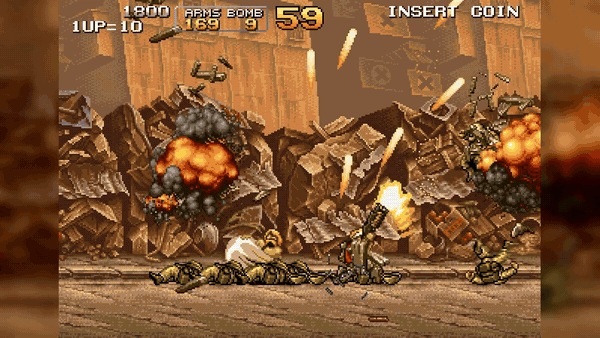</p>

조작감을 위해 점프와 사격 입력은 몇 틱 동안 보관했다가 쓰고, 발판에서 떨어진 직후에도 잠깐 점프를 받아 줍니다. 사격 버튼은 근처에 적이 있으면 칼 공격으로 바뀝니다. 무기는 [`WeaponState`](Source/Game/Player/PlayerWeapons.h)가 탄약과 발사 간격을 관리하고, 무기마다 어떤 발사체를 어느 방향으로 만들지만 정해 [`ProjectileSystem`](Source/Game/Combat/Projectiles.cpp)에 넘깁니다. 이동과 충돌, 명중 후 폭발 같은 나머지는 발사체 쪽에서 처리하므로 권총, HMG, 샷건, 로켓, 화염방사기가 같은 경로를 씁니다.

무기마다 다른 부분은 발사체의 규칙입니다. 로켓은 느리게 출발해 최대 속도까지 가속하고, 명중하면 날아가던 탄을 끝내는 대신 폭발 범위를 가진 판정을 따로 만들어 주변 대상에게 피해를 줍니다. 화염방사기는 탄 한 발이 아니라 각도와 속도가 조금씩 다른 입자를 시간차로 뿌리고, 입자가 커질수록 판정도 커집니다. 한 번 분출한 입자들은 공격 ID를 공유해서, 여러 입자가 겹쳐도 피해가 한꺼번에 쌓이지 않고 정해진 간격마다 다시 들어갑니다.

HUD는 플레이어 상태로 `HudModel`을 만들고, [`UiSystem`](Source/Game/Ui/UiSystem.cpp)이 비트맵 글꼴과 스프라이트로 목숨, 점수, 탄약, 수류탄, 보스 체력을 그립니다. 미션 시작 배너, 페이드, 결과 화면은 [`ScreenFlow`](Source/Game/Ui/ScreenFlow.cpp)가 맡습니다. 화면 흐름이 진행되는 동안 `StageState::Tick()`은 UI와 화면 흐름만 갱신하고 월드 갱신을 건너뛰므로, 결과 화면 뒤에서 적이 계속 움직이지 않습니다.

<br>

## 적과 보스

적은 병사, 방패병, 바주카병, 차량, 헬기, 버스, 보스까지 모양과 행동이 크게 다릅니다. 그래도 생성되고, 화면에 들어오면 활성화되고, 맞으면 깜빡이고, 죽으면 연출이 끝난 뒤 사라지는 흐름은 같습니다. 이 공통 흐름은 [`EnemyWorld`](Source/Game/Enemies/EnemyWorld.cpp)가 맡고, 종류마다 다른 판단만 [`Enemy`](Source/Game/Enemies/Enemy.h) 파생 클래스에 두었습니다.

```cpp
class Enemy
{
public:
    virtual void Init(const EnemyDef& _def, EnemyEnv& _env) = 0;
    virtual void Tick(const EnemyDef& _def, EnemyEnv& _env) = 0;      // 종류별 판단과 공격
    virtual bool OnHit(const EnemyDef& _def, EnemyEnv& _env, const HitEvent& _event);
    virtual void OnDeath(const EnemyDef& _def, EnemyEnv& _env);
    virtual void TickDying(const EnemyDef& _def, EnemyEnv& _env);     // 사망 연출
    virtual void RegisterHurtboxes(const EnemyDef& _def, CombatSystem& _combat) const;
    // ...
};
```

`EnemyWorld`는 적을 `Scoped<Enemy>`로 소유하고, JSON에 적힌 행동 이름으로 `MakeEnemy()`가 알맞은 클래스를 만듭니다. 일반적인 피해 처리는 기본 `OnHit()`이 하고, 방패병이나 보스처럼 맞은 위치에 따라 반응이 달라지는 적만 이 함수를 다시 씁니다. 방패병은 방패와 몸통을 따로 `Hurtbox`로 등록해, 같은 `HitEvent`라도 방패에 맞았으면 피해 없이 막습니다.

### 적 정의 JSON

몸체 크기, 체력, 클립, 총구 위치, 감지 거리 같은 값은 [`Enemies.json`](Assets/Defs/Enemies.json)에 있습니다. 비슷한 적이 많아서 정의끼리 상속할 수 있게 했습니다. `human_base`가 보병의 몸체와 사망 클립을 갖고, `soldier_base`가 이동 클립을 더하고, `soldier_bomb`이 투척 공격만 더하는 식입니다.

```json
"soldier_bomb": {
  "extends": "soldier_base",
  "params":  { "ai": "bomb", "detect": 350, "closeStop": 200, "fireFrame": 10 },
  "clips":   { "throw": { "name": "SD_Throw_Bomb_{side}", "frames": 14, "sec": 0.08 } },
  "weapons": { "attack": { "projectile": "soldier_bomb_proj", "muzzle": [0, -37], "aim": "facing" } }
}
```

로더는 `extends` 체인을 따라가며 클립·무기·파라미터를 합칩니다. 데이터는 어떤 자원을 쓰고 어떤 수치로 움직일지를 정하고, C++ 클래스는 그 값으로 언제 다가가고 언제 던질지를 판단합니다. 감지 거리나 투척 프레임을 바꾸는 데에는 빌드가 필요 없습니다.

### 차량과 헬기

지프, 탱크, 미사일 탱크, 사루비아, 헬기는 움직이고 공격하는 방식은 다르지만, 부서질 때는 모두 멈추고 파괴 클립을 재생하고 폭발 효과를 낸 뒤 정해진 시간이 지나면 사라집니다. 이 공통 흐름을 [`VehicleCommon`](Source/Game/Enemies/VehicleCommon.cpp)의 `BeginVehicleDeath()`와 `TickVehicleDeath()`로 묶었습니다. 어떤 폭발을 어디에 낼지와 언제 지울지는 정의 JSON의 `death` 항목에서 읽으므로, 각 차량 클래스는 자기 이동과 공격만 구현합니다.

### 버스와 Big Shiee

버스의 주된 공격은 병사를 불러 버스에 태운 뒤 공격하게 하는 것입니다. 카메라가 전투 구역에 들어오면 문과 계단을 펼치고, 소환한 병사는 계단을 올라 버스 안으로 들어갑니다. 살아 있는 소환 병사 수와 버스의 손상 단계로 다음 소환을 조절합니다.

병사가 버스 안에 들어간 것처럼 보이게 하려고, 버스를 한 장의 그림으로 그리지 않고 속(몸체)과 겉(덮개 프레임)을 따로 제출하는 부위로 나눴습니다. 부위마다 깊이와 정렬 값을 [`Bus.json`](Assets/Defs/Bus.json)에 둡니다.

```jsonc
"parts": {
  "body":  { "depth": 15, "sort": 3 },   // 버스 속
  "cover": { "depth": 16, "sort": 4 }    // 버스 겉 프레임
}
```

병사는 다른 적과 같은 깊이 15로 그려집니다. [`SpriteBatch`](Source/Render/SpriteBatch.cpp)는 한 프레임의 그리기 명령을 모은 뒤 깊이, 정렬 값, 제출 순서 순으로 정렬해서 그리므로, 병사는 깊이 15인 버스 속보다 뒤에, 깊이 16인 겉 프레임보다 앞에 그려집니다. 그 결과 병사가 버스 속 위에 보이면서 겉 프레임에 가려져, 버스 안에 타고 있는 장면이 됩니다. 순서를 정하는 것은 깊이 값뿐이라 버스와 병사 중 누가 먼저 `Submit()`을 부르든 결과가 같습니다. 그래서 병사 코드는 버스를 몰라도 되고, 버스 코드도 병사를 언제 그리는지 신경 쓰지 않습니다.

버스는 체력이 0이 된 순간이 아니라 폭발과 잔해 연출이 끝난 순간을 따로 알립니다. 스테이지는 이 신호를 기다렸다가 카메라 잠금을 풉니다.

<p align="center">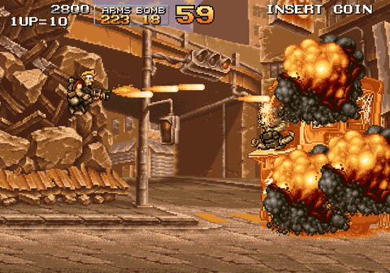</p>

Big Shiee는 포탑 여러 개와 주포로 이루어진 보스입니다. 부위마다 적을 따로 만들면 이동과 사망을 맞추기 어려워서, 적 하나가 여러 부위를 갖게 했습니다. 각 부위는 `MakePartOwner(적 ID, 부위 번호)`로 만든 소유자 ID를 단 `Hurtbox`를 등록하고, `OnHit()`은 이벤트의 소유자 ID로 어느 포탑이 맞았는지 찾습니다. 판정기 입장에서는 평범한 적과 다르지 않습니다. 포탑이 모두 부서지면 주포를 전개하고, 주포는 열려 있는 동안에만 `Hurtbox`를 등록해서 맞는 시간을 패턴으로 만들었습니다.

<p align="center">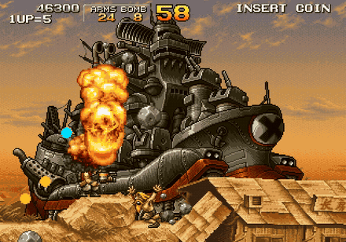</p>

<br>

## 데이터 기반 설계

점프 높이를 조금 낮추거나 적을 몇 픽셀 옮길 때마다 빌드를 다시 하지 않도록, 값과 배치는 JSON에 두고 C++은 그 값을 해석하는 규칙만 갖게 했습니다. 앞에서 본 [적 정의](#적-정의-json)도 같은 방식입니다.

### 튜닝 값

[`Tuning.json`](Assets/Tuning/Tuning.json)에는 플레이어 이동과 몸체, 총구, 무기, 칼, 수류탄, 아이템, 카메라 수치가 들어 있습니다. 예를 들어 이동 항목은 다음과 같습니다.

```json
"move": {
  "runSpeed": 250, "jumpSpeed": 600, "gravity": 1400, "terminalVelocity": 1000,
  "coyoteTicks": 4, "jumpBufferTicks": 4, "shotBufferTicks": 6,
  "maxStepUp": 4, "maxSnapDown": 4
}
```

앞에서 말한 입력 보관 시간(`jumpBufferTicks`)이나 발판에서 떨어진 뒤 점프를 받아 주는 시간(`coyoteTicks`), 지형 단차를 오르내리는 높이(`maxStepUp`, `maxSnapDown`)가 모두 여기 있습니다. 무기도 피해량, 발사 간격, 탄 속도, 사거리, 동시에 살아 있는 탄 수를 같은 형식으로 가집니다. 샌드박스 상태에서는 [`TuningWatcher`](Source/Core/Tuning.h)가 60틱마다 파일을 확인해 바뀌었으면 다시 읽으므로, 게임을 켜 둔 채 값을 고치고 바로 뛰어 볼 수 있습니다.

### 스테이지 진행

어디에 무엇이 나오고 카메라가 언제 멈추는지를 코드로 쓰면, 배치 하나를 옮길 때마다 빌드를 다시 해야 합니다. 그래서 스테이지 진행을 [`Stage0.json`](Assets/Stage/Stage0.json)에 구간(section) 목록으로 적고, [`StageRunner`](Source/Game/Stage/StageRunner.cpp)가 이를 실행하게 했습니다.

구간은 `triggerX`와 액션 목록을 가집니다. 플레이어가 그 X좌표를 넘으면 액션이 차례로 실행됩니다. 현재 스테이지에는 구간 22개가 있고, 액션은 개체 생성(`spawn`)이 176개로 대부분이며 웨이브, 카메라 잠금, 경계 변경, 배경·지형·BGM 교체, 배너와 페이드가 나머지를 채웁니다. 버스 구간은 이렇게 생겼습니다.

```json
{
  "id": "bus", "triggerX": 2605,
  "actions": [
    { "type": "clear", "waves": true },
    { "type": "lockCamera", "rect": [2457, 0, 3097, 448], "glide": 2.5 },
    { "type": "gate", "id": "bus_clear", "waitFor": ["bus"], "until": "destroyFinished",
      "actions": [ { "type": "unlockCamera" }, { "type": "setBounds", "rect": [-89, 0, 4111, 448] } ] }
  ]
}
```

`gate`는 지정한 개체가 격파되거나 파괴 연출을 마칠 때까지 안쪽 액션을 미뤄 둡니다. 버스 구간에서는 카메라를 2.5초 동안 미끄러지듯 잠근 뒤, 버스가 `destroyFinished`를 알릴 때까지 기다렸다가 잠금을 풀고 다음 구간으로 갈 수 있게 경계를 넓힙니다. 보스 파괴 뒤 결과 화면으로 넘어가는 것도 같은 게이트로 표현합니다. 적 쪽은 "연출이 끝났다"는 신호만 내고, 그 뒤에 무엇을 할지는 스테이지 데이터가 정하므로 적 코드가 카메라를 알 필요가 없습니다.

웨이브(`spawnWave`)는 지연 시간, 반복 간격과 횟수를 가지고, 예약된 생성은 실행할 틱과 등록 순서로 정렬해 처리합니다. 카메라는 평소에는 플레이어 주변의 데드존을 벗어날 때만 따라가고, 이 잠금·이동 액션이 들어오면 지정한 영역으로 옮겨 갑니다. 보스전의 자동 스크롤은 잠금 영역 자체를 오른쪽으로 밀어서 만들었습니다.

<br>

## 지형 충돌

메탈슬러그의 배경은 계단, 경사, 무너진 지붕처럼 모양이 불규칙합니다. 이를 사각형으로 하나씩 덮으면 칸 수가 너무 많아지고 경사도 표현하기 어렵습니다. 그래서 충돌을 두 가지로 나눴습니다. 전투는 앞에서 본 축 정렬 사각형(AABB) `Hitbox`·`Hurtbox`로 판정하고, 지형은 배경 픽셀마다 고체인지 아닌지만 담은 비트 배열 [`GroundMap`](Source/World/GroundMap.cpp)으로 판정합니다.

<p align="center">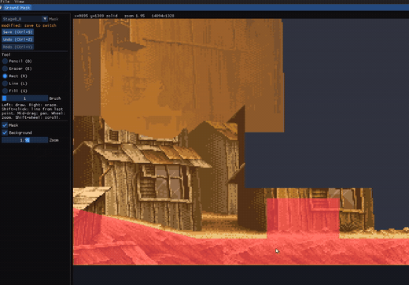</p>

빨간 부분이 고체 픽셀입니다. 스프라이트 색이나 알파를 매번 읽지 않고 미리 만든 1비트 마스크만 보므로, 한 점이 막혔는지는 비트 하나를 읽는 것으로 끝납니다. [`Physics`](Source/World/Physics.cpp)는 이동을 작은 구간으로 나눠 벽·천장·바닥을 검사하고, 발 아래 몇 픽셀을 탐색해 작은 단차는 오르내리게 합니다. 그래서 계단마다 따로 경사 데이터를 만들지 않아도 캐릭터가 그림에 맞춰 걷습니다.

빠른 발사체는 한 틱에 수십 픽셀을 움직여 얇은 벽을 건너뛸 수 있습니다. 지형에 대해서는 이동 선분을 일정 간격으로 나눠 검사하고, 다른 개체에 대해서는 이전 위치와 현재 위치를 덮는 상자로 판정합니다. 부서지는 건물은 파괴될 때 지정된 패치 마스크로 지형 일부를 지워서, 무너진 자리로 지나갈 수 있게 했습니다.

<br>

## 렌더링

### 깊이 정렬

월드의 모든 그리기는 [`SpriteBatch`](Source/Render/SpriteBatch.cpp)에 명령으로 제출됩니다. 배경, 프롭, 적, 플레이어, 탄, 이펙트는 `Submit()`을 부를 때 바로 그리지 않고 깊이, 정렬 값, 프레임과 위치를 담은 명령만 남깁니다. 한 프레임의 제출이 끝나면 `Flush()`가 명령을 정렬한 뒤 차례로 그립니다.

```cpp
std::sort(_commands.begin(), _commands.end(), [](const SpriteCommand& _a, const SpriteCommand& _b) {
    if (_a.depth != _b.depth)     return _a.depth < _b.depth;       // 1. 깊이 (층)
    if (_a.sortKey != _b.sortKey) return _a.sortKey < _b.sortKey;   // 2. 같은 층 안의 순서
    return _a.seq < _b.seq;                                         // 3. 그래도 같으면 제출 순서
});
```

깊이는 배경, 지형 위 오브젝트, 캐릭터, 이펙트처럼 큰 층을 나누고, 정렬 값은 같은 층 안의 앞뒤를 정합니다. 적은 정렬 값에 발의 y좌표를 더해서, 화면 아래쪽에 선 캐릭터가 앞에 그려집니다. 그리는 순서가 이 값들로만 정해지기 때문에 시스템을 갱신하는 순서나 `Submit()`을 부르는 순서를 신경 쓰지 않아도 됩니다. [버스](#버스와-big-shiee)에 병사가 타는 장면도 이 규칙만으로 만들었습니다. `std::sort`는 같은 값끼리의 순서를 보장하지 않기 때문에, 깊이와 정렬 값이 모두 같을 때는 제출 순서로 앞뒤를 고정합니다.

애니메이션 프레임은 아틀라스 페이지의 한 영역과 피벗을 가지고, 제출할 때 좌우 반전, 회전, 배율, 색조를 함께 지정합니다. 화면은 논리 해상도 640×448로 그린 뒤 정수 배율과 최근접 샘플링으로 키워서 도트가 흐려지지 않게 했습니다.

### 긴 배경 분할

스테이지 배경은 가로로 수천 픽셀이 넘는 한 장짜리 그림입니다. 렌더러가 만들 수 있는 텍스처 크기에는 한계가 있어서, 폭이 2048을 넘는 이미지는 로딩할 때 폭 2048 이하의 띠 여러 장으로 잘라 텍스처로 만듭니다. 그릴 때는 카메라가 보는 구간이 어느 띠에 걸치는지 계산해 그 띠들만 그립니다. 화면 폭이 640이므로 한 번에 그리는 띠는 많아야 두 장입니다.

```cpp
const int first = Max(0, static_cast<int>(_src.x) / _texture.stripW);                      // 보이는 구간의 첫 띠
const int last  = Min(static_cast<int>(_texture.strips.size()) - 1,
                      static_cast<int>(_src.x + _src.w - 0.001f) / _texture.stripW);        // 마지막 띠
```

## 오디오

오디오는 miniaudio 위에 [`AudioSystem`](Source/Audio/AudioSystem.cpp)을 두고, 코드에서는 파일 경로 대신 [`sounds.json`](Assets/sounds.json)에 등록한 이름으로 소리를 찾습니다. 효과음은 짧고 자주 겹쳐 나오므로 미리 디코딩해 두고, BGM은 길어서 메모리에 다 올리지 않고 스트리밍합니다. 두 경우는 사운드를 만들 때 `MA_SOUND_FLAG_DECODE`와 `MA_SOUND_FLAG_STREAM` 플래그 하나로 갈립니다.

전투 중에는 총소리와 폭발음이 짧은 간격으로 계속 요청됩니다. 이를 모두 재생하면 소리가 뭉개지고 같은 소리가 겹쳐 커지기 때문에, [`VoiceAllocator`](Source/Audio/VoiceAllocator.cpp)가 재생 슬롯을 나눠 줍니다. 동시에 재생할 수 있는 소리는 기본 16개, 같은 소리는 4개까지입니다. 같은 소리가 이미 4개 재생 중이면 그중 가장 오래된 것을 멈추고 새 소리를 틀고, 전체 슬롯이 가득 차면 전체에서 가장 오래된 소리를 멈춥니다. 새로 난 소리가 항상 들리도록 오래된 소리를 끊는 쪽을 골랐습니다.

## 이미지 로딩

시작할 때 스프라이트 아틀라스와 배경 PNG를 모두 읽습니다. 이미지를 하나씩 차례로 읽으면 첫 화면이 뜨기까지 20초가 넘게 걸립니다(아래 측정의 순차 모드). 이미지 로딩은 파일을 읽고 PNG를 RGBA로 푸는 단계와, 그 결과로 SDL 텍스처를 만드는 단계로 나뉩니다. 앞 단계는 이미지끼리 서로 관계가 없지만, 뒤 단계는 SDL 렌더러를 쓰므로 렌더러를 만든 스레드에서 해야 합니다. 그래서 파일 읽기와 디코딩, 피격 깜빡임에 쓸 색상 변환본 생성만 병렬로 돌리고, 텍스처 생성은 호출 스레드에 남겼습니다.

[`DecodeImages`](Source/Render/SpriteBatch.cpp)는 미리 확보한 결과 배열의 자기 칸에 디코딩 결과를 씁니다. 등록은 모든 작업이 끝난 뒤 원래 경로 순서대로 합니다. 먼저 끝난 이미지부터 등록하면 아틀라스 페이지 번호가 실행마다 바뀌어, 애니메이션 프레임이 엉뚱한 페이지를 가리키게 되기 때문입니다. 모든 이미지의 원본과 변환본 RGBA를 한꺼번에 들고 있지 않도록, 경로를 묶음으로 나눠 묶음 하나의 디코딩과 등록이 끝나면 다음 묶음으로 넘어갑니다. 묶음 크기는 하드웨어 동시 실행 수에서 하나를 뺀 값을 1~8로 제한해 씁니다.

### 측정

같은 Release 실행 파일에서 `--no-async-load` 옵션 유무만 바꿔 초기 실행 시간을 쟀습니다. 프로세스 시작부터 스테이지 첫 프레임을 BMP로 저장하고 종료할 때까지이므로, 이미지 로딩 외에 초기화·렌더링·캡처·정리도 포함됩니다. 모드마다 예열 1회를 빼고, 두 모드를 번갈아 5회씩 실행한 중앙값입니다.

<p align="center">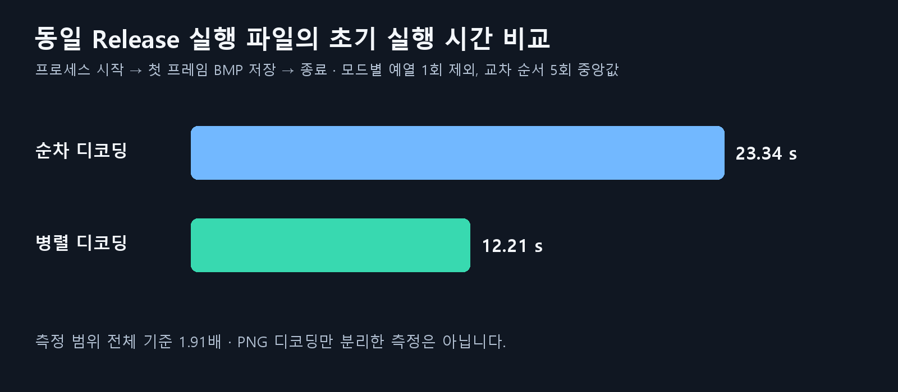</p>

| 실행 모드 | 5회 중앙값 |
|---|---:|
| 순차 디코딩 (`--no-async-load`) | 23.34초 |
| 병렬 디코딩 (기본) | 12.21초 |

전체 실행 시간이 약 47.7% 줄어 약 1.91배 빨라졌습니다. 디코딩 함수만 따로 잰 값이 아니므로 디코딩 자체가 몇 배 빨라졌는지는 이 표로 알 수 없습니다. 예열을 포함한 12회 실행 모두에서 텍스처 20개의 등록 순서·크기·RGBA 해시가 같아, 병렬로 바꾼 뒤에도 같은 데이터가 같은 순서로 등록되는 것을 함께 확인했습니다.

> [!NOTE]
> 2026-10-18 측정. AMD Ryzen 9 7945HX(16코어·32스레드), Windows 빌드 26200, x64 Release, 묶음 크기 8, 오디오와 편집기 끔, 파일 캐시가 데워진 상태. 반복별 결과와 조건은 [`loading-benchmark.json`](Media/loading-benchmark.json)에 있습니다. 저장장치나 캐시 상태가 다르면 시간도 달라집니다.

<br>

## GUI 에디터

`--editor`로 실행하면 게임 화면 옆에 Dear ImGui 편집기가 붙습니다. 별도 도구로 만들지 않고 게임과 같은 실행 파일에 넣은 이유는, 게임이 실제로 읽는 데이터와 실제로 그리는 화면을 그대로 보면서 고치기 위해서입니다. 편집기는 앞에서 설명한 JSON과 마스크 파일을 문서로 열고, 수정은 실행 취소할 수 있게 기록한 뒤 저장과 함께 런타임 라이브러리에 다시 반영합니다. 탭은 Animation, Map, Collision, AI 네 개입니다.

<p align="center">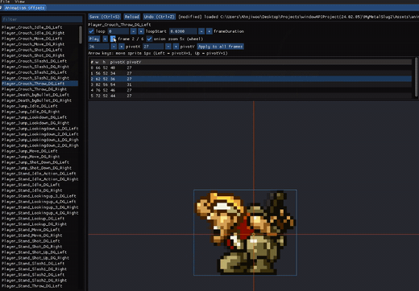</p>

애니메이션 탭은 `anim.json`의 클립을 재생하면서 프레임 시간, 반복 구간과 피벗을 고칩니다. 어니언 스킨으로 앞뒤 프레임을 겹쳐 보며 프레임 사이의 연결과 원점을 맞춥니다. 

<p align="center">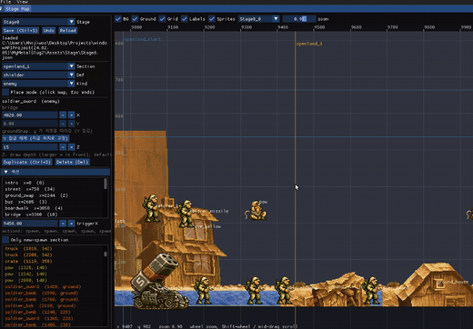</p>

Map 탭은 [스테이지 진행 데이터](#스테이지-진행)를 지도 위에 띄워 고칩니다. 개체를 배치하고, 구간의 트리거 선과 카메라 사각형을 보면서 옮깁니다.

<p align="center">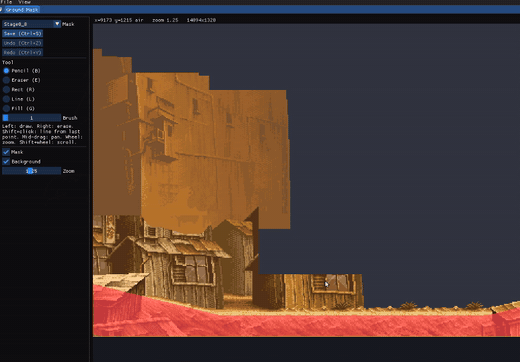</p>

Collision 탭은 [지형 마스크](#지형-충돌)를 픽셀 단위로 그리고 지웁니다.

<p align="center">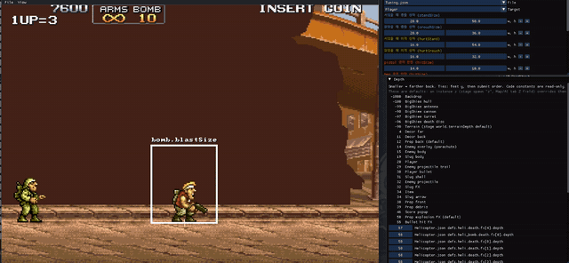</p>

AI 탭은 샌드박스에 적을 원하는 위치와 방향으로 소환해 행동을 관찰하는 곳입니다. 적의 현재 AI 상태, 판정 상자, 플레이어를 향한 대상선, 지면 탐색 결과를 화면에 겹쳐 그리고, 일시정지와 1틱 진행으로 특정 순간을 멈춰 봅니다. 고정 스텝으로 진행하기 때문에 같은 틱을 다시 보며 판단이 바뀌는 지점을 찾을 수 있습니다. 같은 탭에서 히트박스 크기와 공격 유효 프레임, 총구 위치, 그리기 깊이도 고치고 바로 시험 발사해 봅니다.

<p align="center">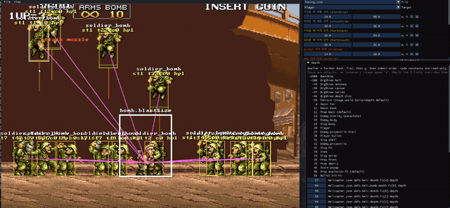</p>

<br>

## 빌드 및 실행

Windows x64에서 C++20으로 빌드합니다. Visual Studio의 C++ 데스크톱 개발 도구와 Windows SDK, 프로젝트가 지정한 MSVC `v145` 도구 집합이 필요합니다. 의존성은 vcpkg manifest로 관리하며 SDL3, Dear ImGui, miniaudio, stb, yyjson 등을 씁니다. 직접 만든 유틸리티 라이브러리 JugX는 서브모듈로 가져와 정적 라이브러리로 연결합니다.

1. 서브모듈을 포함해 저장소를 받습니다.

   ```powershell
   git clone --recurse-submodules https://github.com/JuggernautSensei/MetalSlug2-Clone.git
   cd MetalSlug2-Clone
   ```

2. vcpkg 경로를 `VCPKG_ROOT` 환경 변수로 지정합니다. 지정하지 않으면 `C:\vcpkg\`를 씁니다.

3. `MetalSlug2_Clone.sln`을 열어 x64 Release로 빌드하거나, 저장소 루트에서 스크립트를 실행합니다.

   ```powershell
   powershell -NoProfile -ExecutionPolicy Bypass -File Scripts/Build.ps1 -Config Release
   .\Output\Release\MetalSlug2_Clone.exe
   ```

> [!TIP]
> 이미 받은 저장소라면 `git submodule update --init --recursive`로 서브모듈을 준비합니다. 실행 파일은 `Assets`를 찾아 올라가므로 실행 파일만 따로 옮기지 마세요. `Play.cmd`는 Release 증분 빌드 후 바로 게임을 실행합니다.

| 조작 | 키 |
|---|---|
| 이동·조준 | 방향키 또는 W/A/S/D |
| 사격·근접 공격 | J 또는 Z |
| 점프 | K 또는 X |
| 수류탄 | L 또는 C |
| 타이틀에서 시작 | Enter 또는 Space |
| 종료 | Esc |

편집기는 다음과 같이 실행합니다.

```powershell
.\Output\Release\MetalSlug2_Clone.exe --editor
.\Output\Release\MetalSlug2_Clone.exe --editor --state enemylab --editor-tab ai
```

개발 중에는 F1로 판정 상자를 표시하고, F2로 일시정지, F3으로 한 틱 진행, F4로 슬로모션을 켭니다. `--warp-boss`나 `--warp-x`로 원하는 구간부터 시작하고, `--capture`로 화면을 저장할 수 있습니다.

<br>

학습을 위한 비공식 모작입니다. 원작 게임과 사용한 그래픽·음원의 권리는 각 원저작권자에게 있습니다.
