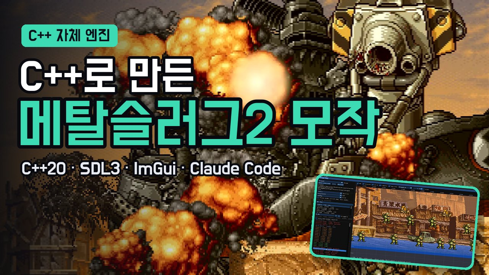

<div align="center">

# MetalSlug2 Clone

**C++20과 SDL3로 바닥부터 만든 메탈슬러그 2 Mission 4 모작과, 런타임 에디터**


[](https://www.youtube.com/watch?v=3DOms4Vg5p4)

[프로젝트 소개](#프로젝트-소개) · [플레이 영상](#플레이-영상) · [코드 둘러보기](#코드-둘러보기) · [런타임 에디터](#4-런타임-에디터) · [빌드 및 실행](#빌드-및-실행) · [회고](#회고)

</div>

## 프로젝트 소개

메탈슬러그 2의 Mission 4를 학습 목적으로 모작한 프로젝트입니다. 게임 엔진 없이 SDL3 위에 게임 루프, 물리, 충돌, 렌더링, 애니메이션, 사운드, 에디터를 직접 만들었습니다.

- **2024년 2월 5일부터 두 달 동안** 혼자 개발해 게임을 완성했습니다.
- **2026년 10월 9일부터 일주일 동안** AI 활용 경험을 쌓기 위해 Claude Code와 함께 과거 코드를 리팩터링했습니다.

시작부터 보스전 클리어까지 한 판을 플레이할 수 있고, 실행 인자 `--editor`로 켜면 게임을 돌리면서 애니메이션, 맵, 충돌, 적 데이터를 고칠 수 있습니다.

| 근접 공격과 사격 | 중간 보스 버스 | 최종 보스 빅 셰이 |
|---|---|---|
|  |  |  |

| 구분 | 내용 |
|---|---|
| 플레이어 | 이동, 점프, 앉기, 8방향 조준, 사격, 칼, 폭탄, 무기 5종(권총·헤비머신건·샷건·로켓·파이어샷) |
| 적 | 병사, 방패병, 바주카, 헬기, 탱크, 사루비아, 중간 보스 버스, 최종 보스 빅 셰이 |
| 스테이지 | 시내 → 버스 → 지하 → 강가 → 다운타운 → 사막 → 보스, 섹션 단위 진행, 카메라 고정·보간 |
| 오브젝트 | 부서지는 건물·구조물, 아이템 드롭, 포로 |
| 에디터 | 애니메이션, 맵, 픽셀 충돌, 게임 플레이(히트박스·모션·적 AI) 4종 |

## 플레이 영상

시작부터 보스전 클리어까지의 플레이와 에디터 사용 장면, 설계 설명은 유튜브 영상에 자세히 담았습니다.

<div align="center">

[](https://www.youtube.com/watch?v=3DOms4Vg5p4)

</div>

## 코드 둘러보기

### 파일 구성

```
MetalSlug2_Clone.sln
Play.cmd                  Release 빌드 후 실행
Scripts/Build.ps1         MSBuild 래퍼
Projects/                 MetalSlug2_Clone.vcxproj, JugX.vcxproj
Vendor/JugX/              직접 만든 C++ 유틸리티 라이브러리 (서브모듈)
Source/
  Base/                   Json, Result, Log, 공용 타입
  Core/                   App, 입력, 고정 스텝, 튜닝
  Render/                 스프라이트 배치, 애니메이션, 카메라
  Audio/                  miniaudio 기반 사운드
  World/                  지형 마스크, 물리, 충돌
  Game/                   장면, 플레이어, 적, 소품, 스테이지, UI
  Editor/                 Dear ImGui 런타임 에디터
Assets/
  anim.json  sprites.json  sounds.json  manifest.json
  Atlas/                  스프라이트 아틀라스
  Textures/               배경, 큰 이미지
  Audio/BGM/  Audio/SFX/  배경음, 효과음
  Ground/                 픽셀 충돌 마스크 PNG
  Stage/                  스테이지 배치 JSON
  Defs/                   적·소품 정의 JSON
  Tuning/                 플레이어·무기 수치 JSON
```

### 한 틱이 처리되는 순서

게임은 1/60초 고정 스텝으로 갱신하고, 화면은 틱 사이를 보간해서 그립니다.

1. `App`이 SDL 키 상태를 `InputFrame`(이동, 사격, 점프, 폭탄 등)으로 샘플링합니다.
2. `SimRunner`가 입력을 기록하고 현재 장면(`IGameState`)의 `Tick`을 부릅니다.
3. 장면이 플레이어, 적, 투사체, 소품을 갱신하고 공격 상자와 피격 상자를 맞대어 판정합니다.
4. 그릴 항목을 `SpriteBatch`에 모았다가 깊이 순으로 정렬해 한 번에 그립니다.

## 1. 장면은 인터페이스 하나로 갈아 끼웁니다

타이틀, 스테이지, 에디터 샌드박스는 모두 `IGameState`를 구현합니다. 장면을 실행하는 `SimRunner`는 구체적인 장면을 몰라도 `Tick`과 `TakeNextState`만으로 똑같이 다룹니다.

```cpp
void SimRunner::Step(const InputFrame _input)
{
    m_history.Push(_input);
    m_pState->Tick(m_history);

    if (Scoped<IGameState> pNext = m_pState->TakeNextState(); pNext)
    {
        SwitchState(std::move(pNext));   // OnExit → 교체 → 입력 기록 초기화 → OnEnter
    }
}
```

새 장면이 필요하면 `IGameState`를 구현한 클래스를 하나 더 만들고 `CreateState`에 이름을 등록하면 됩니다.

## 2. 플레이어: 상태를 계산하고, 상태로 애니메이션을 고릅니다

- **상태**: Idle, Run, Jump, Crouch를 따로 전환하지 않고, 매 틱 바닥 접지·자세·이동 여부로 다시 계산합니다.
- **입력 보정**: 점프는 4틱, 사격·폭탄은 6틱 동안 입력을 기억해서, 조금 일찍 눌러도 반응합니다. 발판에서 떨어진 직후 4틱 안에는 점프할 수 있습니다(코요테 타임).
- **같은 키, 다른 공격**: 근접 범위에 적이 있으면 사격 키가 칼 공격이 되고, 연타하면 칼질 1·2가 번갈아 나옵니다.
- **애니메이션**: 상체와 하체를 따로 재생합니다. 자세·조준·공격 상태로 슬롯을 고르고, 무기별 클립 이름 규칙으로 실제 클립을 찾습니다. 사격·칼·투척 모션은 튜닝의 지속 시간에 맞춰 재생 속도를 늘리거나 줄입니다.

## 3. 충돌은 두 가지를 섞어 씁니다

| 방식 | 대상 | 이유 |
|---|---|---|
| AABB 박스 | 플레이어, 적, 투사체, 발판·벽 | 계산이 단순하고 저렴합니다 |
| 픽셀 마스크 | 사선·곡선 지형 | 경사를 부드럽게 오르내리려면 박스로는 부족합니다 |

- 지형 마스크는 `Assets/Ground/*.png`이고, 파란 픽셀이 바닥입니다.
- 빠른 탄은 이전 위치와 현재 위치를 감싸는 상자로 판정해 적을 뚫고 지나가지 않습니다.
- 공격마다 hit ID를 붙여 같은 대상에게 중복으로 피해를 주지 않습니다.

## 4. 런타임 에디터

게임을 `--editor`로 실행하면 Dear ImGui 에디터가 함께 뜹니다. 게임의 상당 부분을 데이터 중심으로 만들어서, 수치와 배치를 JSON으로 저장하고 다시 읽습니다.

| 애니메이션 에디터: 어니언 스킨으로 프레임 맞추기 | 맵 에디터: 섹션 시작선 드래그 |
|---|---|
|  |  |
| **픽셀 충돌체 에디터: 맵 위에 충돌 마스크 칠하기** | **게임 플레이 에디터: 히트박스·AI 확인, 적 대량 스폰** |
|  |  |

| 탭 | 대상 파일 | 할 수 있는 것 |
|---|---|---|
| Animation | `Assets/anim.json` | 프레임별 기준점(pivot)·재생 시간, 어니언 스킨, 1px 이동 |
| Map | `Assets/Stage/*.json` | 적·오브젝트 배치, 섹션 시작선(triggerX) 드래그 |
| Collision | `Assets/Ground/*.png` | 맵 위에 충돌 마스크를 연필·사각형·선·채우기로 칠하기 |
| AI | `Assets/Defs/*.json`, `Assets/Tuning/Tuning.json` | 히트박스, 발사 위치, 모션 값, 적 스폰, 일시정지·1틱 진행 |

- 애니메이션과 튜닝 값은 편집하는 즉시 게임에 반영됩니다.
- 맵과 충돌 데이터는 저장하면 빌드 없이 다음 실행에 반영됩니다.
- 저장은 모두 Ctrl+S입니다.

## 5. 렌더링, 로딩, 사운드

- **깊이 정렬**: 그릴 항목을 depth → sortKey → 제출 순서로 정렬합니다. 버스 안의 병사처럼 겹친 표현을 그리는 순서와 상관없이 맞출 수 있습니다.
- **화면 밖 처리**: 화면에 보이는 영역만 계산해 그리고, 카메라 뒤로 멀리 벗어난 적과 오브젝트는 지웁니다.
- **섹션 진행**: 맵을 섹션으로 나누고, 플레이어가 섹션 시작선을 넘으면 그 섹션의 적만 생성합니다.
- **병렬 로딩**: 이미지 읽기와 디코딩은 여러 스레드로 병렬 처리하고, GPU 텍스처 등록은 메인 스레드에서 순서대로 합니다.
- **사운드**: miniaudio로 재생하고 이름으로 찾습니다. 같은 소리는 동시에 4개까지만 재생하고, 넘치면 가장 오래된 소리를 교체합니다. BGM은 페이드 아웃 후 전환합니다.

## 빌드 및 실행

### 준비

1. Visual Studio(MSVC, C++20)와 vcpkg를 설치합니다. vcpkg는 manifest 모드로 `vcpkg.json`의 의존성을 받습니다.
2. JugX 서브모듈을 함께 받습니다.

```bash
git clone --recursive https://github.com/JuggernautSensei/MetalSlug2-Clone.git
```

### 빌드와 실행

- `Play.cmd`: Release로 증분 빌드한 뒤 실행합니다. 인자는 게임으로 넘어갑니다.
- `MetalSlug2_Clone.sln`을 Visual Studio로 열어 빌드해도 됩니다. 결과물은 `Output/<Config>/`에 생깁니다.

```bash
Play.cmd --editor
```

### 조작

| 키 | 동작 |
|---|---|
| ← → ↑ ↓ / WASD | 이동, 조준, 앉기 |
| J / Z | 사격 (적이 가까우면 칼) |
| K / X | 점프 |
| L / C | 폭탄 |
| Enter / Space | 시작 |
| F1 ~ F4 | 디버그 표시, 일시정지, 1틱 진행, 슬로 모션 |

### 실행 옵션

| 옵션 | 의미 |
|---|---|
| `--editor` | 런타임 에디터와 함께 실행 |
| `--editor-tab <animation/map/collision/ai>` | 에디터 시작 탭 |
| `--state <title/stage0/sandbox/enemylab>` | 시작 장면 |
| `--life <n>` `--weapon <n>` | 시작 목숨, 시작 무기 |
| `--warp <n>` `--warp-boss` | 스테이지 구간으로 바로 이동 |
| `--no-audio` | 소리 끔 |

### 의존성

[SDL3](https://github.com/libsdl-org/SDL) · [Dear ImGui](https://github.com/ocornut/imgui) · [yyjson](https://github.com/ibireme/yyjson) · [miniaudio](https://github.com/mackron/miniaudio) · [stb](https://github.com/nothings/stb) · [parallel-hashmap](https://github.com/greg7mdp/parallel-hashmap) · [utfcpp](https://github.com/nemtrif/utfcpp) · [JugX](https://github.com/JuggernautSensei/JugX)

## 회고

- 바닥부터 직접 만들며 C++과 그래픽스 기본기를 단련하고, 객체 설계와 데이터 구조, 직렬화·역직렬화 구조를 깊이 고민할 수 있었습니다.
- 직접 짜면서 오픈 소스도 많이 참고해, 좋은 코드를 보고 설계하고 판단하는 눈을 기를 수 있었습니다.
- AI를 접목한 뒤 코드가 통째로 뒤엎어져 곤혹을 겪기도 했지만, 하네스 작성, AI 코드 리뷰, 테스트와 검증을 거치며 AI 활용 역량도 키울 수 있었습니다. 마치 개발팀을 꾸려 기획, 개발, QA를 간접적으로 체험하는 느낌이었습니다.

> [!NOTE]
> 이 프로젝트는 학습 목적의 비상업 모작입니다. 메탈슬러그 2의 그래픽과 사운드 저작권은 SNK에 있습니다.
