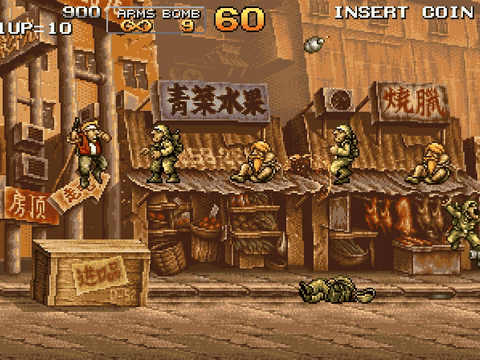
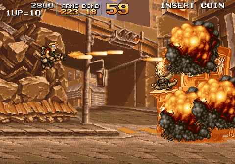
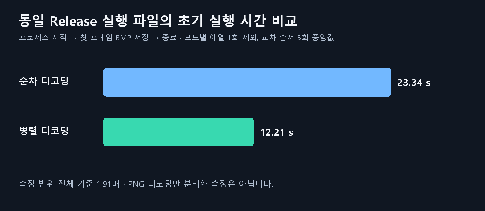
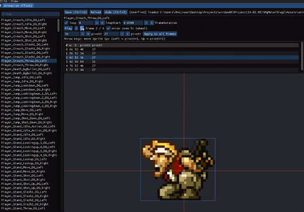
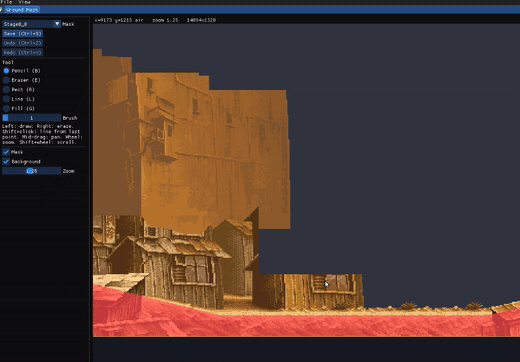

<h1 align="center">MetalSlug2-Clone</h1>

<p align="center">C++20과 SDL3로 만든 메탈슬러그 2 Mission 4 모작</p>

<p align="center">
  
  
  
  
  <a href="https://youtu.be/OR9MWsp2wJE"></a>
</p>



## Contents

* [프로젝트 소개](#프로젝트-소개)
* [고정 스텝과 판정 순서](#고정-스텝과-판정-순서)
* [플레이어의 상체와 하체](#플레이어의-상체와-하체)
* [적과 보스](#적과-보스)
* [깊이 정렬](#깊이-정렬)
* [데이터로 정의한 스테이지](#데이터로-정의한-스테이지)
* [픽셀 마스크 지형](#픽셀-마스크-지형)
* [병렬 이미지 로딩](#병렬-이미지-로딩)
* [GUI 에디터](#gui-에디터)
* [빌드 및 실행](#빌드-및-실행)

## 프로젝트 소개

메탈슬러그 2의 Mission 4를 학습 목적으로 모작한 횡스크롤 액션 게임입니다. 게임 엔진 없이 SDL3 위에 게임 루프, 물리와 충돌, 스프라이트 렌더링, 애니메이션, 사운드를 직접 만들었고, 애니메이션·맵·지형 충돌·적 AI를 고치는 ImGui 편집기를 같은 실행 파일에 넣었습니다.


`MISSION 4` 배너로 시작해 시가지의 병사와 부서지는 건물, 병사를 쏟아내는 버스, 차량과 헬기 구간을 지나 Big Shiee 보스전으로 이어집니다. 무기는 권총, HMG, 샷건, 로켓, 화염방사기이고, 적 가까이에서 사격하면 칼 공격으로 바뀝니다. 전체 플레이는 [유튜브 영상](https://youtu.be/OR9MWsp2wJE)에서 볼 수 있습니다.

2024년 2월부터 두 달 동안 혼자 개발해 완성했고, 2026년 10월에 Claude Code와 함께 일주일 동안 당시 코드를 리팩터링했습니다. 아래 설명은 리팩터링을 마친 현재 코드 기준입니다.

## 고정 스텝과 판정 순서

게임은 60Hz 고정 스텝으로 진행합니다. [`FixedStepClock`](Source/Core/FixedStep.h)이 실제 경과 시간을 누적해 이번 프레임에 몇 틱을 돌릴지 정하므로, 모니터 주사율이 달라도 점프 높이나 탄 속도가 같습니다. 창을 끌다가 돌아왔을 때 밀린 틱을 한꺼번에 돌리지 않도록 한 프레임은 0.25초, 5틱으로 제한했습니다.

화면은 틱 사이에도 그려지므로, 현재 위치를 그대로 그리면 같은 위치가 두 번 그려지거나 한 틱씩 건너뛰어 움직임이 고르지 않습니다. 플레이어, 탄, 카메라는 이전 틱 위치를 기억하고, 렌더는 남은 시간 비율 `_alpha`로 두 위치 사이를 그립니다. 보간한 값은 그리기에만 쓰고 판정은 틱 위치로 하므로, 프레임 수가 달라도 게임 결과는 같습니다.

```cpp
const VECTOR2 feet = Lerp(m_player.GetPrevFeet(), m_player.GetFeet(), _alpha);
```

한 틱 안에서는 판정 순서를 고정했습니다. 플레이어, 적, 부서지는 건물, 발사체가 서로를 직접 때리게 하면 누가 먼저 갱신되느냐에 따라 결과가 달라지고, 공격하는 쪽이 맞는 쪽의 체력 규칙까지 알아야 합니다. 그래서 [`StageState::Tick()`](Source/Game/Stage/StageState.cpp)은 판정 상자를 모두 등록한 뒤, 판정을 한 곳에서 한 번에 내리고, 결과를 각자 가져가게 했습니다. 아래는 호출 순서만 남긴 것입니다.

```cpp
m_combat.BeginTick();                    // 지난 틱의 판정 상자를 비웁니다.
m_props.Tick(propCtx);
m_enemies.RegisterHurtboxes(m_combat);   // 맞을 수 있는 범위를 먼저 등록
m_props.RegisterHurtboxes(m_combat);

m_player.Tick(playerCtx, _input);        // 이동하고, 공격 범위(Hitbox)를 등록
m_enemies.Tick(enemyCtx);
m_projectiles.Step(ground, m_combat, kStepSec, m_enemyPlatforms);

const Vector<HitEvent>& events = m_combat.Resolve();   // 겹침 판정은 여기서 한 번만
m_props.OnHitEvents(events);             // 각 시스템이 자기 몫의 결과를 처리
m_enemies.OnHitEvents(events);
m_player.OnHitEvents(events);
m_projectiles.OnHitEvents(events, m_combat);

m_runner->Tick();                        // 마지막으로 스테이지 진행을 확인
```

[`CombatSystem`](Source/Game/Combat/CombatSystem.h)은 공격 범위 `Hitbox`와 피격 범위 `Hurtbox`의 겹침, 팀, 무적 여부만 보고 `HitEvent`를 만듭니다. 체력을 깎을지, 방패로 막을지, 보스의 어느 부위가 맞았는지는 이벤트를 받은 쪽이 정합니다. 그래서 새 무기를 만들 때 적 코드를 고치지 않고, 맞는 방식이 특이한 적을 만들 때 판정기를 고치지 않습니다. 칼이나 화염처럼 여러 틱 동안 남는 공격은 공격마다 ID를 받아 명중 이력을 남기므로, 같은 대상에게 한 번만, 또는 정해진 간격마다만 피해를 줍니다.

## 플레이어의 상체와 하체


메탈슬러그의 캐릭터는 달리면서 위를 쏘고, 점프하면서 아래로 수류탄을 던집니다. 이동, 조준, 공격을 동작 하나로 묶으면 모든 조합마다 애니메이션 상태가 필요합니다. 그래서 플레이어를 무엇을 하는가와 어떻게 보이는가로 나눴습니다.

[`PlayerController`](Source/Game/Player/PlayerController.cpp)는 입력을 해석해 이동, 자세, 조준, 무기, 공격을 정하고, 결과를 `RigState`라는 구조체로만 내보냅니다. [`PlayerRig`](Source/Game/Player/PlayerRig.cpp)는 이 구조체만 보고 그릴 클립을 고릅니다.

```cpp
struct RigState
{
    eWeapon      weapon  = eWeapon::Pistol;
    ePlayerState state   = ePlayerState::Idle;   // 달리기, 점프, 사망 등
    ePose        pose    = ePose::Stand;         // 서기, 앉기
    eAim         aim     = eAim::Forward;        // 앞, 위, 아래
    eOverlay     overlay = eOverlay::None;       // 사격, 칼, 투척처럼 상체에 겹치는 동작
    int          facing  = 1;
    // ...
};
```

하체 클립은 `state`와 `pose`로, 상체 클립은 `weapon`, `aim`, `overlay`로 고르므로, 달리는 하체 위에 위를 조준한 상체를 얹을 수 있습니다. 조합이 곱셈이 아니라 덧셈으로 늘어납니다. 걸을 때는 상체와 하체의 재생 위치를 맞추고, 앉기나 사망처럼 몸 전체가 함께 움직이는 동작만 전신 클립을 씁니다. 컨트롤러는 클립 이름을 하나도 모르기 때문에, 이동과 판정을 고칠 때 애니메이션 코드를 건드리지 않습니다.

## 적과 보스

병사, 방패병, 바주카병, 차량, 헬기, 버스, 보스는 모양과 행동이 크게 다르지만, 생성되고, 화면에 들어오면 활성화되고, 맞으면 깜빡이고, 연출이 끝나면 사라지는 흐름은 같습니다. 이 공통 흐름은 [`EnemyWorld`](Source/Game/Enemies/EnemyWorld.cpp)가 맡고, 종류마다 다른 판단만 [`Enemy`](Source/Game/Enemies/Enemy.h)의 파생 클래스가 구현합니다.

```cpp
class Enemy
{
public:
    virtual void Init(const EnemyDef& _def, EnemyEnv& _env) = 0;
    virtual void Tick(const EnemyDef& _def, EnemyEnv& _env) = 0;      // 종류별 판단과 공격
    virtual bool OnHit(const EnemyDef& _def, EnemyEnv& _env, const HitEvent& _event);
    virtual void OnDeath(const EnemyDef& _def, EnemyEnv& _env);
    virtual void TickDying(const EnemyDef& _def, EnemyEnv& _env);     // 사망 연출
    virtual void RegisterHurtboxes(const EnemyDef& _def, CombatSystem& _combat) const;
    // ...
};
```

`EnemyWorld`는 JSON에 적힌 행동 이름으로 알맞은 클래스를 만들고, 이후에는 `Enemy` 인터페이스로만 다룹니다. 일반적인 피해 처리는 기본 `OnHit()`이 하고, 맞은 위치에 따라 반응이 달라지는 적만 이를 다시 구현합니다. 방패병은 방패와 몸통을 따로 `Hurtbox`로 등록해, 방패에 맞은 `HitEvent`는 피해 없이 막습니다.

체력, 클립, 총구 위치, 감지 거리 같은 값은 [`Enemies.json`](Assets/Defs/Enemies.json)에 있고, 비슷한 적이 많아 정의끼리 상속할 수 있습니다. 아래 `soldier_bomb`은 `soldier_base`에 투척 공격만 더한 정의입니다. 로더가 `extends`를 따라가며 클립, 무기, 파라미터를 합치므로, C++ 클래스는 언제 다가가고 언제 던질지만 판단합니다.

```json
"soldier_bomb": {
  "extends": "soldier_base",
  "params":  { "ai": "bomb", "detect": 350, "closeStop": 200, "fireFrame": 10 },
  "clips":   { "throw": { "name": "SD_Throw_Bomb_{side}", "frames": 14, "sec": 0.08 } },
  "weapons": { "attack": { "projectile": "soldier_bomb_proj", "muzzle": [0, -37], "aim": "facing" } }
}
```


Big Shiee는 포탑 여러 개와 주포로 이루어진 보스입니다. 부위마다 적을 따로 만들면 이동과 사망을 맞추기 어려워서, 적 하나가 여러 부위를 갖게 했습니다. 각 부위는 `MakePartOwner(적 ID, 부위 번호)`로 만든 소유자 ID를 단 `Hurtbox`를 등록하고, `OnHit()`은 소유자 ID로 어느 포탑이 맞았는지 찾습니다. 판정기 입장에서는 평범한 적과 같습니다. 포탑이 모두 부서지면 주포가 열리고, 주포는 열려 있는 동안에만 `Hurtbox`를 등록해서 공격할 수 있는 시간을 패턴으로 만듭니다.

## 깊이 정렬



버스는 뒷면, 계단, 안에 탄 병사, 몸체, 겉 프레임, 창문, 잔해가 겹쳐 있는 그림입니다. 손상 단계마다 일부가 바뀌고 소환한 병사도 오가므로, 이 부위들을 매번 올바른 순서로 그려야 합니다. 그리는 코드의 호출 순서에 앞뒤를 맡기면 부위를 하나 추가할 때마다 순서를 다시 맞춰야 해서, 앞뒤를 값으로만 정하게 했습니다.

월드의 모든 그리기는 [`SpriteBatch`](Source/Render/SpriteBatch.cpp)에 명령으로 쌓이고, 프레임 끝의 `Flush()`가 정렬한 뒤 그립니다.

```cpp
std::sort(_commands.begin(), _commands.end(), [](const SpriteCommand& _a, const SpriteCommand& _b) {
    if (_a.depth != _b.depth)     return _a.depth < _b.depth;       // 1. 깊이 (층)
    if (_a.sortKey != _b.sortKey) return _a.sortKey < _b.sortKey;   // 2. 같은 층 안의 순서
    return _a.seq < _b.seq;                                         // 3. 그래도 같으면 제출 순서
});
```

버스의 부위는 [`Bus.json`](Assets/Defs/Bus.json)에 깊이와 정렬 값을 가집니다.

```json
"innerSoldier": { "depth": 15, "sort": 2 },
"body":         { "depth": 15, "sort": 3 },
"cover":        { "depth": 16, "sort": 4 },
"window":       { "depth": 15, "sort": 5 },
```

부위의 앞뒤가 데이터로 정해지므로, 순서를 바꾸거나 부위를 추가할 때 코드를 고치지 않고 편집기에서 값만 바꿔 확인합니다. 같은 깊이 안에서는 적의 정렬 값에 발의 y좌표를 더해 화면 아래쪽 캐릭터가 앞에 오게 했습니다. `std::sort`는 같은 값끼리의 순서를 보장하지 않으므로, 마지막 기준인 제출 순서로 프레임마다 앞뒤가 바뀌는 깜빡임을 막습니다.

## 데이터로 정의한 스테이지

어디에 무엇이 나오고 카메라가 언제 멈추는지를 코드로 쓰면, 적 하나를 옮길 때마다 빌드를 다시 해야 합니다. 그래서 스테이지 진행은 [`Stage0.json`](Assets/Stage/Stage0.json)에 구간 목록으로 적고, [`StageRunner`](Source/Game/Stage/StageRunner.cpp)가 실행합니다. 구간은 `triggerX`와 액션 목록을 가지며, 플레이어가 그 X좌표를 넘으면 액션이 차례로 실행됩니다. 현재 스테이지는 구간 22개, 개체 생성 액션 176개로 이루어져 있습니다.

```json
{
  "id": "bus", "triggerX": 2605,
  "actions": [
    { "type": "clear", "waves": true },
    { "type": "lockCamera", "rect": [2457, 0, 3097, 448], "glide": 2.5 },
    { "type": "gate", "id": "bus_clear", "waitFor": ["bus"], "until": "destroyFinished",
      "actions": [ { "type": "unlockCamera" }, { "type": "setBounds", "rect": [-89, 0, 4111, 448] } ] }
  ]
}
```

`gate`는 지정한 개체가 파괴 연출을 마칠 때까지 안쪽 액션을 미룹니다. 버스 구간은 카메라를 잠근 뒤, 버스가 `destroyFinished`를 알리면 잠금을 풀고 경계를 넓힙니다. 버스는 "연출이 끝났다"는 신호만 내고 그다음에 무엇을 할지는 스테이지 데이터가 정하므로, 적 코드는 카메라를 모릅니다. 보스 파괴 뒤 결과 화면으로 넘어가는 것도 같은 게이트입니다.

플레이어의 이동 속도, 점프, 입력 보관 틱, 무기 수치는 [`Tuning.json`](Assets/Tuning/Tuning.json)에 있습니다. 샌드박스 상태에서는 [`TuningWatcher`](Source/Core/Tuning.h)가 60틱마다 파일을 확인해 다시 읽으므로, 게임을 켜 둔 채 값을 고치고 바로 뛰어 볼 수 있습니다.

## 픽셀 마스크 지형


메탈슬러그의 배경은 계단, 경사, 무너진 지붕처럼 모양이 불규칙합니다. 사각형으로 덮으면 칸 수가 너무 많아지고 경사를 표현하기 어렵습니다. 그래서 전투 판정은 사각형으로 하고, 지형은 배경 픽셀마다 고체인지만 담은 1비트 배열 [`GroundMap`](Source/World/GroundMap.cpp)으로 판정합니다. 위 그림의 빨간 부분이 고체 픽셀입니다.

한 점이 막혔는지는 비트 하나를 읽는 것으로 끝납니다. [`Physics`](Source/World/Physics.cpp)는 이동을 작은 구간으로 나눠 벽, 천장, 바닥을 검사하고, 발 아래 몇 픽셀을 탐색해 작은 단차는 오르내리게 합니다. 계단마다 경사 데이터를 만들지 않아도 캐릭터가 그림을 따라 걷습니다. 한 틱에 수십 픽셀을 움직이는 빠른 탄은 이동 선분을 일정 간격으로 나눠 검사해 얇은 벽을 건너뛰지 않게 했고, 부서지는 건물은 파괴될 때 지정된 패치로 마스크 일부를 지워 무너진 자리를 지나갈 수 있게 했습니다.

## 병렬 이미지 로딩

시작할 때 스프라이트 아틀라스와 배경 PNG를 모두 읽는데, 하나씩 차례로 읽으면 첫 화면까지 20초가 넘게 걸렸습니다. 이미지 로딩은 파일을 읽고 PNG를 RGBA로 푸는 단계와 SDL 텍스처를 만드는 단계로 나뉩니다. 앞 단계는 이미지끼리 독립적이지만, 뒤 단계는 SDL 렌더러를 만든 스레드에서만 할 수 있습니다. 그래서 읽기와 디코딩, 피격 깜빡임용 색상 변환본 생성만 병렬로 돌리고, 텍스처 생성은 호출 스레드에 남겼습니다.

[`DecodeImages`](Source/Render/SpriteBatch.cpp)는 미리 확보한 결과 배열의 자기 칸에 결과를 쓰고, 등록은 모든 작업이 끝난 뒤 원래 경로 순서대로 합니다. 먼저 끝난 이미지부터 등록하면 아틀라스 페이지 번호가 실행마다 바뀌어, 애니메이션 프레임이 엉뚱한 페이지를 가리키기 때문입니다. 모든 이미지의 RGBA를 한꺼번에 들고 있지 않도록, 작업자 수(하드웨어 스레드 수 - 1, 1~8)만큼씩 묶어 디코딩과 등록을 반복합니다.



같은 Release 실행 파일에서 `--no-async-load` 옵션만 바꿔, 프로세스 시작부터 스테이지 첫 프레임을 저장하고 종료할 때까지를 쟀습니다. 모드마다 예열 1회를 빼고 두 모드를 번갈아 5회씩 실행한 중앙값입니다. 측정 환경은 Ryzen 9 7945HX(16코어), 작업자 8개입니다.

<table width="100%">
  <thead>
    <tr>
      <th align="left">실행 모드</th>
      <th align="right">5회 중앙값</th>
    </tr>
  </thead>
  <tbody>
    <tr>
      <td>순차 디코딩 (<code>--no-async-load</code>)</td>
      <td align="right">23.34초</td>
    </tr>
    <tr>
      <td>병렬 디코딩 (기본)</td>
      <td align="right">12.21초</td>
    </tr>
  </tbody>
</table>

23.34초 → 12.21초로 약 1.91배 빨라졌습니다. 초기화, 첫 프레임 렌더링, 종료까지 포함한 시간이므로 디코딩 자체의 배율은 이보다 큽니다. 12회 실행 모두에서 텍스처 20개의 등록 순서, 크기, RGBA 해시가 같아, 병렬로 바꾼 뒤에도 같은 데이터가 같은 순서로 등록되는 것을 확인했습니다.

## GUI 에디터

`--editor`로 실행하면 게임 화면 옆에 Dear ImGui 편집기가 붙습니다. 게임과 같은 실행 파일에 넣어, 게임이 실제로 읽는 데이터와 실제로 그리는 화면을 그대로 보면서 고칩니다. 편집기는 앞에서 설명한 JSON과 마스크를 문서로 열고, 수정을 실행 취소할 수 있게 기록한 뒤 저장과 함께 게임에 다시 반영합니다.

<p align="center">
  
  
</p>
<p align="center">
  
  
</p>

탭은 네 개입니다. Animation은 클립의 프레임 시간과 피벗을 어니언 스킨으로 앞뒤 프레임을 겹쳐 보며 고칩니다. Map은 스테이지 구간 데이터를 지도 위에 띄워 개체 배치, 트리거 선, 카메라 사각형을 옮깁니다. Collision은 지형 마스크를 픽셀 단위로 그리고 지웁니다. AI는 샌드박스에 적을 소환해 현재 AI 상태, 판정 상자, 플레이어를 향한 대상선, 지면 탐색 결과를 겹쳐 그립니다. 고정 스텝으로 진행하므로 일시정지와 1틱 진행으로 판단이 바뀌는 순간을 다시 볼 수 있고, 히트박스와 총구 위치를 고쳐 바로 시험 발사할 수 있습니다.

## 빌드 및 실행

Windows x64에서 C++20으로 빌드합니다. Visual Studio 2026(플랫폼 도구 집합 `v145`)의 "C++를 사용한 데스크톱 개발" 워크로드가 필요하고, 의존 라이브러리는 `vcpkg.json` 매니페스트로 설치됩니다. vcpkg 경로는 `VCPKG_ROOT` 환경 변수를 읽고, 없으면 `C:\vcpkg\`를 사용합니다.

1. 저장소를 받습니다.

   ```powershell
   git clone https://github.com/JuggernautSensei/MetalSlug2-Clone.git
   ```

2. 저장소 폴더에서 `Play.cmd`를 실행합니다. Release로 증분 빌드한 뒤 게임을 시작합니다. `Play.cmd --editor`처럼 인자를 붙이면 게임에 그대로 전달됩니다.

<table width="100%">
  <thead>
    <tr>
      <th align="left">동작</th>
      <th align="left">키</th>
    </tr>
  </thead>
  <tbody>
    <tr>
      <td>이동</td>
      <td>A, D 또는 ←, →</td>
    </tr>
    <tr>
      <td>위, 아래 입력</td>
      <td>W, S 또는 ↑, ↓</td>
    </tr>
    <tr>
      <td>사격</td>
      <td>J 또는 Z</td>
    </tr>
    <tr>
      <td>점프</td>
      <td>K 또는 X</td>
    </tr>
    <tr>
      <td>수류탄</td>
      <td>L 또는 C</td>
    </tr>
    <tr>
      <td>시작, 결정</td>
      <td>Enter 또는 Space</td>
    </tr>
    <tr>
      <td>일시정지</td>
      <td>Esc</td>
    </tr>
  </tbody>
</table>
