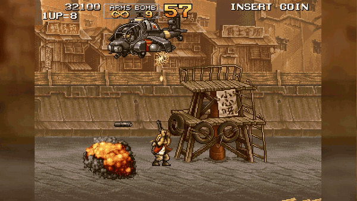

<div align="center">

# MetalSlug2-Clone

**C++과 SDL을 이용한 메탈슬러그2 모작**


</div>

<br>

## Contents

- [프로젝트 개요](#overview)
- [캐릭터 조작과 애니메이션](#player)
- [무기와 공격](#weapons)
- [충돌과 지형 물리](#collision)
- [적 시스템과 보스전](#enemies)
- [JSON 데이터와 스테이지](#data)
- [카메라](#camera)
- [이미지 로딩 최적화](#loading)
- [ImGui 편집기](#editors)
- [게임 루프와 화면·오디오](#runtime)
- [빌드 및 실행](#build)

<a id="overview"></a>
## 프로젝트 개요

메탈슬러그 2의 횡스크롤 전투를 C++20과 SDL3로 구현한 프로젝트입니다. 플레이어의 달리기·앉기·점프와 공격을 시작으로 적의 행동, 파괴 가능한 배경 오브젝트, 포로와 아이템, 보스전과 결과 화면까지 하나의 플레이 흐름으로 연결했습니다. 애니메이션·스테이지·지형 충돌·AI를 수정하는 ImGui 편집기도 같은 실행 파일에서 사용할 수 있습니다.

현재 게임은 `MISSION 4` 배너로 시작해 시가지, 버스 전투, 차량과 공중 적이 등장하는 구간을 지나 Big Shiee 보스전으로 이어집니다. 스테이지 데이터는 하나이며 내부 파일명은 `Stage0.json`입니다. 원작 전체를 구현한 프로젝트는 아닙니다.

<p align="center"></p>

<a id="player"></a>
## 캐릭터 조작과 애니메이션

달리면서 위를 쏘는 캐릭터에게는 이동, 자세, 조준 방향, 무기와 공격 동작이 동시에 필요합니다. 이 조합을 하나의 상태 이름에 모두 담으면 같은 이동이라도 무기와 공격 방향마다 별도 상태가 늘어납니다. `PlayerController`에서는 이 정보를 나누어 갱신하고, `PlayerRig`에서는 확정된 조작 상태를 받아 화면에 보여줄 애니메이션 클립을 선택합니다.

입력은 우선 `InputHistory`와 `PlayerInputBuffer`를 거칩니다. 키가 눌려 있는지와 새로 눌렸는지를 구분하고, 점프·사격·수류탄 입력은 짧은 시간 동안 보관했다가 행동이 시작될 때 소비합니다. 발판을 벗어난 직후에도 잠깐 점프를 허용하는 코요테 타임이 있고, 착지 직전 점프 입력은 다음 물리 갱신에서 착지할지를 미리 검사해 연결합니다. 정확히 한 틱에 맞춰 눌러야만 반응하는 상황을 줄이도록 구성했습니다.

실제 갱신은 이동, 조준, 기본 상태 도출, 공격 행동 순서로 진행됩니다. 좌우 이동과 공중 이동, 앉은 이동은 각 속도 설정을 사용합니다. 앉은 상태에서 사격하거나 수류탄을 던질 때는 수평 이동을 멈추며, 머리 위가 막혀 있으면 그대로 앉아 있도록 합니다. 아래 방향과 점프를 함께 누르면 원웨이 발판을 잠시 무시해 아래로 내려갑니다.

이렇게 계산한 상태는 `RigState`에 모읍니다. 이동 여부, 서기·앉기·공중 자세, 좌우 방향, 조준 방향, 현재 무기를 전달하고, 그 위에 겹쳐 표현할 사격·칼·투척 동작을 공격 오버레이로 구분합니다. 화면 표현은 이 정보를 바탕으로 클립을 선택하므로 입력 해석과 전투 규칙은 컨트롤러에 모이고, 애니메이션의 조합과 재생은 리그에 모입니다.

서 있거나 공중에 있을 때는 상체와 하체 클립을 따로 고릅니다. 달리는 하체를 유지한 채 상체는 위를 조준하거나 총을 쏠 수 있고, 점프 중에도 이동 여부와 공격 방향을 함께 반영합니다. 반면 앉기·사망·승리처럼 몸 전체를 사용하는 동작은 해당 클립을 선택합니다.

<p align="center"></p>

선택한 클립의 재생 시점도 조작 상태에 맞춥니다. 걷는 상체와 하체는 전체 재생 길이에서 얼마나 진행했는지를 나타내는 위상을 맞춰 같은 걸음으로 보이게 합니다.

<a id="weapons"></a>
## 무기와 공격

캐릭터가 사격 동작을 시작하면 먼저 현재 무기로 발사할 수 있는지 확인하고, 무기별 규칙으로 발사체를 만든 뒤 월드에 넘깁니다. `WeaponState`는 탄약과 발사 간격을 관리하고, 무기별 동작은 방향과 총구·입자 등의 생성 정보를 구성합니다. 생성된 탄의 이동과 충돌은 `ProjectileSystem`이 이어받습니다. 공격력·사거리·판정 크기와 동시 발사체 수는 튜닝 데이터에서 조정합니다.

권총은 탄약이 무제한이지만 발사 간격과 동시에 살아 있는 탄 수에 제한이 있습니다. HMG는 한 번의 입력에서 여러 발을 이어 쏘는 버스트를 관리합니다. 버스트의 발수와 탄 사이 간격을 적용하고, 조준 각도가 변하는 동안 중간 방향으로도 발사체가 나가도록 합니다.

샷건은 짧은 사거리와 큰 판정의 관통 발사체를 사용합니다. 여러 작은 산탄을 각각 시뮬레이션하는 방식이 아니라 하나의 넓은 공격으로 구성했습니다. 로켓은 초기 속도에서 가속해 최대 속도에 도달하고, 이동 중에는 궤적 효과를 요청합니다. 명중하면 이동하는 탄을 끝내고 별도의 폭발 범위와 피해, 지속 틱을 가진 판정으로 연결합니다.

화염방사기는 한 발의 총알보다 짧은 분출 동작에 가깝습니다. 여러 입자를 시간차로 생성하고 각도·속도·수명에 변화를 주며, 시간이 지나면서 표시 배율과 판정 크기도 커집니다. 같은 분출에서 나온 여러 입자가 겹쳤다는 이유만으로 피해가 한꺼번에 누적되지 않도록 공격 ID를 공유하고, 설정된 간격에 따라 다시 피해를 줄 수 있게 합니다.

<p align="center"></p>

사격 버튼이 항상 총을 발사하지는 않습니다. 근접 가능한 대상이 칼의 감지 범위 안에 있으면 칼 공격으로 전환합니다. 수류탄은 투척 시작 순간이 아니라 지정된 행동 틱에 생성하며, 플레이어 이동 속도의 일부를 물려받은 뒤 중력·튕김·신관·폭발 규칙을 따릅니다.

<a id="collision"></a>
## 충돌과 지형 물리

충돌은 전투 판정과 지형 이동으로 나누었습니다. 전투에서는 공격 범위와 피격 범위를 조정할 수 있도록 축에 평행한 사각형인 AABB를 사용합니다. 배경 지형은 픽셀별 고체 마스크로 저장해 캐릭터가 계단과 경사의 높이를 따라 움직이도록 합니다. 같은 월드에서 두 방식을 사용하지만, 각각이 판단하는 대상과 결과는 구분됩니다.

`Hitbox`는 공격 범위이고 `Hurtbox`는 피해를 받을 범위입니다. 두 상자의 X·Y 구간이 겹치는지 검사하되, 팀 관계와 자기 자신, 무적 여부, 허용하는 공격 종류도 함께 확인합니다. 판정 결과는 `HitEvent`로 만들고 플레이어·적·프롭이 각각 소비합니다. 판정기는 겹침과 타격 규칙을 판단하고, 체력 감소나 부위 파괴처럼 대상마다 다른 반응은 해당 시스템이 처리합니다.

여러 틱 동안 남는 공격은 공격 ID로 명중 이력을 관리합니다. 같은 칼을 휘두르는 동안 판정 상자가 계속 겹쳐도 같은 대상에게 매 틱 피해를 주지 않도록 하고, 비관통 공격은 명중 후 소비합니다. 폭발처럼 여러 대상을 때리는 공격과, 화염처럼 일정 간격 뒤 다시 피해를 주는 공격도 이 수명과 ID를 이용해 구분합니다.

빠른 발사체는 현재 위치만 검사하면 한 틱 사이의 얇은 지형을 건너뛸 수 있습니다. 객체에 대해서는 이전 위치와 현재 위치를 덮는 상자를 사용하고, 지형에 대해서는 이동 선분을 일정 간격으로 나누어 고체 픽셀을 검사합니다.

지형은 `GroundMap`의 비트 배열에 저장합니다. 각 픽셀은 고체인지 빈 공간인지만 가지며, 스프라이트의 색상이나 투명도를 매번 읽어 비교하지 않습니다. 물리는 수평·수직 이동을 작은 구간으로 나눠 벽·천장·바닥을 검사합니다. 발 아래 지면을 탐색해 작은 단차를 오르거나 내려가고, 경사와 법선을 추정합니다.

<p align="center"></p>

파괴 가능한 오브젝트는 정상·손상·파괴 상태와 함께 피격 범위, 벽, 발판 역할을 가집니다. 파괴되면 충돌 목록을 다시 만들고, 지정된 경우에는 패치 마스크로 지형 일부를 제거합니다.

<a id="enemies"></a>
## 적 시스템과 보스전

적은 몸체와 체력, 활성화, 공격 판정, 피격 효과, 사망과 제거라는 공통 흐름을 갖습니다. 반면 칼을 든 병사가 접근하는 방법과 헬기가 공격 위치를 잡는 방법은 다릅니다. 이를 `EnemyWorld`, `EnemyDef`, `Enemy` 파생 행동으로 나눴습니다.

`EnemyWorld`는 적을 소유하고 생성·활성화·갱신·피격·제거를 진행합니다. `EnemyDefLibrary`는 JSON에서 몸체, 체력, 클립, 무기, 발사체와 행동 파라미터를 읽습니다. 실제 종류별 동작은 팩터리가 만든 행동 클래스의 `Init`, `Tick`, `OnHit`, `OnDeath`, `TickDying` 등에 들어갑니다. 일반적인 피해는 월드에서 처리하고, 보스처럼 부위별 해석이 필요하면 `OnHit`에서 별도로 처리할 수 있습니다.

이 공통 흐름에서 보병마다 달라지는 부분은 플레이어와 지형을 보고 다음 행동을 고르는 판단입니다. 일반 병사는 수류탄·칼·미사일형에 따라 접근·대기·후퇴·공격을 선택하고, 벽 점프와 발판 하강, 점프 베기, 계단·지붕 이동으로 전투 위치를 바꿉니다. 방패병은 같은 피해 이벤트를 사용하면서도 방패와 몸통을 따로 등록해 앞·위·아래 방어와 사격 중 방패를 내리는 반응을 구현합니다.

### 버스 전투

버스는 카메라가 지정 구간에 들어오면 문과 계단을 전개합니다. 계단 준비가 끝난 뒤 병사를 반복해서 내보내며, 병사 종류 비율과 살아 있는 소환 병사 수, 버스의 피해 단계로 추가 소환을 조절합니다.

<p align="center"></p>

버스는 체력 소진과 파괴 연출 완료를 구분합니다. 스테이지는 이 완료 신호를 기다린 뒤 카메라 잠금을 풀고 다음 구간으로 진행합니다.

### Big Shiee 보스전

Big Shiee는 입장, 포탑전, 주포 전개, 주포전으로 나뉩니다. 포탑은 각각 체력과 회전·준비·사격 상태를 가지며, 포탑과 주포에 서로 다른 소유자 식별자를 붙여 공통 전투 이벤트에서 맞은 부위를 찾아냅니다. 포탑 전멸 뒤에는 뚜껑과 주포를 전개하며, 주포는 취약한 상태에서만 피격 판정을 등록합니다.

<p align="center"></p>

보스전에는 포탑 일제사격, 플레이어 각도에 따른 주포 조준과 발사, 자동 스크롤, 낙하산 지원 병력과 아이템 투하가 연결됩니다. 마지막에는 다중 폭발과 대폭발, 잔해·연기가 이어지고 파괴 완료를 스테이지에 전달합니다.

<a id="data"></a>
## JSON 데이터와 스테이지

스테이지를 조정할 때마다 적 생성 코드와 카메라 코드를 함께 바꾸지 않도록 진행 구성을 JSON으로 분리했습니다. `Stage0.json`에는 시작 위치, 배경과 지형, 카메라 영역, 구간별 트리거와 액션이 들어갑니다. 플레이어의 X좌표가 섹션을 넘으면 스폰과 웨이브, 카메라 잠금·이동, 배경·지형·BGM 교체, 배너·페이드와 종료 액션을 실행합니다.

웨이브에는 지연 시간, 반복 간격과 횟수를 지정합니다. 예약된 항목은 실행할 틱과 등록 순서에 따라 처리하고, 게이트는 지정 개체의 격파 또는 파괴 연출 완료를 기다립니다. 버스가 파괴될 때까지 전투 구역을 유지하거나 보스 파괴가 끝난 뒤 결과 화면으로 넘어가는 연결을 이 데이터로 표현합니다.

적 정의도 공통 부분을 데이터에서 공유합니다. 예를 들어 `human_base`에는 보병의 몸체와 사망 클립을 두고, `soldier_base`가 이를 상속해 이동과 기본 클립을 더합니다. 그 아래 `soldier_bomb`는 공격 판단 파라미터와 투척 클립, 사용할 발사체를 지정합니다. 아래는 실제 정의에서 설명에 필요한 필드만 남긴 예입니다.

```json
{
  "soldier_bomb": {
    "extends": "soldier_base",
    "params": { "ai": "bomb", "detect": 350, "closeStop": 200, "fireFrame": 10 },
    "clips": {
      "throw": { "name": "SD_Throw_Bomb_{side}", "frames": 14, "sec": 0.08 }
    },
    "weapons": {
      "attack": { "projectile": "soldier_bomb_proj", "muzzle": [0, -37], "aim": "facing" }
    }
  }
}
```

로더는 상속 체인을 따라 정의를 읽고 클립·무기·파라미터 항목을 병합합니다. 데이터는 어떤 자원을 쓰고 어떤 수치로 동작할지를 지정하고, C++ 행동 클래스는 그 값을 해석하는 규칙과 상태 전환을 담당합니다.

분리한 범위는 적과 스테이지에 그치지 않습니다. `Tuning.json`에는 이동·점프·입력 버퍼, 몸체와 피격 크기, 총구, 무기와 플레이어·아이템·카메라 관련 설정을 둡니다. `anim.json`은 클립과 프레임·피벗, `sprites.json`은 스프라이트 자원, `sounds.json`은 사운드 이름과 파일을 연결합니다.

<a id="camera"></a>
## 카메라

플레이어 위치를 그대로 카메라 중심에 대입하면 작은 움직임까지 화면 전체에 전달됩니다. 이 프로젝트의 카메라는 목표 주변에 데드존을 두고, 그 밖으로 나갔을 때 추적합니다. 횡스크롤의 전진 제한과 월드 경계, 전투 구역 잠금, 플레이어 위치에 따라 달라지는 세로 경계도 함께 적용합니다.

<p align="center"></p>

가로 추적에서는 플레이어가 추적 방향으로 움직인 양에 따라 밀어내는 속도를 키웁니다. 멈추거나 반대로 움직이면 속도를 줄이고, 틱 사이 속도 증가량과 목표까지 남은 거리에 따른 감속을 제한합니다. 목표와 크게 벌어진 경우에는 별도의 글라이드 상태로 가속·감속하며 따라잡습니다.

지정 위치로 이동하는 연출은 시작 위치와 기존 속도를 사용한 3차 보간으로 이어가고, 이동이 끝난 뒤 잠금을 적용할 수 있습니다. 보스전에서는 잠금 영역 자체를 오른쪽으로 옮겨 자동 스크롤을 진행합니다. 이러한 동작을 스테이지 액션이 호출하므로 평소 추적과 전투 연출을 같은 카메라에서 처리합니다.

<a id="loading"></a>
## 이미지 로딩 최적화

이미지 로딩은 파일을 읽고 PNG를 RGBA로 푸는 작업과, 그 결과로 SDL 텍스처를 만드는 작업으로 나눴습니다. 아틀라스에는 피격 시 사용할 색상 변환본도 필요하므로 디코딩 결과에서 해당 RGBA를 함께 만듭니다. 이 파일 읽기·디코딩·색상 변환을 이미지별 독립 작업으로 처리하고, 렌더러를 사용하는 텍스처 생성은 호출 스레드에서 이어갑니다.

`DecodeImages`는 미리 확보한 결과 배열의 각 위치에 병렬 디코딩 결과를 기록합니다. 작업이 끝난 뒤에는 경로의 원래 순서대로 아틀라스를 추가합니다. 디코딩이 먼저 끝난 이미지부터 등록하지 않기 때문에 애니메이션 프레임이 참조하는 페이지 번호를 유지할 수 있습니다.

한 번에 모든 이미지의 원본·변환 RGBA를 보관하지 않도록 경로를 묶음으로 나누고, 각 묶음의 디코딩과 텍스처 등록이 끝나면 다음으로 넘어갑니다. 기본 묶음 크기는 하드웨어 동시 실행 수에서 하나를 뺀 값을 1~8로 제한한 설정을 사용합니다. `--no-async-load`를 주면 같은 경로를 순차 디코딩합니다.

같은 Release 실행 파일에서 `--no-async-load`의 유무만 바꾸어 초기 실행 시간을 비교했습니다. 모드별 예열 1회는 제외하고, 순서를 번갈아 5회씩 실행한 중앙값입니다. 프로세스 시작부터 스테이지의 첫 프레임 BMP를 저장하고 종료할 때까지를 재므로, 초기화·이미지 로딩·렌더링·캡처·정리가 모두 포함됩니다. 오디오와 편집기는 사용하지 않았고 파일 캐시가 데워진 상태의 비교입니다.

<p align="center"></p>

| 실행 모드 | 5회 중앙값 |
|---|---:|
| 순차 디코딩 (`--no-async-load`) | 23.34초 |
| 병렬 디코딩 (기본 모드) | 12.21초 |

측정 범위 전체에서 약 **47.7% 짧아졌으며**, 시간 비율로는 약 **1.91배**입니다. PNG 디코딩 함수만 분리해서 잰 수치는 아닙니다. 예열을 포함한 12회 실행에서 텍스처 20개의 로드 순서·크기·RGBA 해시가 모두 같아, 이 로딩 경로가 같은 이미지 데이터를 같은 순서로 등록하는 것도 함께 확인했습니다.

> 측정 환경: 2026-10-18, AMD Ryzen 9 7945HX(16코어·32논리 프로세서), Windows 빌드 26200, x64 Release, 기본 묶음 설정 8. [반복별 원시 결과와 측정 조건](Media/loading-benchmark.json)을 함께 남겼습니다. 다른 저장장치·캐시 상태·컴퓨터에서는 시간이 달라질 수 있습니다.

긴 배경은 로딩 이후 표시 방식도 다릅니다. 가로 길이가 큰 이미지는 폭 2048 이하의 텍스처 조각으로 나누고, 카메라에서 보이는 구간에 해당하는 부분을 그립니다.

<a id="editors"></a>
## ImGui 편집기

ImGui 편집기는 Animation, Map, Collision, AI 네 탭으로 구성했습니다. 파일을 저장하는 기능뿐 아니라 수정 대상과 실제 화면을 함께 보는 데 초점을 맞췄습니다.

### 애니메이션 편집기

애니메이션 탭에서는 클립을 검색하고 재생·정지하거나 프레임을 하나씩 넘깁니다. 프레임 시간, 반복 여부와 반복 시작 프레임을 수정하고, 피벗은 숫자나 방향키로 조절합니다. 공통 원점을 맞출 때는 전체 프레임에 피벗을 적용할 수 있습니다. 어니언 스킨으로 인접 프레임을 겹쳐 보며 연결을 확인합니다.

<p align="center"></p>

편집 문서는 실행 취소와 저장·다시 읽기를 지원하고, 수정된 클립은 런타임 라이브러리에 반영합니다.

### 스테이지 편집기

맵 탭은 배경·지형 마스크·그리드·스프라이트·라벨을 겹쳐 보여줍니다. 정의를 고른 뒤 지도에 개체를 배치하고, 선택·드래그·좌표와 Z 변경·복제·삭제를 수행합니다.

<p align="center"></p>

섹션의 트리거 X와 카메라 사각형, 잠금 진입 시간을 수정할 수 있으며, 섹션을 옮길 때 관련 스폰과 카메라 영역을 함께 이동할지도 선택합니다. Undo·저장·Reload를 지원합니다.

### 지형 충돌 편집기

지형 충돌 탭에서는 배경과 고체 마스크를 겹쳐 보고, 확대와 이동으로 세부 지형을 편집합니다. 연필과 지우개, 직선·사각형·영역 채우기 도구를 사용하고 브러시 크기를 바꿀 수 있습니다. 연속된 입력은 스트로크 단위로 묶어 Undo/Redo하며, 수정한 마스크를 파일로 저장합니다.

<p align="center"></p>

### AI 편집기

AI 탭은 EnemyLab을 중심으로 샌드박스에 적을 소환하고 동작을 살펴보는 공간입니다. 정의와 좌우 방향·깊이를 골라 플레이어 옆이나 클릭한 위치에 생성하고, 마지막 소환 세트를 다시 만들 수 있습니다. 적의 상태와 위치를 검사하면서 판정 상자, AI 상태, 대상선, 지면 탐색과 카메라 경계를 표시합니다. 일시정지, 1틱·10틱 진행, 시간 배율로 특정 순간을 확인합니다.

<p align="center"></p>

히트박스·모션·깊이 도구도 이 AI 탭에 포함됩니다. 히트박스는 몸체와 피격 크기·오프셋, 추가 공격·피격 상자, 공격 유효 프레임과 피해량을 수정합니다. 모션 도구는 총구와 효과 위치, 클립, 효과 발생 프레임과 행동 파라미터를 바꾸고 시험 발사·모션 재생으로 확인합니다. 깊이 도구에서는 전체 그리기 순서를 보면서 JSON의 깊이와 부위별 정렬 값을 조정하며, 코드 상수는 읽기 전용으로 보여줍니다.

<p align="center"></p>

<a id="runtime"></a>
## 게임 루프와 화면·오디오

`App`은 SDL 이벤트를 받고 누적 시간에서 실행할 틱 수를 계산합니다. 시뮬레이션은 60Hz로 진행하며, 남은 시간 비율을 렌더에 전달해 플레이어·카메라·발사체 위치를 이전 상태와 현재 상태 사이에서 보간합니다.

타이틀·스테이지·샌드박스는 `IGameState` 인터페이스로 실행합니다. 현재 상태가 다음 상태를 넘기면 `SimRunner`가 틱이 끝난 뒤 교체하고 진입·종료 처리를 호출합니다.

그리기는 깊이, 정렬 키, 제출 순서로 정리합니다. 애니메이션 프레임에는 피벗·반전·회전·배율·색조를 적용하고, 개별 텍스처는 화면에 보이는 구간을 잘라 배율과 색조를 적용합니다. 논리 해상도 640×448을 정수 배율과 최근접 샘플링으로 표시합니다. HUD는 비트맵 글꼴과 스프라이트로 목숨·점수·탄약·수류탄·보스 체력을 보여줍니다.

오디오는 `sounds.json`의 이름으로 자원을 찾습니다. 효과음은 디코딩된 자원을 사용하고 BGM은 스트리밍하며, 전체와 같은 소리의 동시 재생 수를 제한합니다.

<a id="build"></a>
## 빌드 및 실행

Windows x64에서 C++20으로 빌드합니다. Visual Studio의 C++ 데스크톱 개발 도구와 Windows SDK, 프로젝트가 지정한 MSVC `v145` 도구 집합이 필요합니다. 의존성은 vcpkg manifest로 관리하며 SDL3, Dear ImGui, miniaudio, stb, yyjson 등을 사용합니다. JugX는 서브모듈로 가져와 정적 라이브러리로 연결합니다.

1. 서브모듈을 포함해 저장소를 받습니다.

   ```powershell
   git clone --recurse-submodules https://github.com/JuggernautSensei/MetalSlug2-Clone.git
   cd MetalSlug2-Clone
   ```

2. vcpkg의 경로를 `VCPKG_ROOT` 환경 변수로 지정합니다. 별도 지정이 없으면 프로젝트는 `C:\vcpkg\`를 사용합니다. 이미 받은 저장소라면 `git submodule update --init --recursive`로 서브모듈을 준비합니다.

3. `MetalSlug2_Clone.sln`을 열어 x64 Release로 빌드하거나 저장소 루트에서 스크립트를 실행합니다.

   ```powershell
   powershell -NoProfile -ExecutionPolicy Bypass -File Scripts/Build.ps1 -Config Release
   .\Output\Release\MetalSlug2_Clone.exe
   ```

`Play.cmd`는 Release 증분 빌드를 호출한 뒤 게임을 실행합니다. 실행 파일만 옮기지 말고 `Assets`를 찾을 수 있는 저장소 구성을 유지해야 합니다. 빌드 로그는 `Intermediate/last_build.log`에 남습니다.

| 조작 | 키 |
|---|---|
| 이동·조준 | 방향키 또는 W/A/S/D |
| 사격·근접 공격 | J 또는 Z |
| 점프 | K 또는 X |
| 수류탄 | L 또는 C |
| 타이틀에서 시작 | Enter 또는 Space |
| 실행 종료 | Esc |

편집기는 다음과 같이 실행합니다.

```powershell
.\Output\Release\MetalSlug2_Clone.exe --editor
.\Output\Release\MetalSlug2_Clone.exe --editor --state enemylab --editor-tab ai
```

개발 중에는 F1로 판정을 표시하고 F2로 일시정지, F3으로 한 틱 진행, F4로 슬로모션을 켤 수 있습니다. `--warp-boss`나 `--warp-x`로 원하는 전투 구간부터 확인하고 `--capture`로 화면을 저장할 수 있습니다.

<br>

학습을 위한 비공식 모작입니다. 원작 게임과 사용한 그래픽·음원의 권리는 각 원저작권자에게 있습니다.
