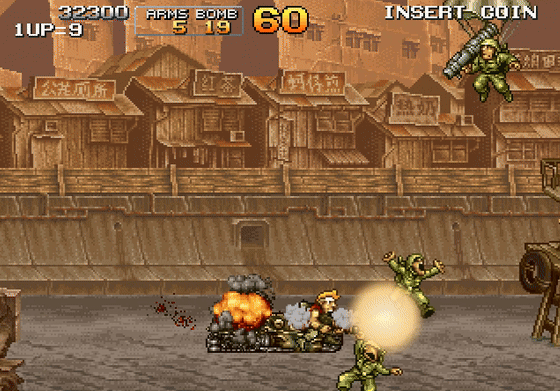
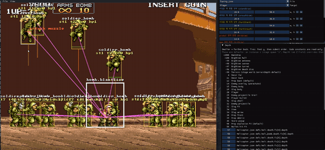
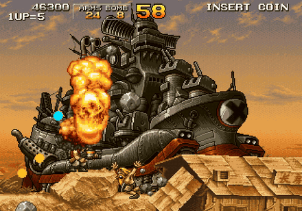
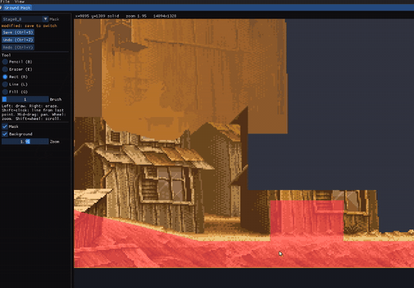
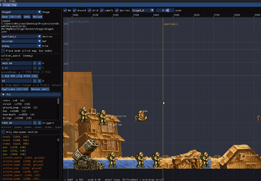
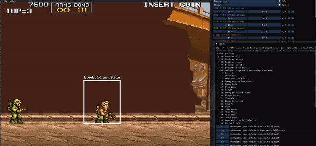

<h1 align="center">MetalSlug2-Clone</h1>

<p align="center">C++20과 SDL3로 만든 메탈슬러그 2 Mission 4 모작</p>

<p align="center">
  
  
  
  
  <a href="https://youtu.be/OR9MWsp2wJE"></a>
</p>

<p align="center"></p>

## Contents

* [프로젝트 소개](#프로젝트-소개)
* [고정 스텝과 전투 판정](#고정-스텝과-전투-판정)
* [플레이어의 상체와 하체](#플레이어의-상체와-하체)
* [적과 보스](#적과-보스)
* [데이터로 구성한 스테이지](#데이터로-구성한-스테이지)
* [스프라이트 깊이 정렬](#스프라이트-깊이-정렬)
* [픽셀 마스크 지형](#픽셀-마스크-지형)
* [그 밖의 구현](#그-밖의-구현)
* [병렬 이미지 로딩](#병렬-이미지-로딩)
* [GUI 에디터](#gui-에디터)
* [빌드 및 실행](#빌드-및-실행)

## 프로젝트 소개

메탈슬러그 2의 Mission 4를 학습 목적으로 모작한 횡스크롤 액션 게임입니다. 2024년 2월부터 두 달 동안 혼자 개발했고, 2026년 10월에 Claude Code와 함께 일주일 동안 리팩터링했습니다. 아래 설명은 리팩터링 이후 코드 기준입니다.

- 게임 엔진 없이 SDL3 위에 게임 루프, 물리와 충돌, 스프라이트 렌더링, 애니메이션, 사운드를 구현했습니다.
- 물리와 전투 로직을 60Hz 고정 스텝으로 처리해 프레임 속도와 관계없이 정확한 판정을 얻고, 렌더링은 틱 사이를 보간해 부드러운 화면을 보여 줍니다.
- 적, 스테이지 진행, 스프라이트 깊이, 플레이어 수치를 JSON 데이터로 정의해 빌드 없이 조정합니다.
- 애니메이션, 맵, 지형 충돌, 적 AI를 편집하는 Dear ImGui 에디터를 같은 실행 파일에 넣었습니다.

<p align="center"></p>

`MISSION 4` 배너로 시작해 시가지의 병사와 부서지는 건물, 병사를 쏟아내는 버스, 차량과 헬기 구간을 지나 Big Shiee 보스전으로 이어집니다. 무기는 권총, HMG, 샷건, 로켓, 화염방사기이고, 적에게 가까이 붙어 사격하면 칼 공격으로 바뀝니다. 전체 플레이는 [유튜브 영상](https://youtu.be/OR9MWsp2wJE)에서 볼 수 있습니다.

## 고정 스텝과 전투 판정

물리와 전투는 60Hz 고정 스텝으로 갱신합니다. [`FixedStepClock`](Source/Core/FixedStep.h)이 경과 시간을 누적해 프레임마다 실행할 틱 수를 정하므로, 모니터 주사율이 달라도 점프 높이나 탄 속도가 같습니다. 창을 끌다 돌아왔을 때 밀린 틱이 한꺼번에 실행되지 않도록 한 프레임은 0.25초, 5틱으로 제한했습니다. 렌더링은 이전 틱과 현재 틱의 위치를 보간해 그리고, 판정은 틱 위치로만 합니다.

플레이어, 적, 건물, 발사체가 서로를 직접 때리게 하면 갱신 순서에 따라 결과가 달라지고, 공격하는 쪽이 맞는 쪽의 체력 규칙까지 알아야 합니다. 그래서 [`StageState::Tick()`](Source/Game/Stage/StageState.cpp)은 한 틱을 다음 순서로 고정했습니다. 아래는 호출 순서만 남긴 것입니다.

```cpp
m_combat.BeginTick();                    // 지난 틱의 판정 상자를 비웁니다.
m_enemies.RegisterHurtboxes(m_combat);   // 맞을 수 있는 범위를 먼저 등록
m_props.RegisterHurtboxes(m_combat);

m_player.Tick(playerCtx, _input);        // 이동하고 공격 범위(Hitbox)를 등록
m_enemies.Tick(enemyCtx);
m_projectiles.Step(ground, m_combat, kStepSec, m_enemyPlatforms);

const Vector<HitEvent>& events = m_combat.Resolve();   // 겹침 판정은 여기서 한 번만
m_props.OnHitEvents(events);             // 각 시스템이 자기 몫의 결과를 처리
m_enemies.OnHitEvents(events);
m_player.OnHitEvents(events);

m_runner->Tick();                        // 마지막으로 스테이지 진행을 확인
```

<p align="center"></p>

[`CombatSystem`](Source/Game/Combat/CombatSystem.h)은 `Hitbox`와 `Hurtbox`의 겹침, 팀, 무적 여부만 보고 `HitEvent`를 만듭니다. 체력을 깎을지, 방패로 막을지는 이벤트를 받은 쪽이 정합니다. 그래서 새 무기를 만들 때 적 코드를 고치지 않고, 특이한 적을 만들 때 판정기를 고치지 않습니다. 칼이나 화염처럼 여러 틱 동안 남는 공격은 명중 이력을 남겨, 같은 대상에게 한 번만 또는 정해진 간격마다 피해를 줍니다.

## 플레이어의 상체와 하체

<p align="center"></p>

메탈슬러그의 캐릭터는 달리면서 위를 쏘고, 점프하면서 아래로 쏩니다. 이동, 조준, 공격을 동작 하나로 묶으면 모든 조합마다 애니메이션이 필요합니다. 그래서 입력 해석과 애니메이션 선택을 분리했습니다.

[`PlayerController`](Source/Game/Player/PlayerController.cpp)는 입력을 해석해 결과를 `RigState`로만 내보내고, [`PlayerRig`](Source/Game/Player/PlayerRig.cpp)는 이 구조체만 보고 클립을 고릅니다.

```cpp
struct RigState
{
    eWeapon      weapon  = eWeapon::Pistol;
    ePlayerState state   = ePlayerState::Idle;   // 달리기, 점프, 사망 등
    ePose        pose    = ePose::Stand;         // 서기, 앉기
    eAim         aim     = eAim::Forward;        // 앞, 위, 아래
    eOverlay     overlay = eOverlay::None;       // 사격, 칼, 투척처럼 상체에 겹치는 동작
    int          facing  = 1;
    // ...
};
```

하체 클립은 `state`와 `pose`로, 상체 클립은 `weapon`, `aim`, `overlay`로 고릅니다. 그래서 달리는 하체 위에 위를 조준한 상체를 얹을 수 있고, 필요한 클립 수가 조합의 곱이 아니라 합으로 늘어납니다. 걸을 때는 상체와 하체의 재생 위치를 맞추고, 앉기나 사망처럼 몸 전체가 움직이는 동작만 전신 클립을 씁니다.

## 적과 보스

병사, 방패병, 바주카병, 차량, 헬기, 버스, 보스는 행동이 크게 다르지만 생성, 활성화, 피격 깜빡임, 사망 연출의 흐름은 같습니다. 이 공통 흐름은 [`EnemyWorld`](Source/Game/Enemies/EnemyWorld.cpp)가 맡고, 종류마다 다른 행동만 [`Enemy`](Source/Game/Enemies/Enemy.h)의 파생 클래스가 구현합니다.

체력, 클립, 총구 위치, 감지 거리는 [`Enemies.json`](Assets/Defs/Enemies.json)에 있습니다. 비슷한 적이 많아 정의끼리 상속할 수 있습니다. 아래 투척 병사는 기본 병사 정의에 투척 클립과 발사체만 더했습니다.

```json
"soldier_bomb": {
  "extends": "soldier_base",
  "params":  { "ai": "bomb", "detect": 350, "closeStop": 200, "fireFrame": 10 },
  "clips":   { "throw": { "name": "SD_Throw_Bomb_{side}", "frames": 14, "sec": 0.08 } },
  "weapons": { "attack": { "projectile": "soldier_bomb_proj", "muzzle": [0, -37], "aim": "facing" } }
}
```

<p align="center"></p>

부위 판정도 같은 `Hurtbox` 구조로 처리합니다. 방패병은 방패와 몸통을 따로 등록해, 방패에 맞은 공격은 피해 없이 막습니다. Big Shiee는 적 하나가 포탑 여러 개와 주포를 갖고, 각 부위의 `Hurtbox`에 부위 번호를 담은 소유자 ID를 붙여 어느 부위가 맞았는지 구분합니다. 포탑을 모두 부수면 주포가 열리고, 열린 동안에만 주포의 `Hurtbox`를 등록해 공격 가능한 시간을 패턴으로 만듭니다.

## 데이터로 구성한 스테이지

적 배치와 카메라 제어를 코드로 쓰면 적 하나를 옮길 때마다 다시 빌드해야 합니다. 그래서 스테이지 진행은 [`Stage0.json`](Assets/Stage/Stage0.json)에 구간 목록으로 적고 [`StageRunner`](Source/Game/Stage/StageRunner.cpp)가 실행합니다. 플레이어가 구간의 `triggerX`를 넘으면 그 구간의 액션이 차례로 실행됩니다. 현재 스테이지는 구간 22개, 개체 생성 액션 176개입니다.

```json
{
  "id": "bus", "triggerX": 2605,
  "actions": [
    { "type": "clear", "waves": true },
    { "type": "lockCamera", "rect": [2457, 0, 3097, 448], "glide": 2.5 },
    { "type": "gate", "id": "bus_clear", "waitFor": ["bus"], "until": "destroyFinished",
      "actions": [ { "type": "unlockCamera" }, { "type": "setBounds", "rect": [-89, 0, 4111, 448] } ] }
  ]
}
```

<p align="center"></p>

`gate`는 지정한 개체가 파괴 연출을 마칠 때까지 안쪽 액션을 미룹니다. 버스 구간은 카메라를 잠근 뒤, 버스가 `destroyFinished`를 알리면 잠금을 풀고 이동 범위를 넓힙니다. 버스는 연출이 끝났다는 신호만 보내고 다음 진행은 데이터가 정하므로, 적 코드는 카메라를 모릅니다. 보스 파괴 후 결과 화면으로 넘어가는 것도 같은 방식입니다.

이동 속도, 점프, 무기 수치는 [`Tuning.json`](Assets/Tuning/Tuning.json)에 있습니다. 샌드박스 모드에서는 [`TuningWatcher`](Source/Core/Tuning.h)가 이 파일의 수정 시각을 주기적으로 확인해 다시 읽으므로, 게임을 켠 채 값을 고치고 바로 확인할 수 있습니다.

## 스프라이트 깊이 정렬

버스는 뒷면, 계단, 안에 탄 병사, 몸체, 겉 프레임, 창문, 잔해가 겹친 그림입니다. 손상 단계마다 일부가 바뀌고 병사도 오가므로, 그리는 코드의 호출 순서로 앞뒤를 정하면 부위를 추가할 때마다 순서를 다시 맞춰야 합니다. 그래서 앞뒤를 값으로만 정했습니다.

월드의 모든 그리기는 [`SpriteBatch`](Source/Render/SpriteBatch.cpp)에 명령으로 쌓이고, 프레임 끝에서 정렬한 뒤 그립니다.

```cpp
std::sort(_commands.begin(), _commands.end(), [](const SpriteCommand& _a, const SpriteCommand& _b) {
    if (_a.depth != _b.depth)     return _a.depth < _b.depth;       // 1. 깊이 (층)
    if (_a.sortKey != _b.sortKey) return _a.sortKey < _b.sortKey;   // 2. 같은 층 안의 순서
    return _a.seq < _b.seq;                                         // 3. 제출 순서
});
```

버스 부위의 깊이와 정렬 값은 [`Bus.json`](Assets/Defs/Bus.json)에 있어 에디터에서 값만 바꿔 확인합니다. 같은 깊이의 적은 정렬 값에 발의 Y좌표를 더해 화면 아래쪽 캐릭터가 앞에 그려집니다. `std::sort`는 같은 값끼리의 순서를 보장하지 않으므로, 마지막 기준인 제출 순서로 프레임마다 앞뒤가 바뀌는 깜빡임을 막습니다.

## 픽셀 마스크 지형

<p align="center"></p>

메탈슬러그의 배경은 계단, 경사, 무너진 지붕처럼 모양이 불규칙해서 사각형으로 덮기 어렵습니다. 그래서 전투 판정은 사각형으로 하고, 지형은 배경 픽셀마다 고체 여부를 1비트로 담은 [`GroundMap`](Source/World/GroundMap.cpp)으로 판정합니다. 위 그림의 빨간 부분이 고체 픽셀입니다.

- [`Physics`](Source/World/Physics.cpp)는 이동을 작은 구간으로 나눠 벽, 천장, 바닥을 검사하고, 발 아래 몇 픽셀을 탐색해 작은 단차를 오르내립니다. 계단마다 경사 데이터를 만들지 않아도 캐릭터가 그림을 따라 걷습니다.
- 한 틱에 수십 픽셀을 움직이는 탄은 이동 선분을 일정 간격으로 나눠 검사해 얇은 벽을 건너뛰지 않습니다.
- 건물이 파괴되면 지정된 영역의 마스크를 지워 무너진 자리를 지나갈 수 있습니다.

## 그 밖의 구현

- 입력 버퍼: [`PlayerInputBuffer`](Source/Game/Player/PlayerInput.h)가 최근 입력을 틱 단위로 기억합니다. 착지 직전에 누른 점프(4틱)와 사격·수류탄(6틱)도 처리하고, 발판에서 떨어진 직후 4틱 동안은 점프를 허용해 조작이 씹히지 않게 했습니다. 수치는 `Tuning.json`에서 조정합니다.
- 오디오: [`AudioSystem`](Source/Audio/AudioSystem.h)은 효과음을 미리 로드하고 BGM은 스트리밍합니다. 동시 발음은 16개, 같은 효과음은 4개로 제한하고, [`VoiceAllocator`](Source/Audio/VoiceAllocator.h)가 슬롯을 배분합니다. 같은 소리가 반복돼도 단조롭지 않도록 재생마다 피치를 조금씩 바꿉니다.
- 오브젝트와 아이템: [`PropWorld`](Source/Game/Props/PropWorld.h)는 부서지는 건물과 파편, [`ItemWorld`](Source/Game/Props/ItemWorld.h)는 무기·점수 아이템과 획득 시 점수 표시를 관리합니다.

## 병렬 이미지 로딩

시작할 때 스프라이트 아틀라스와 배경 PNG를 하나씩 읽으면 첫 화면까지 20초가 넘게 걸렸습니다. 로딩은 PNG를 RGBA로 디코딩하는 단계와 SDL 텍스처를 만드는 단계로 나뉩니다. 디코딩은 이미지끼리 독립적이지만, 텍스처 생성은 SDL 렌더러를 만든 스레드에서만 할 수 있습니다. 그래서 읽기, 디코딩, 피격 깜빡임용 색상 변환본 생성만 작업자 스레드로 병렬화했습니다.

[`DecodeImages`](Source/Render/SpriteBatch.cpp)는 작업자 수만큼 묶어서 디코딩하고, 묶음마다 원래 경로 순서대로 등록합니다. 끝난 순서대로 등록하면 아틀라스 페이지 번호가 실행마다 바뀌어 애니메이션 프레임이 엉뚱한 페이지를 가리키기 때문입니다. 묶음 단위로 처리해 모든 이미지의 RGBA를 한꺼번에 메모리에 들고 있지 않습니다.

<p align="center"></p>

| 실행 모드 | 5회 중앙값 |
| --- | ---: |
| 순차 디코딩 (`--no-async-load`) | 23.34초 |
| 병렬 디코딩 (기본) | 12.21초 |

Ryzen 9 7945HX, 작업자 8개 환경에서 프로세스 시작부터 첫 스테이지 프레임까지 측정했고, 약 1.91배 빨라졌습니다. 12회 실행 모두에서 텍스처 20개의 등록 순서, 크기, RGBA 해시가 같아, 병렬화 후에도 같은 결과가 등록됨을 확인했습니다. [측정 원본](Media/loading-benchmark.json)

## GUI 에디터

`--editor`로 실행하면 게임 화면 옆에 Dear ImGui 에디터가 열립니다. 게임이 실제로 읽는 JSON과 지형 마스크를 열어 수정하고, 실행 취소와 저장 후 게임에 바로 반영합니다.

<p align="center">
  
  
</p>
<p align="center">
  
  
</p>

| 탭 | 기능 |
| --- | --- |
| Animation | 어니언 스킨으로 앞뒤 프레임을 겹쳐 보며 클립의 프레임 시간과 피벗을 수정 |
| Map | 지도 위에서 개체 배치, 구간 트리거, 카메라 영역을 수정 |
| Collision | 지형 마스크를 픽셀 단위로 그리고 지움 |
| AI | 샌드박스에 적을 소환해 AI 상태, 판정 상자, 대상선, 지면 탐색 결과를 표시. 일시정지와 1틱 진행으로 판단이 바뀌는 순간을 확인 |

## 빌드 및 실행

Windows x64, C++20 환경에서 빌드합니다. Visual Studio 2026(플랫폼 도구 집합 `v145`)의 "C++를 사용한 데스크톱 개발" 워크로드와 vcpkg가 필요합니다. 의존 라이브러리는 [`vcpkg.json`](vcpkg.json) 매니페스트로 설치되며, vcpkg 경로는 `VCPKG_ROOT` 환경 변수를 읽고 없으면 `C:\vcpkg\`를 사용합니다.

```powershell
git clone https://github.com/JuggernautSensei/MetalSlug2-Clone.git
cd MetalSlug2-Clone
.\Play.cmd
```

`Play.cmd`는 Release 구성으로 증분 빌드한 뒤 게임을 실행합니다. 에디터는 `.\Play.cmd --editor`로 엽니다.

| 동작 | 키 |
| --- | --- |
| 이동 | A, D 또는 ←, → |
| 위, 아래 입력 | W, S 또는 ↑, ↓ |
| 사격 | J 또는 Z |
| 점프 | K 또는 X |
| 수류탄 | L 또는 C |
| 시작, 결정 | Enter 또는 Space |
| 일시정지 | Esc |
