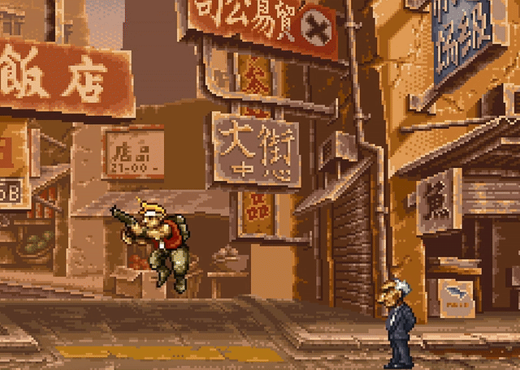

<h1 align="center">MetalSlug2-Clone</h1>

<p align="center">C++20과 SDL3로 만든 메탈슬러그 2 Mission 4 모작</p>

<p align="center">
  
  
  
  
</p>


## Contents

- [프로젝트 소개](#프로젝트-소개)
- [고정 스텝과 전투 판정](#고정-스텝과-전투-판정)
- [플레이어의 상체와 하체](#플레이어의-상체와-하체)
- [적과 보스의 부위 판정](#적과-보스의-부위-판정)
- [데이터로 구성한 스테이지](#데이터로-구성한-스테이지)
- [병렬 이미지 로딩](#병렬-이미지-로딩)
- [GUI 에디터](#gui-에디터)
- [빌드 및 실행](#빌드-및-실행)

## 프로젝트 소개

메탈슬러그 2의 Mission 4를 학습 목적으로 모작한 횡스크롤 액션 게임입니다. SDL3 위에 게임 루프, 물리와 충돌, 스프라이트 렌더링, 애니메이션, 사운드를 구현했습니다. 시가지 전투에서 시작해 버스, 차량과 헬기 구간을 지나 Big Shiee 보스전까지 진행됩니다. 애니메이션, 맵, 지형 충돌, 적 AI를 확인하고 수정할 수 있는 Dear ImGui 편집기도 같은 실행 파일에 넣었습니다. [전체 플레이 영상](https://youtu.be/OR9MWsp2wJE)

2024년 2월부터 두 달 동안 혼자 개발했고, 2026년 10월에는 Claude Code와 함께 일주일 동안 코드를 리팩터링했습니다. 아래 내용은 리팩터링 이후의 구현을 설명합니다.

## 고정 스텝과 전투 판정

물리와 전투는 60Hz 고정 스텝으로 갱신합니다. 실제 경과 시간을 누적해 프레임마다 실행할 틱 수를 정합니다. 창을 끌어 이동할 때처럼 게임이 잠시 멈춰도 밀린 틱이 한꺼번에 실행되지 않도록, 한 프레임에서 누적할 시간은 0.25초, 실행할 틱은 5개로 제한합니다. 그리기에서는 플레이어, 발사체, 카메라의 이전·현재 틱 위치를 보간해 움직임이 고르게 보이도록 했습니다. [고정 스텝 구현](Source/Core/FixedStep.cpp)

틱마다 적과 오브젝트가 피격 범위(`Hurtbox`)를 등록하고, 플레이어와 적의 공격 및 발사체를 갱신합니다. `CombatSystem`은 등록된 공격 범위(`Hitbox`)와 피격 범위의 겹침, 팀과 무적 조건을 검사해 `HitEvent`를 만듭니다. 각 개체는 받은 이벤트에 따라 피해나 방어, 파괴 연출을 처리하고, 스테이지는 마지막에 진행 조건을 확인합니다. 여러 틱에 걸쳐 판정되는 공격은 명중 이력을 기록해 같은 대상에 한 번만 피해를 주거나 다음 피해까지 간격을 둡니다. [스테이지 틱](Source/Game/Stage/StageState.cpp) · [전투 판정](Source/Game/Combat/CombatSystem.h)

## 플레이어의 상체와 하체



달리면서 위를 조준하는 동작을 만들기 위해 상체와 하체 애니메이션을 따로 고릅니다. `PlayerController`는 입력을 이동, 자세, 조준, 무기, 공격 상태로 해석해 `RigState`로 전달합니다. `PlayerRig`는 이동과 자세로 하체를, 무기와 조준 방향, 공격 동작으로 상체를 선택합니다. 걷기는 두 클립의 재생 위치를 맞추고, 앉기나 사망처럼 몸 전체가 함께 움직이는 동작에는 전신 클립을 사용합니다. [플레이어 컨트롤러](Source/Game/Player/PlayerController.cpp) · [애니메이션 조합](Source/Game/Player/PlayerRig.cpp)

## 적과 보스의 부위 판정

`EnemyWorld`는 적의 생성과 갱신, 사망 연출을 관리합니다. 적 클래스는 각각의 행동과 공격을 구현하고, 체력, 클립, 총구 위치, 감지 거리 같은 값은 JSON에서 읽습니다. 비슷한 적은 `extends`로 공통 정의를 상속합니다. 예를 들어 투척 병사는 공통 병사 정의에 투척 클립과 발사체를 추가합니다. [적 정의](Assets/Defs/Enemies.json) · [적 관리](Source/Game/Enemies/EnemyWorld.cpp)


방패병은 방패와 몸통의 피격 범위를 따로 등록해 방패에 맞은 공격을 막습니다. Big Shiee는 적 하나에 포탑과 주포를 두고, 피격 범위의 소유자 ID에 부위 번호를 담아 어느 부위가 맞았는지 구분합니다. 포탑을 모두 파괴한 뒤 주포가 열린 동안에만 주포의 피격 범위를 등록해, 공격할 수 있는 시점을 보스 패턴에 맞췄습니다. [Big Shiee 구현](Source/Game/Enemies/BigShiee.cpp)

## 데이터로 구성한 스테이지

스테이지에는 구간 22개와 개체 생성 액션 176개가 있습니다. `StageRunner`는 플레이어가 구간의 `triggerX`를 넘으면 JSON에 정의한 배치, 배경 전환, 카메라 제어 등을 실행합니다. 적 배치나 카메라 영역은 게임을 다시 빌드하지 않고 데이터에서 수정할 수 있습니다. 샌드박스에서는 이동과 무기 수치가 담긴 `Tuning.json`의 변경도 실행 중에 반영합니다. [스테이지 데이터](Assets/Stage/Stage0.json) · [스테이지 실행기](Source/Game/Stage/StageRunner.cpp) · [조정 데이터](Assets/Tuning/Tuning.json)


버스 구간에서는 카메라를 잠그고, `gate`가 버스의 파괴 연출 종료 신호(`destroyFinished`)를 기다립니다. 신호가 오면 카메라 잠금을 풀고 이동 가능 영역을 넓힙니다. 보스가 파괴된 뒤 결과 화면으로 넘어갈 때도 같은 방식으로 연출이 끝나기를 기다립니다.

### 스프라이트 깊이 정렬

버스의 창문과 몸체, 내부 병사, 잔해처럼 서로 겹치는 스프라이트는 깊이, 같은 층의 정렬 값, 명령 제출 순서를 차례로 비교해 그립니다. 버스 부위별 깊이와 정렬 값은 JSON에서 조정할 수 있습니다. 같은 깊이의 적은 발의 Y좌표를 정렬 값에 반영해 화면 아래에 있는 적이 앞에 그려집니다. [스프라이트 정렬](Source/Render/SpriteBatch.cpp) · [버스 정의](Assets/Defs/Bus.json)

### 픽셀 마스크 지형


계단과 경사, 무너진 지붕은 배경 픽셀마다 통과 가능 여부를 1비트로 기록한 `GroundMap`으로 표현합니다. 물리는 이동을 작은 구간으로 나눠 벽과 바닥을 검사하고, 발 아래를 탐색해 작은 단차를 오르내리게 합니다. 빠른 발사체는 이동 선분을 따라 검사해 얇은 지형을 건너뛰지 않도록 했습니다. 건물이 파괴되면 해당 마스크를 지워 그 자리를 지나갈 수 있습니다. [지형 마스크](Source/World/GroundMap.cpp) · [물리 구현](Source/World/Physics.cpp)

## 병렬 이미지 로딩

시작할 때 아틀라스와 배경 PNG를 순서대로 읽으면서 첫 화면을 보기까지 20초 넘게 걸렸습니다. 파일 읽기, RGBA 디코딩, 피격 깜빡임에 쓸 이미지 생성은 여러 작업자에 나누고, SDL 텍스처 생성은 렌더러가 있는 스레드에서 처리했습니다. 작업자 수만큼 묶어 처리해 디코딩한 이미지를 한꺼번에 메모리에 쌓지 않고, 묶음마다 원래 경로 순서로 등록해 아틀라스 페이지 번호를 유지합니다. [이미지 로딩 구현](Source/Render/SpriteBatch.cpp)


Ryzen 9 7945HX에서 작업자 8개로 측정했습니다. 같은 Release x64 실행 파일에서 `--no-async-load` 옵션으로 모드를 바꾸고, 예열 뒤 각 모드를 번갈아 5회씩 실행했습니다. 프로세스 시작부터 첫 스테이지 프레임 저장과 종료까지 걸린 시간의 중앙값은 **23.34초에서 12.21초로 줄었습니다.** 예열을 포함한 12회 실행에서 텍스처 20개의 등록 순서, 크기와 RGBA 해시가 모두 일치했습니다. [측정 원본](Media/loading-benchmark.json)

## GUI 에디터

`--editor`로 실행하면 게임 화면 옆에 Dear ImGui 편집기가 열립니다. 게임이 읽는 JSON과 지형 마스크를 불러와 수정하고, 변경 사항을 실행 취소하거나 저장해 게임에 반영할 수 있습니다.

| 탭 | 주요 작업 |
| --- | --- |
| Animation | 앞뒤 프레임을 겹쳐 보며 클립의 프레임 시간과 피벗을 수정합니다. |
| Map | 지도에서 개체 배치, 구간 트리거와 카메라 영역을 수정합니다. |
| Collision | 배경에 고체 마스크를 픽셀 단위로 그리거나 지웁니다. |
| AI | 샌드박스에 적을 소환하고, 일시정지와 1틱 진행으로 상태와 판정 상자, 지면 탐색을 확인합니다. |

<p align="center">
  
  
</p>
<p align="center">
  
  
</p>

## 빌드 및 실행

Windows x64, Visual Studio 2026의 “C++를 사용한 데스크톱 개발” 워크로드와 vcpkg가 필요합니다. 프로젝트는 C++20과 플랫폼 도구 집합 `v145`를 사용합니다. 의존 라이브러리는 매니페스트에서 설치하며, vcpkg는 `VCPKG_ROOT`를 읽고 값이 없으면 `C:\vcpkg\`를 사용합니다. [의존 라이브러리 설정](vcpkg.json)

```powershell
git clone https://github.com/JuggernautSensei/MetalSlug2-Clone.git
cd MetalSlug2-Clone
.\Play.cmd
```

`Play.cmd`는 Release 구성을 증분 빌드한 뒤 게임을 실행합니다. 편집기를 열려면 `.\Play.cmd --editor`를 실행합니다.

| 조작 | 키 |
| --- | --- |
| 이동 | A, D 또는 ←, → |
| 위, 아래 입력 | W, S 또는 ↑, ↓ |
| 사격 | J 또는 Z |
| 점프 | K 또는 X |
| 수류탄 | L 또는 C |
| 시작, 결정 | Enter 또는 Space |
| 일시정지 | Esc |
